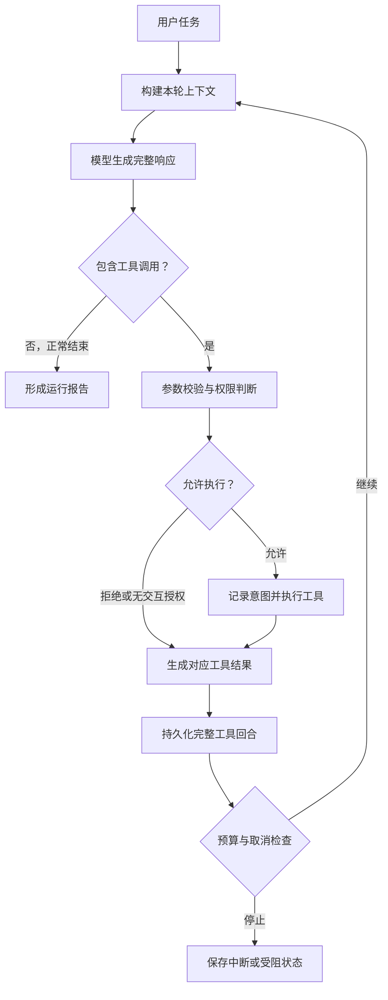

# StellarWeaver：命令行 Coding Agent 实现规范

版本：1.1  
调研与方案日期：2026-10-25  
用途：交给 Codex 实施，也作为开发者逐阶段学习、验收和讲解的依据。  
项目名称：**StellarWeaver**。统一使用 Python 包名 `stellarweaver`、CLI 命令 `stellarweaver`。

> 本文是拟建项目的设计要求，不是对现有代码或测试通过情况的声明。仓库推荐基于官方项目页面、目录和部分关键源码；难度、学习顺序、开发时间是本方案的判断。参考项目会继续演进，开始阅读时应记录自己的 checkout commit。

## 0. 给 Codex 的使用说明

1. 将本文放到新仓库的 `docs/IMPLEMENTATION_SPEC.md`。
2. 先读当前仓库及上级目录适用的 `AGENTS.md`；本文不能覆盖用户现有代码的约束。
3. 按第 18 节里程碑推进。每个里程碑都必须留下可运行入口、相关测试和说明，不能只创建接口或 TODO。
4. 首轮完成 M0 和 M1，提交可检查的成果；后续会话从 `docs/PROGRESS.md` 的状态继续。用户授权继续时按顺序推进，不反复询问常规实现细节。
5. 默认采用本文技术选择。确实阻塞实现的缺失信息才向用户提问；API Key 缺失时继续用 FakeModel 完成离线工作。
6. 不自动连接外部账户，不假设 ChatGPT 订阅等于可调用的 API 凭据。模型 API 由用户配置。
7. 参考仓库用于理解设计。独立实现本项目；确需复用代码时记录来源并保留适用的许可证、版权及 NOTICE。

### 0.1 已确定的设计假设

| 项目 | 默认选择 |
| --- | --- |
| 学习目标 | 从零理解并实现 CLI Coding Agent 的基础组件 |
| 核心语言 | Python 3.12+；具体支持上限由 CI 实测确认 |
| 首要平台 | Linux / macOS；Windows 开发优先使用 WSL2 |
| 用户界面 | 命令行交互 + 非交互执行；先用 Rich 和 prompt_toolkit |
| 模型接入 | 一个明确测试过的 OpenAI-compatible Chat Completions provider |
| Agent 结构 | 单 Agent、显式工具调用、观察结果后继续执行 |
| 项目场景 | 在用户指定的本地 Git 工作区理解、修改和验证代码 |
| 存储 | SQLite 为权威会话记录；文件保存大输出、改动备份等制品 |
| 第一版仓库检索 | 文件清单 + rg + 按需读取 |
| 项目进阶方向 | 上下文管理、可恢复执行、可观测性、独立评测 |

Windows 原生进程树终止和完整终端兼容属于后续适配项。不得只在 Linux 验证后声称 Windows 原生完全支持。

### 0.2 三个版本的定义

- **V0 / M0–M2：最小可用闭环。** 用户输入任务，模型选择工具，程序读取和修改真实文件、执行已授权命令、读取测试结果，并给出报告。
- **V1 / M3–M5：基础组件完整版。** 在 V0 上补齐会话恢复、上下文压缩、改动预览及有条件回退、MCP、Skills、离线测试和小型评测集。
- **V2：后续增强。** 完整 TUI、Tree-sitter 多语言 repo map、更多 provider、容器执行完善、可选规划器等。V1 完成前不开展大规模扩展。

最终目标是 V1。分阶段是实现顺序，不是将基础组件永久留为占位接口。

## 1. 项目要实现的实际行为

### 1.1 一句话目标

开发一个用户可以在项目目录启动的命令行 Coding Agent，它能定位相关代码、实施修改、运行检查、根据反馈继续修复，并保留可追踪的执行记录。

### 1.2 完成后的典型演示

用户在一个存在输入校验缺陷的 Python 示例仓库中运行：

```bash
uv run stellarweaver chat --workspace ./examples/buggy_repo
```

输入：

> 找出 parse_page_size 对非法输入处理不正确的问题，修复它，补充必要测试，并运行相关测试。

系统应完成：

1. 获取工作区路径及 Git 初始状态。
2. 使用目录、搜索和文件读取工具理解实现。
3. 展示将要修改的文件及 diff，并按当前策略取得执行授权。
4. 使用带版本校验的编辑工具修改代码。
5. 运行测试命令，获得真实退出码、stdout 和 stderr。
6. 测试失败时，将失败信息放回模型上下文，继续必要修复。
7. 输出修改摘要、已执行的检查、检查结果和仍未解决的问题。
8. 保存本次消息、工具调用、权限决定、改动和资源用量。

### 1.3 必须区分的结果

| 字段 | 含义 |
| --- | --- |
| `run_status` | 运行流程是正常结束、被阻止、被取消、超预算还是异常 |
| `task_assessment` | 任务判断为 solved、partial 或 unknown |
| `verification_status` | 实际检查 passed、failed 或 not_run |
| `evidence` | 检查命令、退出码、输出制品和文件变更等依据 |

模型输出“已经修复”只能作为声明。它不能替代工具执行结果，也不能替代评测器的独立判定。

## 2. 推荐仓库与学习顺序

以下是截至调研日核验的项目。难度为“阅读与独立复现相关设计”的相对难度，1 最容易，5 最难。

| 项目 | 主要语言 | 最适合学习 | 难度 | 本项目的参考方式 |
| --- | --- | --- | --- | --- |
| [SWE-agent/mini-swe-agent](https://github.com/SWE-agent/mini-swe-agent) | Python | Agent–Model–Environment 划分、最小执行闭环、轨迹和预算 | 1.5/5 | 首先读懂主循环，再独立实现自己的版本 |
| [mistralai/mistral-vibe](https://github.com/mistralai/mistral-vibe) | Python 为主，含其他组件 | 工具参数与结果类型、权限、会话、配置、MCP | 3/5 | 作为 Python 工程组件参考 |
| [earendil-works/pi](https://github.com/earendil-works/pi) | TypeScript | 模型层与 Agent 核心分离、事件流、扩展式 CLI | 3/5 | 借鉴分层和流式事件设计；不照搬整个 monorepo |
| [Aider-AI/aider](https://github.com/Aider-AI/aider) | Python | repo map、编辑策略、Git 交互、上下文选择 | 3/5 | 重点读仓库地图和编辑相关模块 |
| [anomalyco/opencode](https://github.com/anomalyco/opencode) | TypeScript 为主 | 产品化 CLI、核心与 UI 分离、会话及工具系统 | 4.5/5 | V1 后按模块研究，不作为首轮整仓复刻对象 |
| [google-gemini/gemini-cli](https://github.com/google-gemini/gemini-cli) | TypeScript | CLI/core 边界、工具调度、策略和 MCP | 4/5 | 参考模块边界与测试方式 |
| [openai/codex](https://github.com/openai/codex) | Rust 核心 | 执行与审批、patch、会话、沙箱的工程边界 | 5/5 | 专题阅读；首轮不移植完整 Rust 实现 |
| [MoonshotAI/kimi-code](https://github.com/MoonshotAI/kimi-code) | TypeScript | 当前 CLI/SDK/引擎分层、provider 抽象、会话事件 | 4.5/5 | 作为当前产品设计参考 |

### 2.1 两个版本说明

- mini-swe-agent 的“约 100 行”描述针对核心 agent 类，不代表完整 CLI 工程只有 100 行；当前主线已提示 v2。
- Python 版 [MoonshotAI/kimi-cli](https://github.com/MoonshotAI/kimi-cli) 已归档，官方指向新的 kimi-code。旧 Python 源码仍适合阅读 `soul/`、`tools/`、`wire/` 等结构，但不作为仍在维护的运行基础，也不按照旧教程安装后假设可用。
- Pi 使用当前官方仓库地址 `earendil-works/pi`。旧文章可能使用 `pi-mono` 等旧名称。

### 2.2 已核验的阅读入口

| 项目 | 阅读入口 | 具体问题 |
| --- | --- | --- |
| mini-swe-agent | `src/minisweagent/agents/default.py` | 模型调用、动作执行、异常、预算和轨迹如何串联 |
| mini-swe-agent | `src/minisweagent/models/`、`environments/`、`run/` | 更换模型或执行环境时，哪些代码不应改变 |
| Mistral Vibe | `vibe/core/tools/base.py`、`manager.py`、`permissions.py` | 如何定义工具、校验参数并统一做授权 |
| Mistral Vibe | `vibe/core/session/`、`compaction/`、`llm/` | 会话、压缩和模型层如何拆开 |
| Pi | `packages/agent/src/agent-loop.ts`、`types.ts` | AgentEvent、工具结果和取消如何贯穿主循环 |
| Pi | `packages/ai/`、`packages/coding-agent/src/core/` | 通用模型抽象与 Coding Agent 产品逻辑如何分离 |
| Aider | `aider/repomap.py` | 如何在 token 预算中选择仓库结构信息 |
| OpenCode | `packages/core/`、`packages/cli/`、`packages/tui/` | 当前主线的核心与终端界面边界 |
| Gemini CLI | `packages/core/`、`packages/cli/` | 后端核心为何不依赖 UI |
| Codex | `codex-rs/core/`、`tools/`、`apply-patch/`、`execpolicy/`、`sandboxing/` | 执行、审批和隔离如何区分 |
| Kimi Code | `packages/agent-core-v2/src/`、`packages/kosong/`、`apps/kimi-code/` | 当前引擎、模型抽象与 UI 如何分层 |

推荐顺序：mini-swe-agent → Mistral Vibe 的工具与会话 → Pi 的事件流 → Aider 的 repo map → 按需读大型项目。

先回答四个问题再继续扩展：消息在哪里保存？工具是谁执行的？执行结果怎样回到模型？任务在什么条件下停止？

## 3. 功能范围与优先级

| 组件 | V0 必须实现 | V1 必须补齐 | V2 可选 |
| --- | --- | --- | --- |
| CLI | chat、exec、help、doctor | sessions、resume、replay、export、slash commands | 全屏 TUI |
| Agent runtime | 单循环、工具调用、停止条件、取消 | 重复失败检测、完整恢复状态 | 独立 planner 或子 Agent |
| Provider | 一个真实 provider + FakeModel | 能力检查、流式解析测试、使用量统计 | 更多原生协议 |
| 工具 | 搜索、读写编辑、命令、Git 查询 | 工具输出制品、改动回退 | 多文件 patch、LSP |
| 权限 | allow / ask / deny；非交互不等待 | 工作区信任、细粒度授权、MCP 一致策略 | 更完整容器/OS 沙箱 |
| 上下文 | 文件按需读取、忽略规则、长度限制 | 预算、完整工具回合分组、压缩、基础 repo map | 向量检索、多语言 AST |
| 持久化 | 保存消息和工具执行 | SQLite journal、恢复、离线回放、版本迁移 | 跨设备同步 |
| 指令与记忆 | 系统提示和项目 AGENTS.md | 局部 AGENTS.md、显式记忆文件 | 自动长期记忆 |
| Skills | 预留边界但不阻塞闭环 | SKILL.md 发现、按需加载、可追踪使用 | 自动安装插件 |
| MCP | 不阻塞本地工具开发 | stdio 工具发现和调用、本地演示服务器 | HTTP、OAuth、资源/提示全支持 |
| 验证与评测 | FakeModel 集成闭环 | 故障注入、小型任务集和独立评分 | SWE-bench 等外部评测 |

V1 不要求 Web 服务、IDE 插件、云账号系统、分布式任务队列、自动训练模型、自动自进化或多 Agent。学习价值首先来自能解释并验证基础运行机制。

## 4. 技术选型

| 功能 | 建议实现 | 选择理由 |
| --- | --- | --- |
| 包管理 | uv + pyproject.toml + uv.lock | 环境和依赖可复现 |
| 类型与数据校验 | typing + dataclasses；边界使用 Pydantic v2 | 工具参数、配置和事件有明确契约 |
| CLI | Typer | 子命令、帮助、选项结构直接 |
| 渲染 | Rich | Markdown、表格、diff、进度与错误 |
| 交互输入 | prompt_toolkit | 历史输入、多行输入和取消处理 |
| 模型请求 | 官方 openai Python SDK 的显式适配器 | 首先支持已测试的兼容协议 |
| 本地状态 | sqlite3 | 单机事件与会话可事务写入 |
| 路径与目录 | pathlib + platformdirs | 工程路径和系统数据目录分开 |
| 忽略规则 | pathspec 或等价实现 | 尊重 .gitignore 和额外忽略规则 |
| 搜索 | 优先 rg；Python 回退 | 首版直接、可解释，易控制输出 |
| 命令执行 | asyncio subprocess，argv 列表 | 支持超时、取消及输出捕获 |
| 会话锁 | filelock 或等价 OS 锁 | 同一会话避免并发写者 |
| MCP | 官方 modelcontextprotocol Python SDK | 不手写 JSON-RPC 与版本协商 |
| 测试 | pytest + pytest-asyncio；传输层测试替身 | 默认离线、结果可复现 |
| 静态检查 | Ruff + mypy 或 pyright，选一个类型检查器 | 保持一套明确检查入口 |

不要同时引入 LangChain、LangGraph、多个 Agent 框架和消息队列来实现主循环。核心调度由本项目显式编写，便于学习和调试。

具体第三方版本在开始实现时核对官方文档，选一组可工作的版本并锁定，不把本文的库名当作“所有最新版互相兼容”的承诺。

## 5. 代码组织与依赖边界

采用 `src` 布局，按职责建模块。下表是目标结构，不要求 M0 一次生成所有空目录。

| 位置 | 职责 |
| --- | --- |
| `src/stellarweaver/cli.py` | Typer app、子命令和配置装配 |
| `src/stellarweaver/domain/` | Message、ToolCall、ToolResult、AgentEvent、RunOutcome |
| `src/stellarweaver/runtime/loop.py` | 唯一的主 Agent 循环 |
| `src/stellarweaver/runtime/cancellation.py` | 取消标记、清理和暂停点 |
| `src/stellarweaver/providers/base.py` | 模型协议和能力描述 |
| `src/stellarweaver/providers/openai_compatible.py` | 兼容 Chat Completions 适配 |
| `src/stellarweaver/providers/fake.py` | 可脚本化 FakeModel |
| `src/stellarweaver/tools/registry.py` | 工具注册、模式、执行入口 |
| `src/stellarweaver/tools/files.py` | 文件清单、读取、新建、精确替换 |
| `src/stellarweaver/tools/search.py` | rg 与回退搜索 |
| `src/stellarweaver/tools/commands.py` | 命令执行与结果捕获 |
| `src/stellarweaver/tools/git.py` | 只读 Git 状态和 diff |
| `src/stellarweaver/policy/` | 工作区信任、工具授权、受保护路径 |
| `src/stellarweaver/context/` | 提示组装、token 预算、摘要和 repo map |
| `src/stellarweaver/instructions/` | AGENTS.md 与显式记忆加载 |
| `src/stellarweaver/session/` | SQLite、迁移、锁、恢复、回放 |
| `src/stellarweaver/artifacts/` | 大输出和文件修改前后快照 |
| `src/stellarweaver/ui/` | 渲染事件、输入和授权提示 |
| `src/stellarweaver/mcp/` | 服务器连接、生命周期、工具适配 |
| `src/stellarweaver/skills/` | 技能索引、校验和内容加载 |
| `tests/unit/`、`tests/integration/` | 单元、集成和故障场景 |
| `evals/` | 任务清单、独立 oracle 和评测入口 |
| `examples/buggy_repo/` | 演示任务，不污染 Agent 本体 |
| `docs/` | 架构、快速开始、进度、评测方法 |
| `pyproject.toml`、`uv.lock` | 入口、依赖和检查配置 |

依赖规则：

- domain 不依赖 UI、SDK 或数据库。
- runtime 依赖 provider、工具、策略、上下文和会话的接口。
- UI 消费事件，不在组件里发模型请求或直接执行工具。
- provider 只处理模型协议，不拥有文件修改或命令执行权限。
- 所有工具都经过同一个策略和执行入口，MCP 不得绕过。
- SQLite 是权威状态；JSONL 是导出格式，不维护第二份可独立修改的权威会话。

## 6. 运行架构与主循环



### 6.1 主循环的必要步骤

1. 保存用户任务，创建 `run_id`，取得会话锁。
2. 检查取消、总时长、模型调用次数、工具次数和 token 预算。
3. 构造满足协议的上下文；必要时先压缩。
4. 发起模型请求。流式文本可展示，但工具参数必须组装完整才进入执行阶段。
5. 将完整 assistant 消息及其所有 tool calls 写入持久记录。
6. 若没有工具调用，根据结束原因形成报告；长度截断、内容过滤或请求异常不能直接记为成功。
7. 若有工具调用，按返回顺序执行；每个调用都先校验再授权。
8. 对每个 `tool_call_id` 生成一个最终结果，成功、拒绝、异常和取消都要有明确结果。
9. 保存结果，再发下一轮模型请求；完整回合不能被上下文裁剪拆开。
10. 结束时生成运行状态、已验证信息和未完成事项，释放资源和会话锁。

### 6.2 简化伪代码

```python
async def run_turn(task, session, services):
    await session.append_user(task)
    while True:
        services.limits.check_before_model()
        services.cancel.raise_if_requested()
        context = await services.context.build(session)
        reply = await services.provider.complete(context)
        await session.record_assistant(reply)

        if not reply.tool_calls:
            return await services.report.finish_from(reply, session)

        for call in reply.tool_calls:
            result = await services.tools.dispatch(
                call=call,
                session=session,
                policy=services.policy,
                cancellation=services.cancel,
            )
            await session.record_tool_result(result)
```

这只是控制流示意。真实实现必须覆盖部分流中断、执行前 journal、取消时补齐未执行调用、达到预算时的停止以及恢复行为，不可原样当成完成实现。

### 6.3 必须保持的不变量

- 流式参数未结束时，零工具副作用。
- 一个模型请求失败重试，不会触发历史工具重跑。
- 一个持久化 assistant 工具回合，每个调用最终都有对应结果或明确的恢复待处理状态。
- 任何实际执行都具有 call_id、operation_id、授权结果和开始记录。
- 首版工具全部串行，防止“同一文件并发读改写”。
- 一轮任务结束不代表后台命令可以遗留运行。
- 预算和权限由程序控制，不交给提示词或模型自行决定。

## 7. 核心数据与接口契约

以下是接口意图。Codex 可以在保持语义一致的前提下调整类型实现，不应为机械照抄而引入冗余包装。

```python
from collections.abc import AsyncIterator
from dataclasses import dataclass
from typing import Any, Literal, Protocol

JSONDict = dict[str, Any]

@dataclass(frozen=True)
class ToolCall:
    call_id: str
    name: str
    arguments_json: str

@dataclass(frozen=True)
class AssistantReply:
    text: str
    tool_calls: tuple[ToolCall, ...]
    stop_reason: str
    usage: JSONDict | None

@dataclass(frozen=True)
class ToolResult:
    call_id: str
    operation_id: str
    tool_name: str
    status: Literal[
        "ok", "error", "denied", "cancelled", "blocked", "unknown"
    ]
    content: str
    data: JSONDict
    artifact_ids: tuple[str, ...]
    duration_ms: int

@dataclass(frozen=True)
class ModelCapabilities:
    tool_calling: bool
    streaming: bool
    parallel_tool_calls: bool
    context_window_tokens: int | None

class ModelProvider(Protocol):
    async def complete(self, request: JSONDict) -> AssistantReply: ...
    def stream(self, request: JSONDict) -> AsyncIterator[JSONDict]: ...
    def capabilities(self) -> ModelCapabilities: ...

class PolicyEngine(Protocol):
    async def decide(self, invocation: JSONDict) -> JSONDict: ...

class SessionStore(Protocol):
    async def append_event(self, event: JSONDict) -> int: ...
    async def load_state(self, session_id: str) -> JSONDict: ...

class Tool(Protocol):
    name: str
    description: str
    input_schema: JSONDict
    async def execute(self, args: JSONDict, context: JSONDict) -> ToolResult: ...
```

约束：

- ToolCall 中保留原始 JSON 字符串，便于精确记录参数解析失败；解析后的参数经过严格模式校验。
- 将 `call_id` 与 provider 返回的调用标识对应；`operation_id` 是本地副作用操作身份，二者不能混为一谈。
- 工具返回的 status 是本项目状态，不直接等于进程 exit_code。
- 使用 Pydantic 时对参数禁止未知字段，避免拼写错误被默默吞掉。
- provider 的供应商特有字段保留在适配层，核心事件模型不直接暴露 SDK 对象。
- 不持久化或展示供应商未明确提供的隐藏推理；只记录用户可见文本、操作摘要和工具证据。

## 8. 模型适配层

### 8.1 第一版协议范围

实现一个 `OpenAICompatibleChatProvider`。支持明确配置的：

- `base_url`、`model`、环境变量凭据引用。
- Chat Completions 的文本消息和 function tools。
- assistant 多工具调用、tool 结果及调用 ID 对应。
- 非流式请求；M2 再补齐流式接收。
- 供应商提供的 usage；不提供时显示 unknown 或估算标记。

“OpenAI-compatible”不代表所有兼容服务参数完全一致。必须记录已测 provider，使用能力配置来控制可选参数，不盲目发送所有 SDK 字段。

OpenAI 官方 SDK 当前以 Responses 为主要接口，也保留 Chat Completions。本项目首选兼容 Chat Completions 是范围选择；如后续接入原生 Responses，另建 adapter，不能把两套消息协议混用。

### 8.2 配置示例

```toml
[model]
provider = "openai-compatible-chat"
base_url = "https://api.example.com/v1"
model = "REPLACE_WITH_TESTED_MODEL_ID"
api_key_env = "STELLARWEAVER_API_KEY"
context_window_tokens = 32768
max_output_tokens = 4096
request_timeout_seconds = 90
supports_streaming = true
supports_tools = true

[limits]
max_model_calls = 30
max_tool_calls = 100
max_wall_seconds = 900
max_input_tokens_total = 200000
max_output_tokens_total = 30000

[execution]
backend = "host"
default_timeout_seconds = 60
max_timeout_seconds = 300
max_output_bytes_per_stream = 1048576

[policy]
preset = "ask"

[context]
trigger_ratio = 0.80
target_ratio = 0.55
reserve_tokens = 2048
recent_complete_rounds = 6
```

`api.example.com` 是说明用地址，不能作为可用 API。`doctor` 对未替换的占位配置要给出明确提示。

`context_window_tokens` 必须由配置或可靠模型元数据取得，示例数字不表示任意模型的真实上下文窗口。模型支持的输出参数名也由 adapter 处理。

### 8.3 流式工具调用

必须覆盖：

1. 同一响应中的多个 tool call。
2. 通过 call index / ID 归并交错 delta。
3. function name、arguments 可能分多个片段到达。
4. JSON 字符串的引号、换行和 Unicode 跨片段。
5. 到完整结束后才 parse JSON、校验 schema、进行授权和执行。
6. 中途断线仅留下未提交的流式片段；不能调用半个工具。
7. 文本和工具调用同时存在时，文本可展示，但不能据此提前结束。
8. usage 缺失、额外 usage chunk、无 choices 的 chunk。
9. stop reason 为 length 时，标记不完整，不能把不完整参数“修复”后执行。
10. provider 不支持 streaming 时显式回退非流式，不影响核心执行契约。

SDK 负责网络和协议传输，项目仍需测试自身的聚合、规范化和提交边界。

### 8.4 重试

- 只由一层负责重试，避免 SDK 自动重试与自定义循环叠加；采用本层重试时显式关闭 SDK 自带自动重试。
- 429、部分 5xx 和可重试网络失败：最多 2 次附加尝试，指数退避加抖动，遵守总时长和 Retry-After。
- 401、403、错误模型名和无效请求：不盲目重试，提示配置问题。
- 已展示的部分流失败：丢弃未提交 assistant 轮，记录 interrupted stream，再进行受限重新生成；尚无工具执行。
- 每次重试都计入请求次数，能获取的计费用量照实累计；无法确认的计费为 unknown。
- 工具运行失败不是 provider 重试。命令和修改工具默认不自动重试。
- 连续 3 次相同工具 + 参数 + 相同失败结果时停止该循环并说明原因；权限拒绝不能靠换一种工具绕过。

## 9. 基础工具：参数、行为与边界

### 9.1 V0 的八个内置工具

| 工具 | 主要参数 | 必须返回 |
| --- | --- | --- |
| `list_files` | `path="."`、`glob`、`limit` | 相对路径、条数、truncated 标记 |
| `read_file` | `path`、`start_line=1`、`end_line` | 带行号文本、文件 SHA-256、行范围、截断状态 |
| `search_text` | `pattern`、`path="."`、`glob`、`max_matches` | 文件、行号、匹配内容、截断状态 |
| `create_file` | `path`、`content` | 新文件 hash、diff、改动操作 ID |
| `edit_file` | `path`、`old_text`、`new_text`、`expected_sha256` | 修改前后 hash、diff、替换次数 |
| `run_command` | `argv`、`cwd="."`、`timeout_seconds` | 退出码、stdout、stderr、超时/取消标记、制品 |
| `git_status` | 无，使用固定工作区 | staged / unstaged / untracked 状态 |
| `git_diff` | `paths`、`staged=false` | 原始 diff 或可分页输出制品 |

### 9.2 工具统一调度顺序

查找工具 → JSON 解析 → 参数校验 → 规范化路径与命令 → 工具自身前置检查 → 策略判断 → 用户授权 → 执行前再次检查 → 写入执行意图 → 执行 → 持久化结果 → 发布最终事件。

在用户等待审批期间文件可能改变。审批后再次检查 expected hash；发现变动必须重新准备 diff，不能直接执行旧预览。

### 9.3 路径规则

- 所有工作区文件参数必须落在固定 workspace_root 中；不允许通过绝对路径或 `..` 扩展边界。
- 使用规范化路径与 realpath 检查符号链接；读目标和新建目标的父目录都要核验。
- 默认拒绝内置文件工具访问 `.git/`、凭据文件、会话数据库和工作区外文件。
- 搜索和批量枚举尊重 `.gitignore`、`.stellarweaverignore`，跳过依赖目录、构建产物和明显二进制文件。
- 默认过滤 `.env`、私钥等敏感路径；用户显式配置才能放行。
- 含空格、中文和非 ASCII 文件名必须有测试。
- 应用层路径检查无法在所有并发文件系统攻击场景下代替 OS 隔离；不要将其宣称为强沙箱。

### 9.4 read_file 与 search_text

- 行号从 1 开始，读取行数设上限，例如 400 行；范围外返回明确错误或空结果及行数信息。
- 针对大文件以有界流式方式扫描，不为读取一个片段把整个多 GB 文件载入内存。
- 可通过流式计算得到完整文件 hash；超过设定可编辑体积时仅允许分段读取，返回不可直接编辑标记。
- V0 内置编辑仅支持不超过 1 MiB 的 UTF-8 文本；大文件和未知编码给出清晰结果。
- binary、decode error、permission denied 都是结构化错误，不导致整个会话崩溃。
- 搜索采用 argv 调用 `rg`，不要把模型字符串拼入 shell。
- 参数模式可能以 `-` 开头，必须按所用 rg 参数规范处理，不能被解释成新选项。
- 搜索输出同时返回命中总量信息或“达到上限”的状态，不把截断误写成“没有更多匹配”。

### 9.5 create_file

- 只允许新建，不覆盖已有文件。
- 保证“仅当不存在才写入”的排他语义；不能先 exists 再普通覆盖写入。
- 新建前检查父目录和策略。
- 确保文件持久化结果与 journal 一致；失败时记录实际状态，避免虚报成功。
- 不存在的多级目录可以在工作区内受控创建，并记录新建制品。

### 9.6 edit_file

默认采用精确字符串替换，第一版不实现模糊定位。

1. 文件存在、编码与体积符合要求。
2. 当前 hash 必须等于 `expected_sha256`。
3. `old_text` 必须非空且精确出现一次。
4. 零次命中返回 `EDIT_NOT_FOUND`；多次命中返回 `EDIT_AMBIGUOUS`。
5. 预先计算新内容和 unified diff，交给授权界面。
6. 执行时再次校验当前版本。
7. 保存旧内容和 hash，再使用同目录临时文件及原子替换完成单文件写入。
8. 保留文件权限和换行风格；避免意外更改可执行位或全文件换行。
9. 返回 old_hash、new_hash、diff_artifact_id、operation_id。

原子替换防止半文件写入，但 hash 检查加替换不是面对任意外部并发写者的全局原子 CAS。V1 应有 Agent 自身的工作区写锁并检测可观察冲突；不能保证编辑器恰在检查与替换之间修改时零竞争。

### 9.7 patch 的范围

V0 用 create_file 与 edit_file 即可完成修改。V2 可增加 apply_patch：

- 多文件 patch 必须先完整解析、预检路径和所有基线。
- 向用户展示变更清单。
- 清楚定义部分成功后的处理，不能宣称普通多文件替换是事务。
- 不因为补丁失败就退回无约束整文件覆盖。

### 9.8 统一错误结构

```json
{
  "status": "error",
  "code": "FILE_CHANGED",
  "message": "File content changed after the earlier read.",
  "retryable": false,
  "details": {
    "path": "src/parser.py",
    "expected_sha256": "example-old-hash",
    "actual_sha256": "example-current-hash"
  }
}
```

至少覆盖：UNKNOWN_TOOL、INVALID_JSON、INVALID_ARGUMENTS、PATH_OUTSIDE_WORKSPACE、PROTECTED_PATH、FILE_CHANGED、EDIT_NOT_FOUND、EDIT_AMBIGUOUS、COMMAND_TIMEOUT、COMMAND_CANCELLED、OUTPUT_TRUNCATED、PERMISSION_DENIED、EXECUTION_UNKNOWN。

OUTPUT_TRUNCATED 通常是成功结果附带的状态，不必一律作为工具失败。

## 10. 命令执行、权限和隔离

### 10.1 run_command 的基本实现

```json
{
  "argv": ["python", "-m", "pytest", "-q", "tests/test_parser.py"],
  "cwd": ".",
  "timeout_seconds": 60
}
```

- 使用 `create_subprocess_exec` 或等价 argv API。
- V0 不提供默认 shell string，不解释管道、重定向、`&&` 或命令替换。
- 每次调用指定 cwd；不同调用不共享隐含的 `cd` 状态。
- 使用受控环境变量集合；不把模型 API Key 复制到子进程环境。
- 同时并发读取 stdout / stderr，避免一个管道填满导致阻塞。
- 对内存缓冲设硬上限；大输出流向有配额制品，返回头尾和 artifact_id。
- 输出中“error”字样不能代替退出码；退出码 0 也不能证明语义任务通过。
- 超时或取消时终止整个进程组，等待清理；Linux / WSL2 与 macOS 分别验证。
- 禁止后台常驻服务成为无管理的遗留进程。V1 不提供独立后台任务调度器。
- 取消只影响仍在运行的动作，不能撤销已完成的副作用。

argv 方式降低 shell 解析复杂度，但 `python -c`、`node -e`、测试脚本和构建脚本仍可以任意读写。它不是安全证明。

### 10.2 权限策略预设

| 预设 | 文件读取/搜索 | 内置文件修改 | run_command | MCP |
| --- | --- | --- | --- | --- |
| `ask`，默认 | 工作区内允许 | 展示 diff 后询问 | 展示完整 argv/cwd 后询问 | 未知能力询问 |
| `read-only` | 工作区内允许 | 拒绝 | 拒绝，包含所谓“只读命令” | 仅允许用户明确标记的只读工具 |
| `workspace-edit` | 工作区内允许 | 固定范围内允许 | 仍询问或按显式策略文件 | 逐项配置 |

`read-only` 模式直接不暴露 run_command，且 dispatch 层再次拒绝。不能仅用工具描述要求模型“不要修改”。

权限界面支持：本次允许、本会话内相同范围允许、拒绝。持久授权只能经用户显式操作保存，不能由模型改写配置实现。

### 10.3 非交互模式

- 没有 TTY 时绝不等待读取确认输入。
- 需要询问但没有匹配授权时，返回 `blocked`、发出事件并结束本次运行。
- 自动化任务使用用户显式选择的 `--policy-file`，授权规则必须限定 workspace、工具、路径或完整 argv 与 cwd。
- 默认规则不允许靠“匹配 python 前缀”获得任意 Python 执行权限。
- 策略文件在启动时加载并冻结，不因 Agent 修改仓库中的配置而获得新权限。
- 对命令的显式授权意味着用户接受该命令及其脚本可能带来的作用；它仍不是可证明的只读授权。

### 10.4 工作区信任

启动新工作区时，内置读取可用；仓库中的可执行配置、MCP 启动项、插件和脚本不自动运行。用户明确建立信任后才加载相应内容。

AGENTS.md / SKILL.md 是指令文本，不等于授权。任何指令都不能关闭程序级权限、扩大工作区、泄露凭据或删除用户改动。

### 10.5 两种执行后端

**HostBackend：V0 必须实现。**

命令在用户本机身份下运行，默认逐次授权。工作区 cwd 与文件工具检查不能约束任意子进程访问；文档与 UI 必须如实说明它没有 OS 文件系统隔离。

**DockerBackend：V2 增强，接口在 V1 保留。**

工具命令运行在容器内，固定仓库映射为 `/work`，默认关闭网络、限制资源、不挂载凭据目录、不挂载 Docker socket、不启用 privileged，并避免放行无关宿主目录。依赖应提前装进镜像或受控缓存。

容器内仍能修改整个可写挂载工作区；数据库、模型凭据与会话备份留在未挂载的宿主数据目录。容器不是“所有动作可回滚”的保证。

V1 先完成可用的授权边界和清楚的后端接口，不为实现跨平台强沙箱重写整个项目。

## 11. 上下文管理与代码检索

### 11.1 提示构成

将上下文分成可解释的部分，记录每部分 token 估算或实际统计：

1. 固定系统指令与工具定义。
2. 工作区说明和当前适用的 AGENTS.md。
3. 用户当前目标及明确约束。
4. 已确认的任务状态摘要。
5. 最近若干完整对话/工具回合。
6. 本轮按需检索的文件内容或工具结果。

仓库文件、命令输出、外部 MCP 返回和 Skills 内容都按其来源标记。它们可能包含有用说明，也可能包含误导指令；不能覆盖用户目标和程序级策略。

### 11.2 预算计算

输入可用额度：

```text
input_budget =
    context_window_tokens
    - reserved_output_tokens
    - safety_margin_tokens
```

系统指令、工具 schema 和其他固定内容也计入 input_budget，不能只统计聊天历史。

当估算输入达到可用额度的 80% 时触发压缩，目标降到 55% 左右；阈值配置化。保留最近 6 个完整工具回合只是默认策略，不能保证一定不超窗。

tokenizer 可用时采用与模型匹配的 tokenizer。只能按字符估算时标记 estimated，使用保守余量；遇到服务端 context-length 错误，缩减上下文后最多做一次有记录的重试。

没有可靠窗口值时要求配置，或使用显式保守上限；不能默认为无限。

### 11.3 消息裁剪和摘要必须保持协议完整

- assistant 的 tool_calls 与其所有 tool results 组成一个不可拆分的组。
- 不能只保留 tool result 而删掉发起它的 assistant 消息。
- 不能只保留一组调用中的部分结果。
- 副作用执行结果和当前文件状态不应仅靠“最近几条聊天消息”推测。
- 未完成工具回合在恢复阶段先明确状态，再决定是否继续请求模型。
- 压缩用于模型输入的投影，完整原始记录仍留在数据库中。
- 不把摘要伪装成一条来自用户的新命令；在系统上下文的明确 summary 区提供，并标明它是派生状态。

建议摘要结构：

```json
{
  "goal": "修复分页大小校验并验证",
  "constraints": ["不改变公开函数签名"],
  "changed_files": [
    {
      "path": "src/parser.py",
      "operation_id": "example-op",
      "after_sha256": "example-hash"
    }
  ],
  "verified_commands": [
    {
      "argv": ["python", "-m", "pytest", "-q"],
      "exit_code": 1,
      "artifact_id": "example-output"
    }
  ],
  "remaining_work": ["处理非数字字符串"],
  "important_facts": ["默认值由配置文件提供"],
  "uncertainties": ["尚未运行完整测试套件"]
}
```

事实字段优先由日志和工具结果提取；LLM 摘要负责补充解释。摘要里的文件 hash、命令结果和授权状态不能由 LLM 随意改写。

摘要模型调用也计入次数、token 和时长预算。摘要失败时先使用结构化状态和确定性裁剪；仍超预算则停止并提示，不无限循环摘要。

### 11.4 文件检索策略

第一版按以下顺序寻找信息：

用户指明路径 → 文件清单/关键词搜索 → 读取局部实现 → 追踪调用和测试 → 再读取确实需要的文件。

不要在启动时扫描全文并把整仓代码塞进提示。优先排除依赖、构建产物、日志与二进制。

### 11.5 V1 基础 repo map

先支持 Python，避免一下实现几十种语言：

- 用文件清单显示目录和关键配置。
- 用 Python ast 提取文件中的类、函数、行号及简短签名。
- 按显式路径、关键词匹配和当前已访问文件关系排序。
- 只输出限定 token 预算内的索引，不带所有函数体。
- 缓存按内容 hash 失效；编辑后及时刷新对应文件。
- 解析失败保留文件路径并回退文本搜索，不中断任务。
- 非 Python 文件先只做路径索引。

这里是“基础仓库地图”，不要将其描述为完整调用图、类型解析或语义检索。后续需要多语言时再考虑 Tree-sitter / LSP。

### 11.6 记忆管理

区分三类状态：

| 类别 | 保存内容 | 更新方式 |
| --- | --- | --- |
| 对话历史 | 用户、assistant、工具回合 | runtime 自动追加 |
| 工作状态 | 本轮目标、修改、验证结果、待办 | journal 和摘要投影 |
| 长期偏好/项目说明 | 用户认可的约束与约定 | 显式写入记忆文件 |

V1 用可读的 Markdown 记忆文件，例如用户配置目录的 `MEMORY.md` 或工作区 `.stellarweaver/MEMORY.md`。模型想写长期记忆时通过普通文件工具和授权，不暗中持久化所有用户信息。

## 12. AGENTS.md、Skills 与 MCP

### 12.1 AGENTS.md

- 启动时加载工作区根目录的 AGENTS.md。
- 操作子目录时，发现并加载从根到目标目录沿途适用的 AGENTS.md。
- 父目录约束默认继承，子目录细化其适用范围；系统策略和用户明确要求优先。
- 不追溯读取工作区之外的任意祖先目录，除非用户明确配置了额外说明文件。
- 内容设大小上限并记录来源、hash、加载时间。
- 操作目标变化时重新计算适用指令；同一文件没有变化不反复注入。
- 发现冲突时给出具体文件与冲突点，能够按明确优先级解决的直接解决。

### 12.2 Skills：V1 的最小真实实现

支持两类位置：

- 用户主动配置的技能目录。
- 已信任工作区中的 `.stellarweaver/skills/<skill_name>/SKILL.md`。

SKILL.md 示例：

```markdown
---
name: python-tests
description: 为当前 Python 修改选择并运行必要测试
---

先找项目测试配置，再选择与改动相关的测试。
运行前遵守命令授权策略。
在报告中保留命令、退出码和未运行的检查。
```

实现要求：

1. 扫描元数据，形成 name、description、source_path 索引。
2. 用户通过 `/skill python-tests` 或模型通过 `load_skill` 显式加载正文。
3. 模型可先看到技能简介，不默认把所有正文塞入上下文。
4. `load_skill` 是读取工具，记录使用事件及实际来源。
5. 技能中的命令仍走 run_command；技能不能直接调用 subprocess。
6. V1 不自动运行安装脚本、不自动下载 GitHub 插件。
7. 同名冲突采用明确优先级并显示来源；默认项目技能优先于同名用户技能时也必须可见，不能静默替换。
8. 路径越界、损坏元数据、过大文件是可报告错误。

“支持 Skills”的验收必须演示至少一个技能被发现、加载并实际影响任务，不能只有一个字符串插入函数。

### 12.3 MCP 的范围

V1 实现本地 stdio MCP client，支持：

- 用户配置 server 的 command、argv、cwd 和允许传递的环境变量名。
- 连接/初始化或发现流程与协议版本协商。
- tools/list 的分页与工具列表管理。
- tools/call 与结果规范化。
- 超时、取消、断线、服务器退出和会话关闭。
- 将 MCP 工具接入同一个 ToolRegistry、权限系统和事件流。

使用官方 SDK 并锁定一个实际测试过的版本。不同 SDK 大版本的 client 和握手 API 可能变化；按所锁版本实现 initialize / discover 等调用，不硬编码旧教程的协议细节。

### 12.4 MCP 工具命名与权限

建议模型可见名：

```text
mcp__<normalized_server_id>__<normalized_tool_name>
```

- 保留原始 server_id 和 tool_name 映射。
- provider 对工具名字符和长度有限制时做确定性规范化，处理截断后冲突。
- MCP 的只读/副作用 annotations 仅是提示，默认不作为可信权限判断。
- 用户未明确配置的外部工具默认为 ask；read-only 模式只暴露经用户确认的只读项。
- Server 的启动本身就是执行程序，必须先获工作区信任和启动授权。
- 不把所有宿主环境变量发给 server。
- MCP server 作为外部进程可能拥有宿主权限；普通 MCP 接入不等于进程隔离。

### 12.5 MCP 故障处理

- stderr 单独记录，不能混进 stdio 协议通道。
- 启动与发现设超时；失败时内置工具仍可继续使用。
- 请求超时后，把该调用标为结果未知或失败，依据是否能够确认实际执行；不自动重放副作用。
- 服务器重启后可以重新发现工具，但不重新调用未确认的历史动作。
- 列表变化时更新模型工具快照，在下一轮请求使用一致版本。
- V1 只接收文本和可序列化结构化结果；其他内容类型返回“尚不支持”的可见标记，不静默消失。

### 12.6 本地演示

随项目提供 `examples/mcp_server.py`，提供一个固定测试夹具上的只读函数/符号查询工具，返回相对文件路径与行号。

测试和演示使用本地服务器，不依赖付费服务、OAuth 或外部网站。MCP 集成验收包含连接、分页发现、调用、超时和关闭，不只检查启动成功。

## 13. 会话持久化、恢复与回放

### 13.1 存储位置

通过 platformdirs 分离用户配置与数据：

- 配置目录：provider 配置、显式策略、已信任工作区登记。
- 数据目录：`sessions.sqlite3`、输出制品、修改前后快照。
- 仓库内：只有用户选择的项目说明与配置；数据库不写入业务仓库。

数据库和制品目录默认只允许当前用户访问，具体权限按平台实现。API Key 仅从指定环境变量或用户选定的凭据机制取得，不写入会话配置快照。

### 13.2 最小表结构

以下是结构草案；实施时补齐索引、外键和 schema version 迁移。

```sql
CREATE TABLE sessions (
    session_id TEXT PRIMARY KEY,
    workspace_root TEXT NOT NULL,
    created_at TEXT NOT NULL,
    updated_at TEXT NOT NULL,
    status TEXT NOT NULL,
    config_json TEXT NOT NULL,
    schema_version INTEGER NOT NULL
);

CREATE TABLE events (
    session_id TEXT NOT NULL,
    seq INTEGER NOT NULL,
    event_type TEXT NOT NULL,
    payload_json TEXT NOT NULL,
    created_at TEXT NOT NULL,
    PRIMARY KEY (session_id, seq)
);

CREATE TABLE messages (
    message_id TEXT PRIMARY KEY,
    session_id TEXT NOT NULL,
    position INTEGER NOT NULL,
    role TEXT NOT NULL,
    body_json TEXT NOT NULL,
    created_at TEXT NOT NULL,
    UNIQUE (session_id, position)
);

CREATE TABLE tool_executions (
    operation_id TEXT PRIMARY KEY,
    session_id TEXT NOT NULL,
    assistant_message_id TEXT NOT NULL,
    call_id TEXT NOT NULL,
    tool_name TEXT NOT NULL,
    args_json TEXT NOT NULL,
    state TEXT NOT NULL,
    decision_json TEXT NOT NULL,
    result_json TEXT,
    started_at TEXT,
    finished_at TEXT,
    UNIQUE (session_id, assistant_message_id, call_id)
);

CREATE TABLE checkpoints (
    checkpoint_id TEXT PRIMARY KEY,
    session_id TEXT NOT NULL,
    through_event_seq INTEGER NOT NULL,
    summary_json TEXT NOT NULL,
    created_at TEXT NOT NULL
);

CREATE TABLE artifacts (
    artifact_id TEXT PRIMARY KEY,
    session_id TEXT NOT NULL,
    kind TEXT NOT NULL,
    relative_storage_path TEXT NOT NULL,
    sha256 TEXT NOT NULL,
    byte_length INTEGER NOT NULL,
    metadata_json TEXT NOT NULL
);
```

messages、tool_executions 与相关 events 更新在同一短事务内完成。不能先把 UI 显示为成功，再尝试保存唯一执行结果。provider 的 call_id 仅在对应 assistant 消息内要求唯一，本地识别结合 assistant_message_id，避免把不同模型轮次的同名 ID 当成同一动作。

数据库连接的线程使用必须一致。可采用单存储线程或短同步事务；不要把 sqlite3 同一个默认连接随意传给多个线程。

### 13.3 工具 journal 状态

`planned → approved → started → succeeded / failed / denied / cancelled / unknown`

- planned：模型请求已持久化。
- approved：已记录适用授权。
- started：执行意图已持久化，随后才调用外部动作。
- succeeded / failed：有明确结束证据。
- unknown：程序中断或连接异常，不能确定副作用是否发生。

planned 和 approved 尚未进入实际动作时可以取消；denied 不进入 started。状态变更需要校验允许的转换。

### 13.4 中断恢复规则

| 中断位置 | 恢复行为 |
| --- | --- |
| 模型响应尚未完整 | 丢弃未提交片段，允许重新请求模型 |
| 工具尚未开始 | 标记未执行，重新核对授权和用户意图后决定继续 |
| 文件已改但结果未写入 | 对照 journal 的 before/after hash 进行协调 |
| 命令 started 但没有结束记录 | 标记 unknown，展示命令和证据，不自动重跑 |
| 已保存工具结果 | 直接复用该结果，不能再次执行 |
| 多个 tool call 只执行了一部分 | 对剩余调用逐个标记未执行/取消，保持消息协议完整 |
| 用户切换了工作区 | 阻止直接恢复，要求明确选择匹配工作区 |

文件协调的具体逻辑：

1. 当前 hash 等于预期 after hash：可确认修改已生效，补记“从文件状态恢复”的结果。
2. 当前 hash 等于 before hash：说明未观察到目标变更，但仍按明确恢复流程处理，不能冒充之前已执行成功。
3. 两者都不等：标记冲突，保留文件，要求重新读取并制定新编辑。
4. 文件不存在、类型变化或权限变化：给出对应实际状态。

一般外部副作用无法实现通用 exactly-once。持久化 ID 和 journal 解决识别与协调，不能据此宣称任意 shell/MCP 调用都有“精确一次”保证。

### 13.5 resume 与 replay 的区别

- `resume`：恢复上下文后继续新的模型与工具执行。重验工作区、当前配置和权限，不继承已经失效的“本次允许”。
- `replay`：只把历史事件渲染出来。默认离线、不调用模型、不执行命令、不重放文件修改。
- `export`：输出可读 Markdown 或 JSONL，属于静态导出。

同一 session 仅允许一个写者。第二个进程请求恢复时返回“会话正在被使用”的明确结果；不要只依赖超长数据库事务锁住运行。

### 13.6 文件改动回退

V1 实现 `/undo`，范围限定为 Agent 内置文件工具产生的改动：

- 每次修改前保存 before bytes/hash、after hash、原始权限及路径。
- 回退前验证当前 hash 仍等于该操作的 after hash。
- 匹配时恢复 before 内容；Agent 新建的文件则可删除。
- 不匹配时拒绝覆盖，展示冲突。
- 多次编辑按逆序回退；每一步都独立记录，不假设跨文件原子性。
- 启动前已有的用户 staged/unstaged/untracked 内容均视为用户基线。

绝不使用 `git reset --hard`、`git clean -fd` 或整仓 checkout 实现回退。

shell、测试、格式化器和外部 MCP 造成的变动不保证自动回退。V1 报告其 Git diff 和范围，提示用户检查；不要把“/undo 内置编辑”宣传为“撤销任意运行”。

## 14. CLI、交互与退出状态

### 14.1 子命令

| 命令 | 行为 |
| --- | --- |
| `stellarweaver chat --workspace PATH` | 开启交互会话 |
| `stellarweaver exec --workspace PATH --prompt TEXT` | 非交互完成一次任务 |
| `stellarweaver exec ... --json` | stdout 只输出 JSONL 事件 |
| `stellarweaver sessions list` | 按工作区列出会话 |
| `stellarweaver resume SESSION_ID` | 继续指定会话 |
| `stellarweaver replay SESSION_ID` | 离线渲染执行轨迹 |
| `stellarweaver export SESSION_ID --format markdown` | 导出静态记录 |
| `stellarweaver doctor --offline` | 检查路径、配置结构、依赖与工具可用性 |
| `stellarweaver doctor --check-model` | 用户显式发起最小 API 连通检查 |
| `stellarweaver version` | 版本、Python 和受支持 schema 版本 |

未提供 `--workspace` 时使用当前目录，启动后展示已固定的绝对路径。

### 14.2 Slash commands

V1 支持：

`/help`、`/exit`、`/model`、`/status`、`/plan`、`/diff`、`/compact`、`/undo`、`/skill NAME`、`/clear`。

- `/plan` 切换为只读分析策略；仅恢复 build 模式不会自动扩大已有授权。
- `/clear` 清空当前模型上下文投影并建立新任务边界，历史记录仍保留。
- `/status` 显示当前任务、模型、预算、会话及后端。
- `/model` 切换模型后重新校验能力和上下文预算，不能直接沿用旧模型假设。
- `/diff` 展示当前工作区变化并区分启动前已有改动与本次 Agent 改动。

### 14.3 交互体验

- 首次 Ctrl+C 取消当前模型请求或工具，清理后回到输入；输入空闲时 Ctrl+C 清空当前输入。
- 连续第二次中断可退出，但必须先尽力保存状态和结束受管子进程。
- 工具状态显示名称、关键路径或 argv、耗时及结果。
- 长输出默认折叠，通过 artifact 可查看。
- 编辑授权展示具体 diff，命令授权展示 argv 与 cwd。
- 无颜色终端、重定向输出和 `--no-color` 可用。
- 所有摘要和错误信息支持中文任务；源码类型名与命令保持英文。

### 14.4 JSONL 事件

```jsonl
{"schema_version":1,"session_id":"example-session","run_id":"example-run","seq":1,"type":"run.started","payload":{"workspace":"/example/repo"}}
{"schema_version":1,"session_id":"example-session","run_id":"example-run","seq":2,"type":"tool.started","payload":{"call_id":"call_1","name":"read_file"}}
{"schema_version":1,"session_id":"example-session","run_id":"example-run","seq":3,"type":"tool.completed","payload":{"call_id":"call_1","status":"ok"}}
{"schema_version":1,"session_id":"example-session","run_id":"example-run","seq":4,"type":"run.completed","payload":{"run_status":"completed","task_assessment":"unknown","verification_status":"not_run"}}
```

真实输出每行是一个有效 JSON 对象，不加 Markdown fences，不混入 Rich 控制字符和进度条。日志走 stderr，API Key 等敏感值不出现在任一通道。

持久化最终事件 seq 与纯展示 text delta 的序列应有明确规则。推荐 durable seq 只用于持久事件，临时 delta 使用独立 chunk_index，避免回放中产生事件缺口。

### 14.5 退出码

| 退出码 | 意义 |
| --- | --- |
| 0 | 运行正常结束；是否验证通过仍看结构化结果 |
| 1 | 内部运行失败或未处理异常 |
| 2 | CLI / 配置错误 |
| 3 | 权限阻止 |
| 4 | 预算耗尽 |
| 5 | 验证失败且 exec 配置了 fail-on-verification-error |
| 130 | 用户取消 |

不能将“工具测试失败一次，之后修复并通过”的任务误记为最终验证失败。

## 15. 可观测性、用量与报告

### 15.1 最小事件

`run.started`、`model.started`、`model.completed`、`model.failed`、`assistant.completed`、`tool.planned`、`approval.requested`、`approval.decided`、`tool.started`、`tool.completed`、`context.compacted`、`run.completed`、`run.blocked`、`run.cancelled`、`run.failed`。

每个事件具有 schema_version、session_id、run_id、seq、timestamp、type、payload；模型和工具事件各有稳定的本地 ID。

### 15.2 必须采集

- 模型请求次数，成功与重试分别可见。
- 输入/输出 token，实际值和估算值区分。
- 工具总数、成功数、错误数、拒绝数。
- 模型耗时、工具耗时和总运行时长。
- 文件改动数量、diff 制品。
- 检查命令、最终退出码和输出引用。
- 上下文压缩前后 token 估算。
- 结束原因和剩余任务。

费用只有在用户提供或可靠取得当前单价后才能估算；标注 pricing source / effective date。没有单价返回 unknown，不显示为 0 元。不能声称按美元严格硬限额，除非已实现可靠计量与余量控制。

### 15.3 运行报告模板

```markdown
完成情况：已完成 / 部分完成 / 受阻

修改：
- 文件及行为变化

验证：
- 实际命令
- 退出码与结论
- 未运行的检查及原因

待处理：
- 剩余问题或已知限制

本次用量：
- 模型请求、token、工具次数、总耗时
```

默认只在本机保存轨迹，不默认发送遥测。日志脱敏至少覆盖环境变量凭据、Authorization 头和配置中的 key；代码本身也可能敏感，导出由用户显式执行。

## 16. 测试方案与通过门槛

### 16.1 测试原则

默认 `uv run pytest -q` 不需要 API Key、外网或付费模型。真实 API smoke test 单独打标并由用户显式运行。

只测试有实际风险和语义价值的行为，不为了覆盖率堆简单 getter 测试。不要拿“Mock 返回成功”当成真实文件编辑和进程执行通过。

### 16.2 单元与边界测试

| 领域 | 至少覆盖 |
| --- | --- |
| 流式聚合 | 多调用交错、JSON 跨片段、断线、无效 JSON、length 截断 |
| 消息协议 | 每个调用有结果，裁剪不拆组，拒绝结果能继续对话 |
| 文件 | 越界、符号链接、hash 冲突、重复匹配、中文路径、CRLF、排他新建 |
| 搜索 | 空结果、达到上限、以 - 开头的 pattern、rg 缺失回退 |
| 命令 | 真退出码、stdout/stderr、大输出、超时、取消、子进程清理 |
| 权限 | plan 模式拒绝执行、MCP 一致、无 TTY 不阻塞、策略冻结 |
| 上下文 | token 预算含工具 schema、压缩失败回退、历史保留 |
| 持久化 | 迁移、写锁、事件顺序、部分回合、未知操作状态 |
| 回退 | 恢复内置编辑、保护用户后续编辑、不触碰初始脏工作区 |
| MCP | 本地发现与调用、分页、超时、退出、命名冲突 |

符号链接、进程组和文件权限测试按平台条件执行，报告跳过原因。

### 16.3 必须完成的集成测试

**集成 A：离线真实闭环**

FakeModel 按脚本返回：

read_file → edit_file → run_command → 最终回复。

Agent 在临时 Python 示例仓库中实际读取文件、实际修改文件、实际执行测试。断言：目标行为通过、无关文件未变、调用与结果匹配、数据库记录完整、run.completed 存在。

**集成 B：失败后修复**

第一次编辑不能通过测试；工具返回真实失败信息；下一次模型输入必须含失败结果；FakeModel 返回第二次修复；最后测试通过。

**集成 C：权限阻止**

exec 无 TTY、修改未授权；不能改文件，不能阻塞，必须得到 blocked 和退出码 3。

**集成 D：取消**

运行带子进程的长命令，发起取消。断言：受管进程树结束、工具被记录为取消、会话可继续输入。

**集成 E：中断恢复**

故障注入在“文件写入后、结果提交前”中断。恢复时根据 hash 协调，不能二次套用替换；命令 started 无结果时不能自动重跑。

**集成 F：回放无副作用**

对已有会话执行 replay，模型调用数为 0，工具执行数为 0，工作区 bytes 不变。

**集成 G：本地 MCP**

启动示例 MCP server，发现工具、通过统一策略调用，记录结果后正常关闭。

### 16.4 必需检查入口

```bash
uv sync --locked
uv run ruff check .
uv run ruff format --check .
uv run mypy src/stellarweaver
uv run pytest -q
uv run stellarweaver doctor --offline
```

如果选择 pyright，则同步替换类型检查命令和 CI。Codex 不能文档写 mypy、实际只配置 pyright 而不说明。

真实模型检查示例：

```bash
uv run stellarweaver doctor --check-model
uv run pytest -m live_model
```

测试缺少 API Key 时应 skip 并说明，不能伪造 pass。

## 17. 小型评测集：20 个任务与独立判定

### 17.1 评测目标

证明这个项目能完成实际代码任务，并展示工程组件的作用。先在小而可控的仓库上评测，不直接声称达到大型产品或 SWE-bench 的能力。

每个任务清单包含：

`task_id`、`category`、`fixture_repo`、`task_prompt`、`allowed_paths`、`policy_file`、`model_config`、`limits`、`oracle_entrypoint`、`scoring_rules`。

各 fixture 必须能在独立目录初始化，任务基线和标准输出版本固定。

### 17.2 建议的 20 个开发任务

| ID | 类别 | 任务 | 独立成功条件 |
| --- | --- | --- | --- |
| B01 | Bug | 分页参数边界校验 | 覆盖 0、负数、上限、非数字输入 |
| B02 | Bug | 二分查找边界遗漏 | 空序列、首尾、未命中均正确 |
| B03 | Bug | 时长单位换算错误 | 秒/分/时参数化检查通过 |
| B04 | Bug | 可变默认参数导致状态共享 | 多次调用互不污染 |
| B05 | Bug | 路径带空格读取失败 | 临时带空格路径检查通过 |
| B06 | Bug | 异常被吞导致错误成功码 | 失败可见并返回正确状态 |
| B07 | Bug | JSON 缺失字段处理错误 | 缺失/空值/合法输入均符合规范 |
| B08 | Bug | 缓存未随内容变化失效 | 修改前后返回值检查正确 |
| F01 | 小功能 | 为 parser 增加可选默认值 | 新旧行为兼容且新检查通过 |
| F02 | 小功能 | CLI 增加 --limit | 帮助、默认值和边界行为正确 |
| F03 | 小功能 | 增加简单 CSV 导出 | 编码、表头、转义和行数正确 |
| F04 | 小功能 | 增加确定性排序选项 | 稳定顺序及旧行为符合定义 |
| X01 | 跨文件 | 配置项从 CLI 传到业务层 | 至少跨两层且功能检查通过 |
| X02 | 跨文件 | 更名内部 helper 并更新调用 | 所有调用路径及检查通过 |
| X03 | 跨文件 | 增加错误类型及统一展示 | 业务层和 CLI 行为一致 |
| X04 | 跨文件 | 扩展一个数据字段 | 解析、存储与输出一致 |
| T01 | 测试补充 | 给现有校验器补边界测试 | 新测试可捕获指定变异缺陷 |
| T02 | 测试补充 | 给共享状态问题补回归测试 | 测试在坏实现失败、修复实现通过 |
| Q01 | 仓库理解 | 找到配置优先级及实现位置 | 答案包含验证过的文件/符号与正确顺序 |
| Q02 | 仓库理解 | 解释错误如何传到 CLI | 指出实际调用链及正确行为 |

统计：8 个 Bug、4 个小功能、4 个跨文件任务、2 个测试任务、2 个仓库理解任务。

### 17.3 Oracle 必须独立

- 功能题使用 Agent 不能改写的独立测试，评测结束后在评分环境执行。
- 不要求与标准 patch 字节完全一致，符合行为且无违规修改即可。
- 不只看 Agent 自己运行的测试；Agent 修改可见测试不能改变 oracle。
- 测试补充题要求能发现指定错误或变异，不能以“测试数量增加”为成功。
- 仓库理解题使用明确事实项和文件/符号证据评分；规则过于模糊时保留人工复核，不让另一个 LLM 的主观打分成为唯一依据。
- oracle 不放进暴露给 Agent 的文件列表。需要更强不可访问性时在独立容器或挂载外评分。
- 权限、取消和恢复属于鲁棒性测试，单独报告，不混进 20 个开发任务成功率。

### 17.4 指标定义

- **任务成功率** = 通过独立评分的任务数 / 实际运行任务数；同时报告失败、受阻和跳过数量。
- **有效 diff 率** = 满足任务修改规则、没有额外违规修改的任务数 / 需要修改的任务数。
- **验证执行率** = 实际运行规定检查的可验证任务数 / 该类任务数。
- **平均资源消耗** = 每任务模型请求、token、工具次数和总时长；同时报告中位数。
- **工具错误率** = 返回 error 的执行数 / 实际执行数，权限拒绝与取消单独统计。
- **恢复通过率** = 明确的故障注入场景中，状态协调正确且无重复副作用的场景数 / 场景数。

分母包含什么必须在评测报告中说清，不能将失败任务静默排除。

### 17.5 两个优先做的消融实验

1. **bash-only 基线 vs 结构化工具。** 尽量固定模型、任务、预算和执行环境，分析工具错误、任务成功与成本。该比较更换了工具接口，属于系统方案比较，不把变化全部归因为某个单独函数。
2. **无 repo map / 无压缩 vs 启用。** 对能触发上下文压力的任务运行，比较输入 token、溢出情况和成功率。

真实 LLM 运行有波动。使用同一配置重复若干次并报告次数；如果预算只能跑一次，明确说明单次结果，不制造显著性结论。

`evals/RESULTS.md` 在首次真实评测前只写“尚未运行”。不得填写推测成功率，也不得把 FakeModel 的通过率当模型编码能力。

## 18. 分阶段实施计划

工期仅作排期参考：已有 Python 基础、Codex 辅助的情况下可按约 15–25 个有效开发日推进；边学边做通常需要 4–8 周或更久。以通过验收为准。

| 阶段 | 实现内容 | 必须展示的成果 | 通过门槛 |
| --- | --- | --- | --- |
| M0：可安装骨架 | src 布局、配置、领域类型、FakeModel、CLI、检查配置 | --help、version、doctor --offline 可用 | 不联网可安装并跑基础测试 |
| M1：非流式闭环 | provider 接口、八工具、单循环、基础授权、预算 | FakeModel 在临时仓库读改测 | 集成 A/B/C 通过 |
| M2：真实模型与交互 | 一个真实 provider、流式聚合、Rich、取消、JSONL | 用户模型实际完成小任务 | 流解析边界和集成 D 通过；无 Key 时标明 live 未测 |
| M3：会话与上下文 | SQLite journal、resume/replay/export、压缩、AGENTS.md、基础 repo map | 中断后可检查状态并安全继续 | 集成 E/F、预算与消息分组检查通过 |
| M4：扩展与改动管理 | Skills、MCP stdio、/diff、/undo、策略完善 | 本地技能和 MCP 真实使用 | 集成 G、回退和权限一致性检查通过 |
| M5：评测与交付 | 20 任务 fixture、独立 oracle、示例、文档、CI | 一条命令运行离线 suite；真实评测报告 | 必要检查通过；未测事项有清楚清单 |

### 18.1 每阶段都要交付

- 可运行的代码，而非只有 stub。
- 对应场景的自动化验证。
- 两到五句话说明“核心调用链如何工作”。
- 一条用户可以运行的演示命令。
- `docs/PROGRESS.md` 中的已完成、未完成和下一步。

### 18.2 阶段边界

- M1 不为了等待 API Key 而停工。
- M2 不为了做全屏 TUI 迟迟不接入真实工具。
- M3 不使用“重放所有历史命令”实现 resume。
- M4 不为了支持 MCP OAuth 而扩展账户系统。
- M5 不以 README 里列出功能代替实际验收。

## 19. 给 Codex 的工程执行要求

### 19.1 开工前

1. 读取现有仓库约束，确认当前分支与工作区状态。
2. 检查 Python、uv、Git、rg 的可用性，不擅自修改用户的全局环境。
3. 记录现有用户改动，后续不得覆盖。
4. 建立 `docs/PROGRESS.md`，填写当前目标里程碑。
5. 新项目没有代码时从 M0 开始；已有实现时先对照规格定位缺口。

### 19.2 编码时

- 先写一条能运行的纵向链路，再按真实职责拆分。
- 所有本地工具和 MCP 走统一 dispatch。
- 核心 runtime 不 import Rich、prompt_toolkit 或 SDK 的具体 response 类。
- 不存真实密钥，不在测试夹具里放用户代码或个人凭据。
- 模型名、API 地址、工作区、token 窗口和输出预算可配置。
- 不使用 eval / exec 解释模型返回；模型生成的代码通过受控工具写入后再按授权执行。
- 不用宽泛 `except Exception: pass` 隐藏失败。
- 未实现的 CLI 命令不得显示成可用功能。
- 对无法测试的平台和真实服务明确记录限制。
- 不新增 Web、RAG 数据库、多 Agent 和自进化训练来取代基础组件工作。

### 19.3 验证与汇报

完成相关实现后运行必要检查。失败时修复实际问题，不把有价值的检查删掉以获得绿色结果。

每次交付写明：

1. 这一阶段具体新增了什么行为。
2. 用户应运行哪条命令。
3. 实际运行了哪些检查、结果如何。
4. 有哪些未验证项，原因是什么。
5. 下一阶段从哪里继续。

只说“已实现完整 Coding Agent”不满足交付要求。

### 19.4 推荐的项目说明文件

| 文档 | 最低内容 |
| --- | --- |
| `README.md` | 定位、安装、配置、快速开始、示例、当前范围 |
| `docs/ARCHITECTURE.md` | 消息流、工具调度、权限、持久化与恢复 |
| `docs/IMPLEMENTATION_SPEC.md` | 本实现规范 |
| `docs/PROGRESS.md` | 已完成里程碑、下一步和实际验证记录 |
| `docs/PROVIDER_COMPATIBILITY.md` | 已测协议、模型配置、能力和测试日期 |
| `evals/README.md` | fixture、oracle、指标和复现实验方法 |
| `evals/RESULTS.md` | 真实结果；无结果时注明尚未运行 |
| `CONTRIBUTING.md` | 本地检查、测试与修改方式 |
| `.env.example` | 凭据变量名示例，不含有效 key |

## 20. V1 最终验收清单

以下全部完成才能称为“基础组件完整版”：

- [ ] CLI 能启动 chat 和非交互 exec。
- [ ] 至少一个真实 provider 可接入，缺 Key 时离线模式仍可用。
- [ ] 模型可发现并调用八个内置工具。
- [ ] 能完成“定位 → 修改 → 测试失败 → 再修改 → 通过”的真实文件闭环。
- [ ] 流式工具参数组装完整后才执行。
- [ ] 参数错误、未知工具和权限拒绝都成为结构化结果。
- [ ] 工具、模型和总任务均有边界明确的预算。
- [ ] 只读模式程序级禁止修改与任意命令。
- [ ] 非交互授权不足不会挂起。
- [ ] 超时和取消能清理受管进程。
- [ ] 修改前检查版本，冲突时保护现有文件。
- [ ] diff 区分用户原改动与 Agent 改动。
- [ ] /undo 仅回退可证明匹配的内置编辑。
- [ ] SQLite 记录消息、工具执行、授权和制品。
- [ ] resume 不自动重跑结果未知的副作用。
- [ ] replay 不调用模型、不执行工具。
- [ ] 上下文压缩保留完整工具回合与真实证据。
- [ ] 根与子目录 AGENTS.md 的范围可解释。
- [ ] Skills 可发现、加载并记录。
- [ ] 本地 MCP stdio 工具真实发现、调用与关闭。
- [ ] JSONL 事件有效且 stdout 无 UI 噪声。
- [ ] 默认测试无需外网和付费 Key。
- [ ] 至少 20 个任务 fixture 及独立评分入口已建立。
- [ ] 真实评测结果与未运行项清楚区分。
- [ ] README 的功能声明与实际实现一致。

### 20.1 适合项目展示的三项重点

1. **可恢复运行。** 演示编辑后程序中断，恢复时识别已发生的修改，而不是再次应用。
2. **上下文工程。** 展示长日志被制品化、旧回合被压缩、工具协议仍然完整。
3. **可验证执行。** 展示真实测试反馈、最终 diff 和独立 oracle 结果。

这些足以形成可讲清楚的工程项目。后续若需要研究创新，可以基于评测结果再选择改进点。

## 21. 项目命名与统一约定

用户已确定正式名称为 **StellarWeaver**。Stellar 表达星辰意象，Weaver 表达将代码理解、工具执行、修改与验证编织成完整开发流程。

| 项目 | 统一名称 |
| --- | --- |
| 项目显示名称 | `StellarWeaver` |
| Git 仓库名称 | `StellarWeaver` |
| Python 分发包名称 | `stellarweaver` |
| Python 导入包与源码目录 | `stellarweaver` / `src/stellarweaver/` |
| CLI 命令 | `stellarweaver` |
| 环境变量前缀 | `STELLARWEAVER_` |
| API Key 环境变量 | `STELLARWEAVER_API_KEY` |
| 工作区配置与技能目录 | `.stellarweaver/` |
| 工作区忽略规则文件 | `.stellarweaverignore` |
| 用户配置与数据目录的应用标识 | `stellarweaver` |

Codex 在 README、pyproject.toml、命令入口、配置示例、测试、提示词和进度文档中均使用以上约定。`pyproject.toml` 的 CLI 入口应指向 `stellarweaver.cli:app`。环境变量、配置目录和源码导入路径必须同步，不能只替换展示标题。

命名已定，可直接按实施计划开工。分发前再核查仓库与包名的可用性。

## 22. 官方参考资料与本次核验范围

### 22.1 仓库资料

- [mini-swe-agent 官方仓库](https://github.com/SWE-agent/mini-swe-agent)
- [mini-swe-agent 主 Agent 源码](https://github.com/SWE-agent/mini-swe-agent/blob/main/src/minisweagent/agents/default.py)
- [Mistral Vibe 官方仓库](https://github.com/mistralai/mistral-vibe)
- [Mistral Vibe 工具基类](https://github.com/mistralai/mistral-vibe/blob/main/vibe/core/tools/base.py)
- [Pi 官方仓库](https://github.com/earendil-works/pi)
- [Pi Agent loop](https://github.com/earendil-works/pi/blob/main/packages/agent/src/agent-loop.ts)
- [Pi Agent 类型契约](https://github.com/earendil-works/pi/blob/main/packages/agent/src/types.ts)
- [Aider 官方仓库](https://github.com/Aider-AI/aider)
- [Aider repo map](https://github.com/Aider-AI/aider/blob/main/aider/repomap.py)
- [OpenCode 官方仓库](https://github.com/anomalyco/opencode)
- [Gemini CLI 官方仓库](https://github.com/google-gemini/gemini-cli)
- [Gemini CLI core 说明](https://github.com/google-gemini/gemini-cli/blob/main/docs/core/index.md)
- [Codex 官方仓库](https://github.com/openai/codex)
- [Kimi Code 官方仓库](https://github.com/MoonshotAI/kimi-code)
- [Kimi Code 项目地图](https://github.com/MoonshotAI/kimi-code/blob/main/AGENTS.md)
- [已归档 Kimi CLI 的迁移说明](https://github.com/MoonshotAI/kimi-cli/blob/main/README.md)

### 22.2 实现协议资料

- [OpenAI Python SDK](https://github.com/openai/openai-python)
- [OpenAI Python SDK README](https://github.com/openai/openai-python/blob/main/README.md)
- [MCP 官方 Python SDK](https://github.com/modelcontextprotocol/python-sdk)
- [MCP Python SDK 版本变化说明](https://github.com/modelcontextprotocol/python-sdk/blob/main/docs/whats-new.md)

核验范围是官方介绍、项目地图、当前部分目录，以及 mini-swe-agent 主循环、Mistral Vibe 工具基类、Pi loop/types、Aider repo map 等关键源码。没有完整运行或全面审计这些参考仓库，也未复测其性能宣传。

本项目的模块划分、默认阈值、恢复规则、开发排期和命名均为实施建议，不是这些仓库原有设计的逐字复制。

## 23. 可直接粘贴给 Codex 的启动提示

将本文放入目标仓库后，向 Codex 发送：

```text
请依据 docs/IMPLEMENTATION_SPEC.md，从零开发一个可运行的命令行 Coding Agent。

先读取当前仓库适用的 AGENTS.md，检查已有文件和用户改动。
项目名称已确定为 StellarWeaver，统一使用 Python 包 stellarweaver 和命令 stellarweaver。

本轮先完成 M0 和 M1：
1. 建立 Python src 布局、pyproject.toml、uv 环境、CLI 与配置。
2. 建立 Message、ToolCall、ToolResult、AgentEvent、RunOutcome 等核心类型。
3. 实现 ModelProvider 接口和可脚本化 FakeModel。
4. 实现 list_files、read_file、search_text、create_file、edit_file、
   run_command、git_status、git_diff 八个工具。
5. 实现单 Agent 主循环、完整工具回合、参数校验、基础授权和预算。
6. 用临时 Git 仓库完成真实的读取、编辑、运行测试和失败后修复。
7. 覆盖无 TTY 授权不足、文件 hash 冲突、精确替换多匹配等场景。
8. 提供 --help、version、doctor --offline 和最小 chat/exec 入口。
9. 运行相关测试、静态检查，修复实际失败。
10. 更新 README、docs/ARCHITECTURE.md 和 docs/PROGRESS.md。

API Key 缺失时继续用 FakeModel 完成离线开发，不假造模型连通性。
不要引入大型 Agent 框架代替主循环，不扩展 Web 或多 Agent。
不要覆盖用户已有改动，不自动执行 Git 提交、发布或连接外部账户。
常规可逆实现选择按规范自行决定；只有真正阻塞的信息才询问用户。

最终汇报：
- 本轮完成的行为；
- 一条可直接执行的演示命令；
- 已执行的检查及结果；
- 未完成与未验证的事项；
- M2 从哪里继续。
```

后续继续提示：

```text
继续按 docs/IMPLEMENTATION_SPEC.md 开发。
先读取 docs/PROGRESS.md，对照现有代码核验已完成的阶段，
从下一个未完成里程碑推进；修复当前阶段阻塞后再向后。
以可运行代码和真实验证为交付，不用目录、stub 或 README 声明代替功能。
如果已有完整授权且没有新的范围阻塞，持续完成当前约定范围。
```


