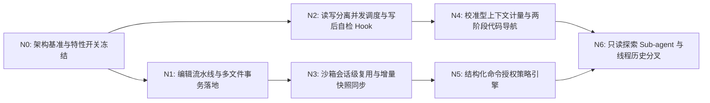

# StellarWeaver Harness 架构差距调研与 N 阶段演进实施方案

> **文档性质**：架构与执行流水线（Pipeline）对比调研及阶段性实施规划（忽略客户端 UI/UX 设计，聚焦核心 Runtime、ACI、沙箱、上下文与编排流水线）。  
> **阶段编号约定**：全部采用 **`N0`–`N6`** 编号体系，严格区分于历史里程碑（CLI `M0–M5`、工作台 `G0–G11`、前期评测与安全基线 `M0–M12`、`H0–H5`）。  
> **调研基准**：当前仓库源码实现（`src/stellarweaver/`）对比 **Claude Code (Core/Desktop Runtime)**、**OpenAI Codex (CLI / App Server)** 与 **DeepSeek Harness**。

---

## 1. 现有架构底座评估（不可退化的核心优势）

在推进架构演进前，以下已在 StellarWeaver 中落地并经过离线/集成回归验证的工程底座属于核心优势，**任何 `N` 阶段改造均不得破坏这些不变量**：

1. **四阶段持久化状态机（`RunJournal`）**：[`session/store.py`](src/stellarweaver/session/store.py) 与 [`web/journal.py`](src/stellarweaver/web/journal.py) 严格区分 `planned` → `approved` → `started` (intent) → `completed/unknown`。崩溃恢复（`reconcile`）遵循**未知副作用绝不自动重放**原则。
2. **Prepare / Execute 分离与双检防 TOCTOU**：[`tools/registry.py`](src/stellarweaver/tools/registry.py) 在授权前后通过 `revalidate()`、`expected_sha256` 及 `InstructionLoader` 指纹比对，确保目标文件、权限边界与适用 `AGENTS.md` 未在等待期间发生篡改。
3. **评测防污染与推理协议完整性**：[`evals/swebench.py`](src/stellarweaver/evals/swebench.py) 将公开题面（`task.json`）与评分资料（`scorer.json`）物理隔离；[`providers/openai_compatible.py`](src/stellarweaver/providers/openai_compatible.py) 与 [`context/manager.py`](src/stellarweaver/context/manager.py) 严格保障 DeepSeek Thinking 模式下 `reasoning_content` 与 `tool_call_id` 的成组回传与历史投影。

---

## 2. 与主流 Harness 的架构实现及流水线差距对比

| 架构 / 流水线维度 | StellarWeaver 当前实现 | Claude Code / Codex / DeepSeek Harness 主流实现 | 核心差距与流水线瓶颈 |
| :--- | :--- | :--- | :--- |
| **1. 工具调度与并发模型** | **全串行调度**：[`runtime/loop.py`](src/stellarweaver/runtime/loop.py) 中 `_tools()` 按 `for call in reply.tool_calls` 顺序逐个 `await`，且 [`openai_compatible.py`](src/stellarweaver/providers/openai_compatible.py) 固定 `parallel_tool_calls=False`。 | **读写分离并发流水线**：单回合并发执行多个只读工具（`read_file`、`search_text`、`find_symbol`），仅对写操作或命令工具加排他锁串行执行。 | **探索阶段延迟高**：读取或检索多个文件需串行等待或多个模型 RTT，拉长单题耗时。 |
| **2. 文件编辑与多文件事务** | **单文件单处替换 + 只读暂存**： • [`tools/files.py`](src/stellarweaver/tools/files.py) `edit_file` 每次仅替换单文件唯一匹配片段。 • [`tools/staging.py`](src/stellarweaver/tools/staging.py) `stage_patch` 仅导出 `.staged.diff` 制品（`workspace_applied: False`）。 | **单文件多块 / 多文件原子应用**： • **Codex**：`apply_patch` 支持单次跨多文件增删改与多 Hunk 落地。 • **Claude Code**：`MultiEdit` 单次完成同文件多处非连续修改并直接进入测试验证。 | **编辑回合膨胀与验证断链**：同文件改多处需多次调用并重算 SHA-256；`stage_patch` 生成的改动无法在当前 Worktree 中直接跑测试验证。 |
| **3. 沙箱生命周期与传输** | **无状态一次性 Tar 容器**：[`web/isolation.py`](src/stellarweaver/web/isolation.py) 每次执行命令均全量打包工作区 Tar（上限 6000 文件 / 32 MiB），启动新容器解压至 `/tmp/work` 执行后销毁，容器内产生的文件变更直接丢弃。 | **会话级持久沙箱 + 增量同步**： • **Codex**：OS 原生沙箱（Landlock/Seatbelt/受限 Token）或会话级持久容器/OverlayFS。 • **Claude Code**：持久 Bash Session（保留进程环境与工作区状态）。 | **单次命令 I/O 开销大、大仓库受限**：>32 MiB 仓库无法快照；每次全量打包解压慢；无法在沙箱内运行代码生成或 `ruff --fix` 并受控写回。 |
| **4. 代码导航与索引覆盖** | **纯 Python AST + Top 100 截断**：[`context/repo_map.py`](src/stellarweaver/context/repo_map.py) 与 [`context/navigation.py`](src/stellarweaver/context/navigation.py) 仅解析 `.py`，且 `max_indexed_files=100` 硬截断候选列表。 | **文本预筛 + Tree-sitter 多语言 + 引用图传播**：先利用倒排/ripgrep 快速缩小候选集再做语法树解析，并基于 import/call 图做 PageRank 权重传播。 | **中大型仓库漏检与跨语言盲区**：超过 100 个 Python 文件的仓库中，排序靠后的文件引用会被静默漏检；不支持 TS/Go/Rust 等多语言符号提取。 |
| **5. 上下文计量与输出裁剪** | **UTF-8 字节估算 + 头部截断**：[`context/manager.py`](src/stellarweaver/context/manager.py) 以 JSON UTF-8 字节数充当 Token 数；`_project_tool` 压缩时仅保留工具输出前 1024 字节（`_preview`）。 | **精确 Tokenizer + 结构化错误帧保留**：使用真实分词器或服务端 `usage` 动态校准；对测试/命令输出提取 `Head + Tail + Traceback/FAILED` 关键块。 | **窗口利用率虚低且丢失报错尾部**：中文与 JSON 转义导致字节数是真实 Token 的 2~4 倍，过早触发压缩；而 Pytest 关键断言往往在输出末尾，头部截断导致有效错误信息丢失。 |
| **6. 权限匹配与生命周期 Hook** | **精确 `argv` 匹配 + 仅拦截型内存 Hook**： • [`policy/__init__.py`](src/stellarweaver/policy/__init__.py) 要求 `argv` 完全相等。 • [`policy/hooks.py`](src/stellarweaver/policy/hooks.py) 仅支持进程内 Python 回调，且仅能返回 `continue/ask/deny/withhold`。 | **结构化命令规则 + 流水线增强型 Hook**： • 支持前缀/通配符规则（如 `pytest *`）与危险参数 AST 拦截。 • **DeepSeek Harness / Claude Code**：Hook 可在写文件后自动附加 Linter/语法诊断或注入上下文。 | **交互审批碎片化 & 缺少自动化自检流水线**：每次切换测试子路径都要重新授权；模型编辑文件后必须额外消耗一轮模型调用才能获知低级语法错误。 |
| **7. 编排拓扑与历史分叉** | **扁平单 Agent 循环 + 线性 Worktree**：所有搜索、探索与修改共享同一主上下文；Web 线程共用单一 Worktree，只能在末尾线性追问。 | **只读探索 Sub-agent + Thread Forking**： • **Claude Code**：派发只读 Sub-agent 独立检索，仅向主上下文返回精简结论。 • **Codex App Server**：`thread/fork` 从任意历史节点克隆会话与代码基线。 | **长程任务上下文污染**：前期大量试探性 `search_text` / `read_file` 迅速占满主上下文窗口；无法从历史中间轮次分叉探索不同修复方案。 |

---

## 3. 分阶段演进实施方案（`N0`–`N6`）

### 3.1 阶段总览与依赖关系

| 阶段编号 | 阶段名称 | 核心解决的架构缺口 | 涉及核心模块 | 优先级 |
| :--- | :--- | :--- | :--- | :--- |
| **N0** | 流水线度量基线与配置开关扩展 | 为 `N1`–`N6` 建立独立开关与过程耗时/Token 利用率基线 | `config.py`、`domain/`、`evals/` | **P0（前置）** |
| **N1** | 多块编辑（`multi_edit`）与事务化补丁落地（`apply_patch`） | 解决单次单处编辑效率低、`stage_patch` 无法落地验证的断链问题 | `tools/files.py`、`tools/staging.py`、`changes/` | **P0（核心）** |
| **N2** | 读写分离并发工具调度与增强型 Hook 流水线 | 解决只读探索串行等待、写文件后需额外回合查语法的流水线延迟 | `runtime/loop.py`、`tools/registry.py`、`policy/hooks.py` | **P0（核心）** |
| **N3** | 沙箱会话级容器复用、增量同步与受控写回 | 解决每次命令 32MB 全量 Tar 打包开销与沙箱无法持久化环境状态问题 | `web/isolation.py`、`web/broker.py`、`web/remote_runner.py` | **P1（高价值）** |
| **N4** | 校准型 Token 计量、Head/Tail 日志保留与两阶段全量导航 | 解决 UTF-8 字节估算失真、截断丢失报错尾部、100 文件导航盲区 | `context/manager.py`、`context/navigation.py`、`context/repo_map.py` | **P1（高价值）** |
| **N5** | 参数感知的命令授权引擎（Pattern Grants & AST Guards） | 解决 `argv` 精确全匹配导致的频繁重复审批与粗粒度风险分级 | `policy/__init__.py`、`policy/risk.py`、`web/approval.py` | **P2（进阶级）** |
| **N6** | 只读探索 Sub-agent 上下文隔离与会话分支（Thread Forking） | 解决长任务探索污染主窗口、线性线程无法从中间轮次分叉试错 | `runtime/service.py`、`web/db.py`、`web/isolation.py` | **P2（进阶级）** |

---

### 3.2 各阶段详细技术方案与验收标准

#### 阶段 N0：流水线度量基线与配置开关扩展
- **设计目标**：
  - 在 `HarnessConfig`（[`src/stellarweaver/config.py`](src/stellarweaver/config.py)）中统一预留 `N` 系列能力开关，确保每项流水线改造均可独立启停、独立消融，默认保持现有行为向后兼容。
  - 在 `RunOutcome` 与 `AgentEvent` 中补充细粒度流水线耗时与计量对比字段（如：`tool_batch_concurrency`、`sandbox_sync_ms`、`estimated_vs_actual_token_ratio`）。
- **实施内容**：
  1. 在 `HarnessConfig` 中增加可选开关字段（默认关闭或维持兼容模式）：
     - `parallel_read_tools: bool = False`
     - `multi_edit_tools: bool = False`
     - `post_edit_syntax_hook: bool = False`
     - `smart_tool_truncation: bool = False`
     - `subagent_exploration: bool = False`
  2. 记录每次模型请求中本地 `input_estimate` 与服务端返回的 `prompt_tokens` 比值，作为 `N4` 校准基准。
- **验收标准**：
  - 现有全量离线单元测试与集成测试 100% 通过，`tools_schema_sha256` 在默认配置下保持不变。

---

#### 阶段 N1：多块编辑（`multi_edit`）与事务化补丁落地（`apply_patch`）
- **设计目标**：将单文件多处修改与跨文件重构的工具调用轮次降低 50% 以上，同时保持现有的 `expected_sha256` 校验、备份制品与 `/undo` 可逆性。
- **实施内容**：
  1. **单文件多块编辑（扩展 `edit_file` 或新增 `multi_edit_file`）**：
     - 在 [`src/stellarweaver/tools/files.py`](src/stellarweaver/tools/files.py) 中支持传入 `edits: list[EditOperation]`（每个包含 `old_text`、`new_text`）及单个 `expected_sha256`。
     - 准备阶段（`prepare`）：校验文件当前 SHA-256 匹配 `expected_sha256`，在内存中按顺序验证每个 `old_text` 唯一存在且不产生非法重叠，生成合并后的完整 unified diff 供审批预览。
     - 执行阶段（`execute`）：复检文件哈希未变，保存单份 `.before` 原文快照与 `.diff` 制品，通过同目录临时文件 + `os.replace` 一次性落盘。
  2. **多文件事务化补丁应用（`apply_patch`）**：
     - 扩展 [`src/stellarweaver/tools/staging.py`](src/stellarweaver/tools/staging.py)：在现有 `stage_patch` 的双临时目录 `git apply --check` 验证基础上，增加受控写回工作区能力。
     - 授权通过后，在 `workspace_write_lock` 保护下复检所有涉及文件的 `expected_sha256`；先为所有目标文件写入 `{operation_id}.{index}.before` 备份制品，再逐个通过同目录临时文件替换目标文件；若任一文件替换前复检失败则中止并由备份精确回滚已替换文件。
     - 升级 [`src/stellarweaver/changes/__init__.py`](src/stellarweaver/changes/__init__.py) 中的 `ChangesManager.undo()`，支持按单个 `operation_id` 逆序恢复整组多文件修改。
- **验收标准**：
  - 离线测试覆盖：同文件 3 处非连续修改一次落盘、其中 1 处 `old_text` 不匹配的整单拒绝、多文件补丁的并发冲突中止与 `/undo` 完整回滚。

---

#### 阶段 N2：读写分离并发工具调度与增强型 Hook 流水线
- **设计目标**：消除模型单轮发出多个只读工具调用时的串行等待，并在写操作后自动内联轻量级静态诊断，减少无效的模型往返回合。
- **实施内容**：
  1. **读写分离批次调度（[`src/stellarweaver/runtime/loop.py`](src/stellarweaver/runtime/loop.py)）**：
     - 当 `harness_config.parallel_read_tools` 开启时，Provider 声明 `parallel_tool_calls=True`。
     - 改造 `Agent._tools()`：将 `reply.tool_calls` 按连续的“纯只读无副作用本地工具”（`read_file`、`list_files`、`search_text`、`find_symbol`、`find_references`、`find_related_tests`、`git_status`、`git_diff`）划分为并发批次（Read Batch），其余写工具、命令工具、远程 MCP 工具作为独立排他项（Serial Item）。
     - 同一 Read Batch 内部通过 `asyncio.gather` 并发调用 `registry.dispatch`，但**严格按照模型原始 `reply.tool_calls` 顺序**依次调用 `self._result(result)` 落库与发布事件，保证 `RunJournal` 事件序列与消息顺序 100% 确定性。
  2. **写后内联诊断 Hook（[`src/stellarweaver/policy/hooks.py`](src/stellarweaver/policy/hooks.py) & [`tools/registry.py`](src/stellarweaver/tools/registry.py)）**：
     - 为 `PostToolUse` Hook 增加可选的 `diagnostic_notes: JSONDict | None` 返回能力（仅允许向 `ToolResult.data["post_hook_diagnostics"]` 附加只读结构化提示，不改变原始文件状态或权限）。
     - 内置一个可选的受控 Hook：当 `edit_file` / `create_file` / `apply_patch` 修改了 `.py` 文件且落盘成功后，在内存中对新内容字节直接执行 `ast.parse`（零外部进程开销），若存在 `SyntaxError` 则直接在当次 `edit_file` 的返回结果中附带行号与语法错误摘要，让模型在下一轮立即修复，省去单独调用 `check_syntax` 的一轮交互。
- **验收标准**：
  - 并发只读批次在 FakeModel 夹具下生成的 `messages` 与 `tool_executions` 顺序与串行模式完全一致；注入 `SyntaxError` 的编辑在单次 `edit_file` 返回中即包含 `syntax_diagnostic` 字段。

---

#### 阶段 N3：沙箱会话级容器复用、增量同步与受控写回
- **设计目标**：解除 32 MiB / 6000 文件的全量 Tar 传输瓶颈，将同一会话内多次命令执行的沙箱启动与同步延迟降低一个数量级。
- **实施内容**：
  1. **两级快照传输（Base Snapshot + Delta Tar）**：
     - 在 [`src/stellarweaver/web/isolation.py`](src/stellarweaver/web/isolation.py) 与 [`web/broker.py`](src/stellarweaver/web/broker.py) 中，将工作区快照拆分为“基线缓存（按 `base_commit` 或初始快照 SHA-256 寻址）”与“增量变更包（Delta Archive，仅包含 `git status` 发生增删改的文件列表）”。
     - Executor 服务在本地缓存基线归档，Worker 每次调用 `RemoteRunner` 时仅上传几 KB 的 Delta Tar 与删除列表，Executor 在临时工作目录合并基线与增量后启动验证，从而将上限安全提升至大型仓库规模，同时消除重复传输未修改源码的开销。
  2. **会话级热容器池 / 受控 Diff 导出（可选进阶）**：
     - 支持在单次 `run_id` 周期内复用同一隔离容器命名空间下的工作目录快照（每次执行前后记录文件树 manifest 哈希）。
     - 若在沙箱内执行格式化或生成类工具，支持以只读 unified diff 形式导出容器内工作区相对于执行前的文本变化，经宿主 `Workspace.resolve` 与 `is_protected` 校验后，仅作为候选证据或待审补丁返回。
- **验收标准**：
  - 连续执行 5 次 `run_tests` 时，后 4 次仅传输增量变更字节；断网、非 root、只读根文件系统、PID/内存限制及超时容器强杀清理（`cleanup_confirmed`）回归全部通过。

---

#### 阶段 N4：校准型 Token 计量、结构化日志裁剪与两阶段代码导航
- **设计目标**：解决 200k 上下文窗口因 UTF-8 字节估算导致的过早压缩、测试报错尾部被截断，以及代码导航在 >100 文件仓库中的漏检问题。
- **实施内容**：
  1. **动态校准 Token 估算器（[`src/stellarweaver/context/manager.py`](src/stellarweaver/context/manager.py)）**：
     - 改进 `estimate_tokens()`：对 ASCII 英文代码与多字节 UTF-8（如中文）采用分字符集权重估算（或接入离线 `tiktoken` `cl100k_base`/`o200k_base`），并在 `Agent` 运行期内根据上一轮服务端实际返回的 `usage.prompt_tokens / input_estimate` 动态维护平滑校准系数（限制在 `[0.35, 1.15]` 安全区间内，并保留 `reserve_tokens` 安全垫）。
  2. **Head + Error Frame + Tail 智能工具输出投影**：
     - 改造 `ContextManager._project_tool()`：当压缩历史中的 `run_command` / `run_tests` 输出时，不再简单取 `raw[:limit]`，而是按 `30% Head + 30% 匹配到的首个 Traceback/FAILED/Error 段落 + 40% Tail` 组合摘要，确保测试失败原因在长会话压缩后依然对模型可见。
  3. **两阶段全仓库导航索引（[`src/stellarweaver/context/navigation.py`](src/stellarweaver/context/navigation.py)）**：
     - 改造 `NavigationIndex.query()`：解除“先按路径名盲排取前 100 个文件（`candidates[:100]`），再做 AST 解析”的硬限制。
     - **阶段一（快速粗筛）**：利用工作区 `rg --files-with-matches --fixed-strings <leaf>`（或 Python 内存快速字节扫描）在全仓库（上限 `max_files=2000+`）中筛出实际包含目标符号名 `leaf` 的 `.py` 文件。
     - **阶段二（精确 AST 解析）**：仅对粗筛命中的文件运行 `_index()` AST 符号与导入别名解析，并按内容 SHA-256 缓存解析结果。
     - **阶段三（引用权重传入 RepoMap）**：在 [`context/repo_map.py`](src/stellarweaver/context/repo_map.py) 的 `rank()` 中引入文件间的静态 import 邻接加分，使与 `explicit_paths` / `visited_paths` 直接相互导入的模块获得更高排序权重。
- **验收标准**：
  - 在包含 500 个 Python 文件的离线夹具仓库中，`find_symbol` 与 `find_references` 能 100% 召回排在字母序后 400 名的目标文件，且单次查询耗时 < 200ms；长 Pytest 日志压缩后仍保留末尾 `FAILED` 汇总行。

---

#### 阶段 N5：参数感知的命令授权引擎（Pattern Grants & AST Guards）
- **设计目标**：对齐 Codex 与 Claude Code 的权限体验，在保证硬性安全边界的前提下，支持安全的命令前缀/参数模式授权，减少用户对同类局部测试命令的重复审批。
- **实施内容**：
  1. **结构化命令模式授权（[`src/stellarweaver/policy/__init__.py`](src/stellarweaver/policy/__init__.py)）**：
     - 在 `Grant` 中保留精确 `argv` 匹配的同时，新增可选的 `argv_prefix: tuple[str, ...]` 与受限参数校验规则（如允许 `["pytest", ...]` 或 `["python", "-m", "pytest", ...]`，只要后续参数均为工作区内合法相对路径或白名单安全 flag 如 `-q`、`-k`、`-x`）。
  2. **高危参数静态守卫（[`src/stellarweaver/policy/risk.py`](src/stellarweaver/policy/risk.py)）**：
     - 细化 `assess()`：识别解释器内联代码执行参数（如 `python -c`、`sh -c`、`bash -c`、`node -e`、`git -c core.sshCommand=...`、`pytest -o` 等），即使前缀匹配也强制升级为 `L2`（要求单次显式审批 `one_shot=True`）或 `L3`（直接拒绝），绝不因前缀授权而放行任意代码注入。
- **验收标准**：
  - 授予 `pytest` 安全模式权限后，Agent 切换测试不同子目录的 `tests/unit/test_a.py` 与 `tests/unit/test_b.py` 无需重复弹窗；但尝试传入 `pytest --import-mode=...` 非白名单危险参数或 `python -c` 时被确定性拦截并降级为 `ask`/`deny`。

---

#### 阶段 N6：只读探索 Sub-agent 上下文隔离与会话分支（Thread Forking）
- **设计目标**：对齐 Claude Code 的 Sub-agent 探索隔离与 Codex App Server 的 `thread/fork` 能力，彻底解决大型复杂任务中的主上下文膨胀与多路线试错问题。
- **实施内容**：
  1. **只读探索 Sub-agent 工具（`delegate_exploration`）**：
     - 基于现有 [`runtime/service.py`](src/stellarweaver/runtime/service.py) 的 `build_agent`，封装一个只读探索工具注册到主 Agent。
     - 当主 Agent 调用 `delegate_exploration(goal, path_hints)` 时，运行时在当前进程内实例化一个子 `Agent`：
       - **权限强制收紧**：固定使用 `PolicyEngine(preset="read-only")`，仅暴露 `list_files`、`read_file`、`search_text`、`find_symbol`、`find_references`、`find_related_tests`。
       - **共享预算扣减**：子 Agent 限制 `max_model_calls=6`、`max_tool_calls=20`，其消耗的 `input_tokens`、`output_tokens`、`tool_calls` 实时汇总并扣减父 Agent 的 `LimitsConfig` 与 Web 账户周额度。
       - **上下文隔离与证据回传**：子 Agent 的中间大量读文件消息保留在子 Journal 事件中供前端折叠审计，**仅将子 Agent 的最终结构化调查结论及核验过的 `{path, sha256, line_range}` 摘要作为一条 `ToolResult` 返回给父 Agent**。
  2. **线程历史轮次分叉（Thread Forking）**：
     - 在 [`web/isolation.py`](src/stellarweaver/web/isolation.py) 中，每当一次修复运行（`run_id`）落入终态时，在线程私有 `base.git` 裸仓库中自动记录一个内部不可变引用 `refs/runs/<run_id>`（保存当时 Worktree 的快照树对象，无需污染源仓库分支）。
     - 在 [`web/db.py`](src/stellarweaver/web/db.py) 与 API 中支持 `POST /threads/{session_id}/fork`（指定 `source_run_id`）：创建新 `session_id`，从 `refs/runs/<source_run_id>` 检出全新的独立 Worktree，并复制截至该 `source_run_id` 的历史问答与验证证据。
- **验收标准**：
  - 主 Agent 调用 `delegate_exploration` 完成 10 次文件检索后，主 Agent 上下文仅增长一条摘要结果，且父子总 Token 用量对账精确；从第 $k$ 轮分叉出的新线程修改文件完全不影响原线程 Worktree。

---

## 4. 推进顺序与工程落地建议

1. **第一批次（快速见效，聚焦单 Agent 核心修复效率）**：优先实施 **`N0` → `N1` → `N2`**。
   - 这三个阶段不需要改动 Docker 容器通信协议或数据库表结构，完全在 `tools/`、`runtime/` 和 `policy/` 内存流水线内完成，却能直接解决**单文件多处编辑繁琐**、**只读工具串行慢**以及**低级语法错误浪费模型轮次**三大高频痛点。
2. **第二批次（突破大仓库与长程会话瓶颈）**：实施 **`N4` → `N3`**。
   - 先通过 `N4` 解决两阶段代码导航与上下文智能裁剪，让 Agent 在大项目中“找得准、记得住报错”；再通过 `N3` 的增量 Tar 同步降低沙箱高频测试的 I/O 延迟。
3. **第三批次（高阶自治与多路线探索）**：实施 **`N5` → `N6`**。
   - 在单 Agent 流水线高度成熟后，引入参数感知的命令授权（`N5`）、只读探索 Sub-agent 与线程 Fork（`N6`），使 StellarWeaver 在架构完备度上全面看齐 Claude Code 与 Codex。
