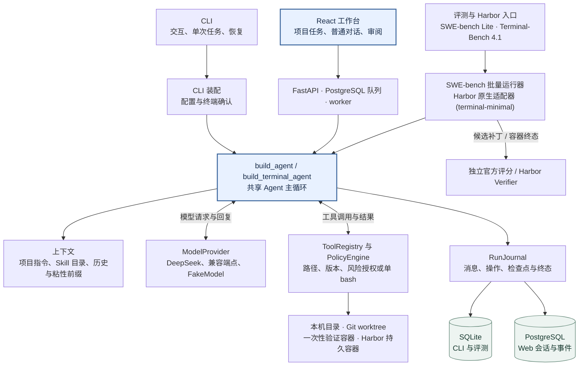
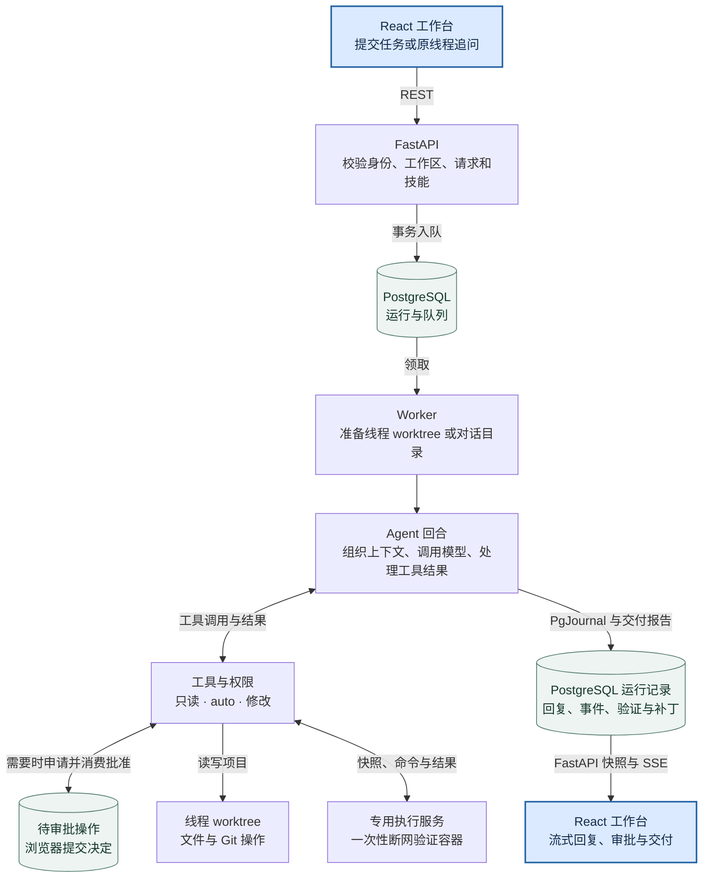

# StellarWeaver

**面向 Git 项目的本地 Coding Agent 与评测 Harness。**

在 React 工作台提交项目修复任务，Agent 会定位源码，在当前线程的 Git worktree 中编辑，在断网容器中验证，并交付可逐块审阅的补丁。工作台也支持无项目对话、在原线程追问和查看历史运行。CLI 使用同一套 Agent 运行时，适合终端交互、脚本调用与离线复现。

**Python · React · FastAPI · SQLite / PostgreSQL**

[核心能力](#核心能力) · [工作原理](#工作原理) · [快速开始与离线演示](#快速开始) · [数据库与部署](#数据库与部署) · [配置](#配置) · [任务管理与报告导出](#任务管理与报告导出) · [评测与开发](#评测与开发) · [模块文档](#模块文档)

## 核心能力

| 能力 | 实现方式 |
| --- | --- |
| 仓库导航与修复 | 搜索文本、AST 定位 Python 定义与引用（含字节预过滤与源码缓存）、查找相关测试；支持多处精确编辑 `edit_file`、跨文件原子写回 `apply_patch`、只读工具并发、只读子 Agent 探索 `delegate_exploration` 与写后 Python 语法检查。 |
| 工作台与 CLI | 工作台支持账号登录、多个项目、线程归档、无项目对话和原线程追问。CLI 提供交互、单次任务、JSONL 输出与会话回放。 |
| 权限与隔离验证 | 工作台提供只读、`auto` 和「修改」，支持沙箱内测试命令作用域授权复用。项目线程拥有独立 Git worktree，验证通过增量快照在一次性断网 Linux 容器中运行。 |
| 补丁审阅与交付 | 按文件或改动块审阅，针对候选发送反馈，选择改动独立复验，预检目标分支并下载补丁。支持单文件与 `apply_patch` 成组撤销。 |
| 上下文、模型与扩展 | CLI 和 Web 默认使用 200k 单请求窗口，支持实测校准预算、固定前缀压缩、最近回合原文保护与导入加权 RepoMap。DeepSeek Flash 默认使用 Thinking High，支持按需网页搜索。工作台支持模型自主加载 Skills 和手动指定版本，CLI 可装配本地 stdio MCP。 |
| 运行证据与恢复 | Web 用 PostgreSQL 保存任务队列、审批、事件和用量，通过 SSE 回显进度，可导出脱敏 JSON 或离线 HTML。CLI 用 SQLite 保存消息、操作及恢复记录。 |
| SWE-bench Lite & Terminal-Bench 评测 | SWE-bench 冻结题面、基线和执行配方，独立官方评分并支持看板发布；Terminal-Bench 4.1 通过 Harbor 原生 `BaseAgent` 与 `terminal-minimal` 单 `bash` 持久容器执行，自动合并官方 Verifier 评分与自包含归档。 |

### 当前进展

CLI M0–M5、工作台 G0–G11、Harness M0–M10、N 阶段（Batch 1–3）与上下文三项优化，以及 **Harness Phase 1–3a、Web Compose 7 开关透传、Harbor 原生评测与 Batch 1 离线工程修复** 均已完成实现、验收并合入主线（**676+ 项离线回归全绿**）。已完成基准实测与工程闭环如下：
- **Terminal-Bench 4.1 评测与工程闭环**（`terminal-minimal` 单 `bash` · DeepSeek Flash `max` · 512k）：
  - **多容器/高难专项与 A/B 基线**：5 题纯 CPU 冒烟官方通过 **`2/5（40.0%）`**（`kv-live-surgery` `6/6`、`payments-pipeline-fix` `3/3`，WAL 实报缓存 **`97.58%`**，标准价 `$3.094`）；在与 19 题子集不重叠的 4 道多容器/专项题中原始通过 **`2/4（50.0%）`**，优于同基座 Claude Code（`30.0%`，6/20）与 Ante（`25.0%`，1/4）。`completion_evidence_reminder` 4-Trial 开关对照成功拦截并修复 `vf2-speedup-networkx` 2 个交卷前必挂缺陷至 **`60/60`**（缓存 **`97.97%`**）。
  - **19 题公开标准子集首轮基线与旁路审计抓虫（`0b2480c`，2026-11-27–28）**：按第三方 `fast-agent` 19 题纯 CPU 单容器子集严格原样实测，`19/19` 零异常、零 OOM、零超时出分，首轮单次 `pass@1` 基线 **`5/19（26.3%）`**（Claude Code `5/5` 稳定题 **`4/4（100%）`** 全过、`mvcc-lsm-compaction` 反超 Ante；实报缓存 **`95.38%`**，美元标准价 `$10.48` / 谷期重算 ~¥34.92）。旁路只读 `PrefixCacheAuditor` 精准定位首轮隐性缺陷：单 `bash` 模式下 `RepairController.notes` 永久驻留导致 **`1,200` 次前缀分叉**，持久化工具消息存在 **`55%` 重复字节冗余**。
  - **Batch 1 工程修复与 7 近失 + 1 哨兵定点回归（`5bb1a4d`，2026-11-28）**：合入单事务 `terminal-minimal` 工具消息去重投影、一次性 `model_note` 诊断、摘要审计与可切换 `v1/v2` 指纹后，在 7 道首轮近失题 + 1 道哨兵 `mvcc` 上验证 **`3/8`**（近失翻盘 **`2/7`**：`production-planning` `20/20`、`wal-recovery-ordering` `97/97`；哨兵 `15/15` 零回归）。底座实测实现前缀分叉 **`397 → 0`**、工具消息单次均重 **`-57.4%`**、上下文压缩 **`5 → 2`**、未缓存输入 **`-64.9%`**、Prefix Cache 命中率 **`96.82% → 98.90%`**（多题达 `99.2%–99.4%`），在多跑 `+98` 次模型调用下标准价总费反降 **`-11.7%`**。
  - **透明双口径汇总**：在 `fast-agent` 19 题公开子集上，跨两轮提交累计已有 **`7/19`** 道不同题目取得官方 `reward=1.0`（含 4 题非重叠多容器专项的 23 题并集累计 **`9/23`**；明确标注为**跨两轮迭代的累计解出数，不等同于同提交单次 `pass@1`**，首轮单次分母保持 `5/19` 独立不混算）。当前按路线 A 固化收益归档，后续按需在 `5bb1a4d` 谷期重跑完整 19 题刷新单次基线（预计 ~¥28–¥32），详见 [TB 4.1 23 题档案](docs/TB4.1Subset23.md) 与 [TB 4.1 评测与优化报告](docs/TerminalBench4.1Eval.md)。
- **SWE-bench Lite `dev` 全量 23 题（已收官归档）**（`full` · DeepSeek Flash Thinking High · 200k）：23/23 产出合法补丁，原始通过 **9/23（39.1%）**，剔除 8 题上游镜像损坏后有效通过 **9/15（60.0%）**，Prefix Cache 86.67%、闲时均摊 **¥0.20 / 题**；不再推进 `test` 300 题。

[当前实现与验收](docs/HARNESS_ACCEPTANCE.md#当前实现进度核对) · [评测体系指南](docs/EVALUATION.md) · [TB 4.1 23 题档案](docs/TB4.1Subset23.md) · [TB 4.1 评测与优化报告](docs/TerminalBench4.1Eval.md) · [SWE-bench dev 23 题报告](docs/SWEBenchLiteEval.md) · [多阶段演进路线图](docs/StellarWeaver_Harness_Roadmap.md)

## 工作原理

### 整体架构



多种入口共用同一套 `Agent` 主循环、上下文压缩与流式容错引擎：CLI、Web 与 SWE-bench Lite 经 `build_agent` 装配完整工具面；Terminal-Bench 4.1 经 Harbor 原生适配器调用 `build_terminal_agent` 装配容器专用 `terminal-minimal` 单 `bash` 运行时。Web 队列与会话事件存于同一个 PostgreSQL 实例。 [整体架构](docs/ARCHITECTURE.md#stellarweaver-整体架构) · [TB 4.1 调用链](docs/ARCHITECTURE.md#terminal-bench-41harbor调用链) · [共享装配入口](src/stellarweaver/runtime/service.py)

### 从工作台到 Agent Runtime



FastAPI 受理后返回运行 ID，worker 独立运行。审批决定经 API 写入数据库，等待中的 worker 读取并核对后继续执行。浏览器关闭或重连后可用原运行 ID 读回快照，按事件序号补齐进度。图中的队列、审批和运行记录对应同一个 PostgreSQL 实例。 [React 工作台调用链](docs/ARCHITECTURE.md#react-工作台调用链)

### 任务提交与工作区准备

工作台用 `workspace_id` 区分项目和普通对话空间，用 `session_id` 标识一条线程，用 `run_id` 标识其中的一次任务、追问、复验或撤销。FastAPI 核对账号、租户与项目范围，再在同一事务写入运行、队列、窗口配置和已选技能版本。同一请求 ID 携相同参数重试会返回原运行。原线程追问创建新运行，并检查线程归属、归档状态和是否已有运行在进行。

| 入口与模式 | worker 或 CLI 准备的执行环境 |
| --- | --- |
| Web 项目只读 | 在本机 Compose 的线程 worktree 中搜索、读取源码并查看 Git 状态。 |
| Web 项目修复 | 从已登记项目的 Git 基线建立或复用线程 worktree。`auto` 自动处理普通编辑与登记的隔离验证，「修改」对编辑和验证逐项审批。 |
| Web 普通对话 | 使用独立对话目录，沿用模型、用量和 SSE。此模式关闭仓库指令、文件和命令工具，可按配置使用共享技能及 DeepSeek 网页搜索。 |
| CLI | 使用显式选择的工作目录。`chat` 保留交互上下文，`exec` 执行单个任务，调用受当前 CLI 策略约束。 |

worker 领取时记录执行归属和尝试号。项目线程首次执行以源仓库已提交的 `HEAD` 初始化 worktree，后续运行复用该线程在状态卷中的目录。源项目在本机 Compose 中只读挂载。 [Web API](src/stellarweaver/web/app.py) · [任务队列](src/stellarweaver/web/db.py) · [工作区隔离](src/stellarweaver/web/isolation.py)

### Agent 回合与模型适配

1. **准备请求。** `Agent` 组合当前任务、适用指令、历史和本轮允许的工具 schema，交给 `ContextManager` 生成窗口内的请求。
2. **接收回复。** Chat Completions 适配器即时传递可见文本片段。工具调用的 ID、名称和参数可分片到达，适配器在聚合并校验完整回复后才交给主循环。
3. **执行工具。** 主循环记录助手回复及计划操作，按调用顺序分派。每个结果携原工具调用 ID 回到消息序列，模型可依据文件内容、权限反馈或真实测试输出决定补读、修正或复验。
4. **交付终态。** 收到完整最终回复，或遇到取消、预算用尽等终止条件时，运行时保存结果。验证状态单独根据实际检查与文件快照生成，因此任务可以在验证失败或尚未验证时结束。

选择 DeepSeek 时默认使用 `deepseek-flash` 的 Thinking High。工具对话所需的 `reasoning_content` 只在活动进程内保留，持久记录保存可见回复和工具证据。限流或网络故障可有限重试。FakeModel 用脚本化回复驱动同一工具循环，可在离线环境复现授权、编辑、失败和再验证。 [Agent 主循环](src/stellarweaver/runtime/loop.py) · [模型适配器](src/stellarweaver/providers/) · [离线演示](src/stellarweaver/demo.py)

### 仓库定位与上下文管理

- **先定位，再读取。** Python repo map 基于 AST 收集函数、类和行号。启用导航扩展后，`find_symbol`、`find_references` 和 `find_related_tests` 给出定义、静态引用和测试线索。Agent 用 `read_file` 取得具体内容和当前文件哈希，再提交编辑。
- **按路径加载项目指令。** 运行时根据项目根目录和目标文件所在目录收集适用的 `AGENTS.md`。等待审批期间如指令变化，运行时重新核对指纹，并将变化反馈给下一轮模型。
- **按完整回合压缩。** CLI 和 Web 默认窗口为 200,000 token。DeepSeek Thinking 默认预留 16,384 token 输出及 2,048 token 余量，估算输入额度为 181,568 token，工具定义也占用输入。达到输入额度的 80% 时可尝试向 55% 压缩，归纳过长工具输出及较早的完整回合，保留对应关系和近期证据。工作台按运行保存提交时使用的窗口。
- **分开记录窗口和用量。** Journal 保留原始消息、工具证据与摘要检查点，模型服务返回的实际用量另行记录。CLI 仍受所配置的运行总预算约束。Web 关闭单次运行累计预算，DeepSeek 继续按成员周额度预留和结算，默认每周 1 亿 token，按 UTC 周一划界。SWE-bench Lite 默认 200k 窗口（兼容旧清单 100k）并支持在 `prepare` 冻结自定义预算与 `--harness-profile baseline|full` 对照。

[上下文管理](src/stellarweaver/context/) · [项目指令](src/stellarweaver/instructions/) · [Web 额度与续接](docs/USAGE.md#上下文续接与额度)

### 工具审批与隔离验证

`ToolRegistry` 先校验函数参数和工作区路径，再准备具体操作。参数格式错误、路径越界与权限拒绝会形成结构化工具结果。编辑会带上文件差异和读取时的 SHA-256，执行前重新核对目标内容，并要求旧文本唯一匹配。

- **模式决定是否送审。** 只读允许范围内的读取，`auto` 自动放行符合条件的工作区编辑和隔离验证，「修改」对编辑与验证逐项审批。审批绑定运行、操作指纹和有效期，执行前继续复核文件和适用指令。路径越界或受保护路径由边界规则直接处理。
- **验证在独立环境运行。** worker 将 worktree 快照和已配置的命令索引或受控验证参数交给执行服务，后者创建一次性断网容器，返回退出码、输出及清理状态。验证容器接收所需文件和命令。CLI 默认使用宿主执行器，也可显式配置 Docker。
- **结果关联到快照。** 交付报告保存测试时的快照摘要。若测试之后项目文件发生变化，旧结果仍可查阅，对最终候选的验证证据会标为过期。重新验证可生成与当前候选对应的结果。

[工具注册表](src/stellarweaver/tools/registry.py) · [策略与授权](docs/SECURITY.md) · [验证证据](src/stellarweaver/web/delivery.py)

### 补丁审阅、复验与交接

修复结束后，工作台将候选差异按文件和改动块展示。用户可以针对某个文件或改动块发送反馈。后端从候选补丁提取相关改动，把反馈作为原线程的新一轮输入，该轮编辑沿用线程的执行模式。

选中改动后，服务端从报告保存的改动块重新组装补丁，将复验作为独立运行入队。worker 在同基线的新 worktree 检查并应用补丁，再执行项目配置的验证命令。这一步由程序执行，无须模型重新生成补丁。每条结果归属本次选中的补丁和实际测试快照。

交接前，预检读取项目目录当前检出的分支、提交和涉及文件的本地状态，并在临时 worktree 检查补丁是否可应用。完整补丁复验通过且预检满足要求时，可以下载已复验补丁，再到 IDE 核对并应用。 [审阅与预检](src/stellarweaver/web/review.py) · [工作台操作](docs/USAGE.md#web-工作台)

### 状态持久化与中断恢复

| 状态 | CLI | Web 工作台 |
| --- | --- | --- |
| 会话与运行 | SQLite 保存原任务、运行及配置。 | PostgreSQL 保存账号、项目、线程和运行，`run_jobs` 记录队列状态与执行归属。 |
| 工具与模型证据 | 保存消息、操作意图、审批、结果和上下文检查点。 | `PgJournal` 保存同类运行证据，并为事件分配 SSE 补读游标。 |
| 文件与交付 | 会话制品保存编辑前的文件内容和差异，`/diff` 对照 Git 基线，`/undo` 按证据撤销符合条件的内置编辑。 | 状态卷保存线程 worktree，运行报告保留改动块和验证证据供审阅。 |

CLI 恢复时按文件哈希核对中断前后的写入状态。已启动而结果未知的命令留待核对。Web 重启后继续领取排队任务，并将已领取但未落终态的运行标记为中断。用户可查看计划、批准、执行意图和已记录结果，再决定如何续接。 [会话存储](src/stellarweaver/session/) · [PostgreSQL Journal](src/stellarweaver/web/journal.py) · [数据库](docs/DATABASE.md)

### 执行观察、追问与扩展

- **过程可回看。** 浏览器用 SSE 接收可见回复、审批状态和工具事件，重连时从最后已处理的 `seq` 补读。运行结束后可以展开已折叠的工具过程，查看日志、检查结果、最近输入量及模型用量。
- **追问复用可核查证据。** 带历史续接时，后端提取最近最多八轮完成的常规问答，再附上文件、检查结果和技能版本。文件哈希或测试快照变化后，原记录会标注为旧证据。从新提示开始时跳过问答和普通证据，项目线程仍复用 worktree。
- **扩展按入口装配。** Web 模型先看到可用技能目录，再按需调用 `load_skill`。用户也可通过输入框的「＋」指定技能，worker 会核验选中的版本哈希。项目技能由成员单独授权，CLI 还可装配本地 stdio MCP。具备网页搜索能力的 DeepSeek provider 可使用 `ds_search`，通过检查的公开查询按 L0 放行，返回来源随工具过程显示。

[Web 前端与 API](docs/ARCHITECTURE.md#web-前端与-api) · [普通对话与恢复](docs/ARCHITECTURE.md#普通对话与恢复) · [扩展](docs/ARCHITECTURE.md#扩展)

## 快速开始

### 1. 安装依赖

CLI 需要 Python 3.12+、uv 和 Git。以下 PowerShell 命令在仓库根目录执行。初次同步依赖后即可离线运行 CLI。Web 工作台使用支持 Linux 容器的 Docker 和 Compose。

```powershell
uv sync --locked
```

### 2. 配置服务

使用 DeepSeek 时，将 [`.env.example`](.env.example) 复制为仓库根目录的 `.env`，填写 `STELLARWEAVER_API_KEY`。Web 初次部署还需准备 `.stellarweaver/workbench.compose.env` 和本机成员 JSON，在其中指定数据库密码、允许浏览的项目根目录、一个已有 Git 提交的初始项目及内部执行服务凭据。用 `SW_WORKBENCH_PROVIDER=fake` 可启动离线工作台。已有实例使用原有配置和数据卷。 [首次部署配置与样例](docs/USAGE.md#新机器首次配置)

### 3. 启动工作台或 CLI

**离线演示。** FakeModel 在临时 Git 仓库中执行真实编辑与测试，依据失败输出修复后再验证。成功时 `demo_passed` 为 `true`，`test_exit_codes` 为 `[1, 0]`。

```powershell
uv run --locked --offline stellarweaver doctor --offline
uv run --locked --offline python -m stellarweaver.demo
```

**启动工作台。** 完成首次部署配置后，用四份 Compose 配置一起启动。打开 [本机工作台](http://127.0.0.1:8787/) 注册或登录。修复功能由 `SW_WORKBENCH_REPAIR=1` 启用，可写项目随后可选择 `auto` 或「修改」。

```powershell
$dc = @('--env-file', '.env', '--env-file', '.stellarweaver/workbench.compose.env',
  '-p', 'stellarweaver', '-f', 'deploy/compose.yaml', '-f', 'deploy/compose.workbench.yaml',
  '-f', 'deploy/compose.g5.yaml', '-f', 'deploy/compose.g5-local.yaml')
docker compose @dc up -d --build --wait
Invoke-RestMethod 'http://127.0.0.1:8787/healthz'
```

**在 CLI 使用 DeepSeek。** 配置模型密钥后，可在终端流式交互，或执行一次只读项目分析并输出 JSONL。

```powershell
uv run --locked stellarweaver chat --workspace . --provider deepseek --env-file .env --stream
uv run --locked stellarweaver exec --workspace . --provider deepseek --env-file .env --policy read-only --json --prompt "梳理项目入口和核心调用链，给出文件路径与行号。"
```

## 数据库与部署

本机工作台使用 PostgreSQL 17，数据库卷保存业务数据，工作台状态卷保存线程 worktree 和运行制品。以下是 Compose 中的常驻服务及一次性迁移服务。

| Compose 服务 | 职责 |
| --- | --- |
| `db` | 保存账号、工作区、队列、会话、事件和用量，按租户约束业务数据访问。 |
| `migrate` | 使用迁移管理员角色更新数据库结构，完成后退出。 |
| `api` | 提供前端、REST 接口和 SSE。 |
| `worker` | 领取任务、管理线程目录、调用模型与工具，并记录运行结果。 |
| `executor` | 经私有网络接收工作区快照及受控操作，持有 Docker socket，负责启动和清理验证容器。 |

本机部署使用账号和密码登录，后端通过会话 Cookie 识别成员，按租户及项目授权决定可见范围。团队部署可选 OIDC。获授权的成员可在「审计与用量」查看运行审计和额度统计。 [团队身份配置](docs/USAGE.md#团队身份配置)

本机工作台默认映射到 `127.0.0.1:8787`，PostgreSQL 默认映射到 `127.0.0.1:55434`，数据库名为 `stellarweaver`，业务表位于 `sw` schema。连接角色、迁移和备份步骤见[数据库文档](docs/DATABASE.md)。

## 配置

CLI 可在目标工作区使用 `stellarweaver.toml`，或通过 `--config` 指定文件。Web 模型与执行配置由本机 Compose 环境文件传入。 [CLI 配置模板](stellarweaver.example.toml) · [Web 配置指南](docs/USAGE.md#本机-compose)

| 配置 | 默认或示例 | 作用 |
| --- | --- | --- |
| `[model].provider` | CLI 默认 `fake` | 指定离线模型、DeepSeek 或 Chat Completions 兼容端点。 |
| `[model].thinking`、`[model].reasoning_effort` | DeepSeek 为 `enabled`、`high` | 控制思考模式与强度。Web 对应 `SW_WEB_DEEPSEEK_THINKING`、`SW_WEB_DEEPSEEK_REASONING_EFFORT`。 |
| `[model].context_window_tokens`、`SW_WEB_CONTEXT_WINDOW_TOKENS` | `200000` | 分别设置 CLI 和 Web 新运行的模型窗口。Web 历史记录保留当时使用的窗口。 |
| `[limits]` | 如 `max_tool_calls`、`max_wall_seconds` | CLI 的整次运行限制。Web 用量由请求窗口和成员周额度管理，单项操作仍有超时。 |
| `[policy].preset` | CLI 默认 `ask` | 根据使用场景选择 `read-only`、`ask` 或 `workspace-edit`。 |
| `SW_WORKBENCH_PROVIDER`、`SW_WORKBENCH_REPAIR` | `fake` / `deepseek`、`0` / `1` | 选择工作台模型，并决定是否开放项目修复。 |
| `SW_RUNNER_IMAGE`、`SW_VERIFY_COMMANDS` | 由部署配置设定 | 指定隔离验证镜像和允许执行的测试、构建命令。 |

## 任务管理与报告导出

工作台可指定技能，带着已复核的文件与验证证据追问，从运行日志导出脱敏 JSON 或离线回放 HTML，并在隔离工作区撤销最近一次文件编辑。补丁复验通过后可预检目标分支并导出。CLI 可从已有会话回放或导出证据，并按需进入恢复流程。将 `SESSION_ID` 替换为实际会话 ID，`--output` 指定一个新文件。

```powershell
uv run --locked stellarweaver sessions list
uv run --locked stellarweaver replay SESSION_ID --json
uv run --locked stellarweaver export SESSION_ID --format markdown --output session-report.md
uv run --locked stellarweaver resume SESSION_ID --provider deepseek --env-file .env --prompt "重新读取当前状态，继续验证。"
```

`replay` 和 `export` 读取已有 Journal。`resume` 会协调待核对的操作，并可用新提示启动后续任务。 [会话、策略和改动](docs/USAGE.md#会话策略和改动)

## 评测与开发

### Terminal-Bench 4.1 与 SWE-bench Lite 评测

Terminal-Bench 4.1 通过 Harbor 原生 `BaseAgent` 与 `terminal-minimal` 单 `bash` 持久容器执行，自动以严格 `TrialLock` 分母合并官方 Verifier 评分、`ctrf.json` 诊断与 v2 逐字段实报用量。历史 SWE-bench Lite 批量适配器冻结数据集修订、题号、基线提交与配方并生成看板契约，现已于 `dev` 23 题收官归档。

```powershell
# 查看 Terminal-Bench 4.1 19 题标准子集冻结配置 / SWE-bench 批量命令行帮助
Get-Content deploy/harbor-tb41-fast19.yaml
uv run --locked --offline python -m stellarweaver.evals.swebench --help
```

| 范围 | 已记录的进度 |
| --- | --- |
| Terminal-Bench 4.1 冒烟 & 4-Trial A/B | 5 题纯 CPU 冒烟官方通过 **2/5（40.0%）**（非重叠 4 题多容器/专项 **`2/4 [50.0%]`** 优于 Ante `25%` 与 CC `30%`，WAL 实报缓存 **97.58%**、标准价 `$3.094`）；4-trial `completion_evidence_reminder` 对照将 `vf2` 修至 `60/60`（缓存 **97.97%**）；Web Compose 7 项开关透传与严格 `TrialLock`/v2 溯源已合并 `master`。 |
| TB 4.1 `fast19` 首轮 & Batch 1 7+1 定点回归 | `fast-agent` 19 题首轮单次 `pass@1` 基线 **`5/19（26.3%）`**（19/19 零异常，谷期估计 ~¥34.92）；合入工具去重投影 + 一次性 `model_note` + `v2` 后，7 近失 + 1 哨兵回归 **`3/8`**（近失 `2/7` 翻盘、哨兵 `1/1`，缓存 **`98.90%`**、前缀偏移 **`0`**、未缓存输入 **`-64.9%`**、总费 **`-11.7%`**）。两轮跨提交累计已独立跑通 **`7/19`**（23 题并集 **`9/23`**，非同提交单次 `pass@1`）。 |
| 下一步（路线 A） | 按需使用 [harbor-tb41-fast19.yaml](deploy/harbor-tb41-fast19.yaml) 在 `5bb1a4d` 谷期刷新完整 19 题单次基线（预计 ~¥28–¥32），或后续单测无锚定新鲜上下文审校。 |
| SWE-bench Lite `dev`（23 题，已归档） | 全量 `dev` 23/23 产出合法补丁，官方原始 **9/23（39.1%）**，剔除 8 题上游镜像损坏后 **9/15（60.0%）**，均摊 ¥0.20/题；不再推进 `test` 300 题。 |

[评测体系技术指南](docs/EVALUATION.md) · [TB 4.1 23 题档案](docs/TB4.1Subset23.md) · [TB 4.1 评测与优化报告](docs/TerminalBench4.1Eval.md) · [SWE-bench dev 23 题报告](docs/SWEBenchLiteEval.md) · [历史 20 题内部评测](docs/archive/00_Sample_Run.md)

### 回归测试与效果验证

```powershell
uv sync --locked --extra web
uv run --locked --extra web pytest -q -ra
uv run --locked --extra web ruff check .
uv run --locked --extra web mypy src/stellarweaver
```

回归覆盖工具权限、真实临时仓库、流式协议、恢复与评分链路。PostgreSQL、Docker 和浏览器集成测试按测试配置提供独立资源。 [复现入口与已有结果](docs/EVALUATION.md#复现入口)

### 项目结构

```text
StellarWeaver/
├── src/stellarweaver/
│   ├── cli.py                  # 终端入口
│   ├── runtime/                # Agent 循环与预算
│   ├── providers/              # 模型适配与流式协议
│   ├── context/                # 上下文压缩与仓库索引
│   ├── tools/、policy/         # 工具注册、执行与授权
│   ├── session/、changes/      # CLI 持久化、恢复和改动管理
│   ├── extensions/             # Skills 与 stdio MCP
│   ├── web/                    # API、worker、迁移与隔离执行
│   └── evals/                  # 内部评测与 SWE-bench Lite 适配
├── frontend/                   # React 工作台和浏览器测试
├── deploy/                     # Compose、应用镜像和数据库初始化
├── tests/                      # Python 单元与集成测试
└── docs/                       # 使用、架构、数据库及评测记录
```

## 模块文档

| 文档 | 内容 |
| --- | --- |
| [项目文档导航](docs/README.md) | 能力总览、修复流程演示与文档阅读顺序。 |
| [使用与部署](docs/USAGE.md) | CLI 操作、Harness 增强开关速查、Web 工作台、Compose 与团队身份配置。 |
| [架构与调用链](docs/ARCHITECTURE.md) | 工作台架构、共享运行时、模型、工具、隔离与交付流程。 |
| [数据库与持久化](docs/DATABASE.md) | PostgreSQL 与 SQLite 的结构、职责、迁移和恢复。 |
| [工具授权与安全](docs/SECURITY.md) | 信任边界、L0–L3 风险分级、作用域授权复用、审批与本地安全夹具。 |
| [评测体系与运行器指南](docs/EVALUATION.md) · [TB 4.1 23 题档案](docs/TB4.1Subset23.md) · [TB 4.1 冒烟与 A/B](docs/TerminalBench4.1Eval.md) · [SWE-bench dev（已归档）](docs/SWEBenchLiteEval.md) | 复现入口、Harbor TB 4.1 与 SWE-bench Lite 双评测器参数流程、19+4=23 题标杆对照及历史归因报告。 |
| [Harness 实施与验收](docs/HARNESS_ACCEPTANCE.md) · [演进路线图](docs/StellarWeaver_Harness_Roadmap.md) · [后续路线图](docs/ROADMAP.md) | M0–M10、N 阶段及 Phase 1–4 至 TB 4.1 演进的完整历史验收、采纳核对与后续计划。 |
| [历史归档索引](docs/archive/README.md) | 已完成规划方案（含 M0–M10 总方案与 N 阶段方案）、历史阶段进度与外部工作流对照。 |
