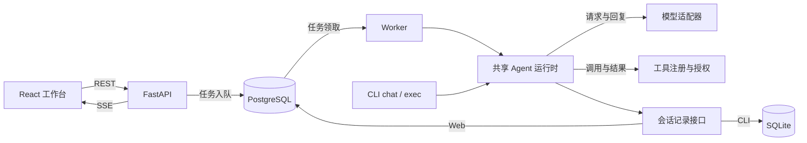

# StellarWeaver

**面向 Git 项目的本地 Coding Agent，从代码定位、审批修复和隔离测试，到补丁审阅与交付。**

在 React 工作台选择一个 Git 项目并描述问题，StellarWeaver 可以读取源码、定位调用链，在独立工作区提出修改，再根据真实测试结果继续修复。用户可以批准每次写入和验证、查看改动块、复验选中的补丁，最后将结果交接到 IDE。CLI 提供同一套 Agent 运行时的交互、单次执行和 JSONL 输出。

**Python · React · FastAPI · SQLite / PostgreSQL**

[核心能力](#核心能力) · [工作原理](#工作原理) · [快速开始](#快速开始) · [数据库与部署](#数据库与部署) · [配置](#配置) · [任务管理与报告导出](#任务管理与报告导出) · [评测与开发](#评测与开发) · [模块文档](#模块文档)

## 核心能力

| 能力 | 实现方式 |
| --- | --- |
| 仓库分析与修复 | 从 Git 项目定位入口、符号和调用链，读取具体文件后精确编辑，将真实测试输出交给 Agent 判断下一步。 |
| Web 工作台与 CLI | 工作台支持多项目、工作区别名、同线程追问、归档与无项目对话。CLI 支持交互任务、命令行调用与结构化输出。 |
| 可核对的工具审批 | 对工具参数、路径和授权逐项校验。工作台可先审阅编辑差异或测试命令，再批准对应操作。 |
| 隔离工作区与验证 | 从已提交基线为项目线程建立独立 Git worktree。批准的验证命令使用当前快照，在断网的一次性 Linux 容器中执行。 |
| 补丁审阅与交付 | 支持按文件或改动块反馈、选择部分补丁复验，以及对当前目标分支预检后导出补丁。 |
| 上下文与模型 | 结合 `AGENTS.md`、Python 仓库索引和会话历史，按完整工具回合压缩旧记录。DeepSeek 支持 Thinking 与按需网页搜索，FakeModel 用于离线演示。 |
| 持久化与恢复 | PostgreSQL 保存 Web 队列及运行事件，浏览器可重连补读。CLI 用 SQLite 保存会话，支持回放、恢复和导出。 |
| 身份、用量与扩展 | 本机账号登录，团队模式支持 OIDC、项目授权、配额和审计。CLI 支持本机 Skills 与 stdio MCP，Web 提供只读 Skills 库。 |
| SWE-bench Lite 评测 | 按题冻结数据和仓库基线，隔离公开任务与评分资料，导出候选补丁并调用独立官方评分器。 |

### 当前进展

CLI M0–M5 和工作台 G0–G5 已有阶段验收记录。当前正在补齐 SWE-bench Lite 开发集的执行环境，为后续基线与 Harness 消融准备可重复的评测流程。 [实施进度](docs/archive/PROGRESS.md) · [评测计划](docs/EVAL_PLAN.md)

## 工作原理

### 从工作台到 Agent Runtime



React 向 FastAPI 提交任务，在同一页面查看审批、工具事件和交付报告。本机 Compose 的 worker 从 PostgreSQL 领取任务，调用 `build_agent` 装配模型、工具、权限策略和会话记录接口。CLI 在终端进程里直接使用同一个入口，终端审批与 SQLite 会话接到相同的运行时。 [React 工作台调用链](docs/ARCHITECTURE.md#react-工作台调用链) · [共享装配入口](src/stellarweaver/runtime/service.py)

### 任务提交与工作区准备

工作台按 `workspace_id` 组织 Git 项目，`session_id` 表示会话线程，`run_id` 表示其中一次任务执行或复验。FastAPI 核对账号、租户和项目访问范围，然后把新运行与队列项写入同一事务。以同一个请求 ID 重复提交相同参数，会拿到已有运行。同一线程上的追问创建新运行，并检查线程是否仍可续接。

| 入口与模式 | worker 或 CLI 准备的执行环境 |
| --- | --- |
| Web 项目只读 | 在隔离部署中使用线程专属 worktree，模型可以搜索、读取源码和查看 Git 状态。 |
| Web 项目修复 | 从已登记项目的 Git 基线建立或复用线程 worktree，编辑和验证通过浏览器逐项审批。 |
| Web 普通对话 | 使用独立聊天线程，沿用模型、用量和 SSE。关闭仓库指令、文件与命令工具，DeepSeek Flash 仍可按需搜索公开网页。 |
| CLI | 使用显式选择的工作目录。`chat` 保留交互上下文，`exec` 执行单个任务，调用受当前 CLI 策略约束。 |

worker 领取任务时写入执行归属和尝试信息。worktree 以租户和线程标识定位，源项目在本机 Compose 中只读挂载，用户后续追问可继续使用线程里的代码改动。 [Web API](src/stellarweaver/web/app.py) · [任务队列](src/stellarweaver/web/db.py) · [工作区隔离](src/stellarweaver/web/isolation.py)

### Agent 回合与模型适配

1. **准备请求。** Agent 整理当前任务、活动上下文和本轮允许的工具，计算上下文与剩余运行预算，然后通过 `ModelProvider` 发起请求。
2. **接收回复。** Chat Completions 适配器把可见文本片段及时交给 UI。工具调用的 ID、名称和参数在流中可能分片到达，适配器聚合并校验完整回复后才交给工具层。
3. **执行并续接。** 运行时记录助手回复和工具意图，逐项分派调用，再用原调用 ID 将文件内容、差异、错误或测试输出作为结果交回模型。Agent 可据此补读、改正编辑或重新验证。
4. **结束运行。** 收到完整最终回复，或遇到取消、权限阻断、预算用尽等终止条件时，运行时保存终态。交付报告单独记录验证是否执行、是否通过及证据对应的文件快照。

选择 DeepSeek 时默认使用 `deepseek-flash` 的 Thinking High。适配器在活动进程内维护工具对话所需的推理协议字段，持久记录保留可见回复和工具证据。暂时性服务错误由运行时按剩余预算重试，FakeModel 可用固定回复驱动同一工具循环。 [Agent 主循环](src/stellarweaver/runtime/loop.py) · [模型适配器](src/stellarweaver/providers/) · [运行预算](src/stellarweaver/runtime/budget.py)

### 仓库定位与上下文管理

- **先定位，再读取。** Agent 可以用 `list_files`、`search_text` 和 `read_file` 按需查看目录、符号和具体内容。Python repo map 基于 AST 提供函数、类和行号线索，实际编辑以工具读取到的最新文件版本为准。
- **按路径加载项目指令。** 运行时根据项目根目录和目标文件所在目录收集适用的 `AGENTS.md`。等待审批期间如指令变化，运行时重新核对指纹，并将变化反馈给下一轮模型。
- **按完整回合压缩。** 默认窗口配置为 100,000 tokens。上下文管理器将当前目标、指令、工具定义和近期完整回合纳入预算。接近阈值时优先缩短大工具输出，再把较早的助手调用及其工具结果作为一组压缩，保留关键路径、检查和修改证据的摘要。
- **保留原始记录。** Journal 保存可核对的原始消息和工具证据，检查点记录摘要及其覆盖范围。请求输入量可用本地估算约束，服务端返回的实际用量会单独记录。

[上下文管理](src/stellarweaver/context/) · [项目指令](src/stellarweaver/instructions/)

### 工具审批与隔离验证

`ToolRegistry` 先校验函数参数和工作区路径，再准备具体操作。参数格式错误、路径越界与权限拒绝会形成结构化工具结果。编辑会带上文件差异和读取时的 SHA-256，执行前重新核对目标内容，并要求旧文本唯一匹配。

- **审批绑定具体操作。** Web 修复使用 `ApprovalGate` 保存待审批请求。决定与当前运行、操作内容和有效期匹配，执行前仍会复核文件与适用指令。CLI 依据本地策略与终端确认处理相同的工具操作。
- **验证在独立环境运行。** worker 将当前 worktree 的文件快照和允许列表中的命令索引交给专用执行服务。一次性容器执行配置的测试或构建命令，并返回退出码、输出和清理状态。CLI 的授权命令使用本机宿主执行器。
- **结果关联到快照。** 交付报告保留测试时的快照摘要。后续编辑会将旧验证标记为过期，Agent 可以在修复后重新运行检查，获得对应最新改动的证据。

[工具注册表](src/stellarweaver/tools/registry.py) · [策略与授权](src/stellarweaver/policy/) · [验证证据](src/stellarweaver/web/delivery.py)

### 补丁审阅、复验与交接

修复结束后，工作台将候选差异按文件和改动块展示。用户可以针对某个文件或改动块发送反馈。后端从当前候选补丁提取相关改动，把反馈作为原线程的新一轮输入，后续编辑继续走审批。

选中改动后，服务端用报告中保存的改动块重新组装补丁，把复验作为独立运行入队。worker 在同基线的新 worktree 检查并应用补丁，执行项目配置的验证命令。每条结果归属该次选中补丁和实际测试快照。

交接前，预检读取项目目录当前检出的分支、提交和涉及文件的本地状态，并在临时 worktree 检查补丁是否可应用。完整补丁复验通过且预检满足要求时，可以下载已复验补丁，再到 IDE 核对并应用。 [审阅与预检](src/stellarweaver/web/review.py) · [工作台操作](docs/USAGE.md#web-工作台)

### 状态持久化与中断恢复

| 状态 | CLI | Web 工作台 |
| --- | --- | --- |
| 会话与运行 | SQLite 保存原任务、运行及配置。 | PostgreSQL 保存账号、项目、线程和运行，`run_jobs` 记录队列状态与执行归属。 |
| 工具与模型证据 | 保存消息、操作意图、审批、结果和上下文检查点。 | `PgJournal` 保存同类运行证据，并为事件分配 SSE 补读游标。 |
| 文件与交付 | 会话制品保存编辑前的文件内容和差异，`/diff` 对照 Git 基线，`/undo` 按证据撤销符合条件的内置编辑。 | 状态卷保存线程 worktree，运行报告保留改动块和验证证据供审阅。 |

CLI 恢复会根据文件哈希核对中断前后的写入状态。已经启动、结果未知的命令会留待确认。Web 重启后可继续领取仍在排队的任务，已领取且未落终态的运行会标记为中断。用户核对记录后，才从原线程提交新的续接请求。 [会话存储](src/stellarweaver/session/) · [PostgreSQL Journal](src/stellarweaver/web/journal.py) · [数据库](docs/DATABASE.md)

### 执行观察、追问与扩展

- **过程可回看。** 浏览器用 SSE 接收可见回复、审批状态和工具事件，重连时从最后已处理的 `seq` 补读。运行结束后可以展开已折叠的工具过程，查看日志、检查结果、最近输入量及模型用量。
- **追问有明确的历史范围。** Web 可以在原线程发起新一轮，默认从符合条件的已完成轮次提取用户任务和最终可见答复。选择以新提示继续时，项目线程仍可复用自己的 worktree。
- **扩展按入口装配。** CLI 可从受信目录加载 Skills，把已配置的本地 stdio MCP 工具接到同一授权流程。Web 的 Skills 库用于只读查看。启用 `ds_search` 时，独立搜索请求发送公开查询，返回来源可在执行过程展开。

[Web 前端与 API](docs/ARCHITECTURE.md#web-前端与-api) · [普通对话与恢复](docs/ARCHITECTURE.md#普通对话与恢复) · [扩展](docs/ARCHITECTURE.md#扩展)

## 快速开始

### 1. 安装依赖

CLI 从源码运行需要 Python 3.12+、uv 和 Git。Web 工作台由 Docker Compose 和 Linux 容器运行。需要本地运行 CLI 时，在仓库根目录同步依赖。

```powershell
uv sync --locked
```

### 2. 配置服务

将 [`.env.example`](.env.example) 复制为仓库根目录的 `.env`，使用 DeepSeek 时填写 `STELLARWEAVER_API_KEY`。FakeModel 可用于离线运行。初次部署工作台还需准备 `.stellarweaver/workbench.compose.env`、本机成员配置和一个带有已提交基线的 Git 项目。 [首次部署配置](docs/USAGE.md#新机器首次配置)

### 3. 启动工作台或 CLI

工作台按下列四个 Compose 文件启动。在浏览器打开 `http://127.0.0.1:8787/`，注册或登录后即可创建会话。设置 `SW_WORKBENCH_REPAIR=1` 可启用经审批的代码修复。

```powershell
$dc = @('--env-file', '.env', '--env-file', '.stellarweaver/workbench.compose.env',
  '-p', 'stellarweaver', '-f', 'deploy/compose.yaml', '-f', 'deploy/compose.workbench.yaml',
  '-f', 'deploy/compose.g5.yaml', '-f', 'deploy/compose.g5-local.yaml')
docker compose @dc up -d --build --wait
```

CLI 的离线演示会在临时 Git 仓库中执行真实测试，并根据失败输出修复代码。通过时 `demo_passed` 为 `true`，`test_exit_codes` 为 `[1, 0]`。

```powershell
uv run --locked --offline stellarweaver doctor --offline
uv run --locked --offline python -m stellarweaver.demo
```

配置 DeepSeek 后可在终端流式交互，也可执行一次只读项目分析并输出 JSONL。

```powershell
uv run --locked stellarweaver chat --workspace . --provider deepseek --env-file .env --stream
uv run --locked stellarweaver exec --workspace . --provider deepseek --env-file .env --policy read-only --json --prompt "梳理项目入口和核心调用链，给出文件路径与行号。"
```

## 数据库与部署

本机 Compose 中，PostgreSQL 17 保存 Web 业务数据，状态卷保存线程 worktree。启动时迁移服务先应用 Alembic 迁移，验证命令经专用执行服务启动临时容器。CLI 会话存储使用本机 SQLite。

| Compose 服务 | 职责 |
| --- | --- |
| `db` | 保存账号、工作区、队列、会话、事件和用量。 |
| `migrate` | 使用迁移管理员角色更新数据库结构，完成后退出。 |
| `api` | 提供前端、REST 接口和 SSE。 |
| `worker` | 领取任务、调用模型与工具，并记录运行结果。 |
| `executor` | 接收授权的工作区快照和命令索引，启动并清理验证容器。 |

本机工作台默认映射到 `127.0.0.1:8787`，PostgreSQL 默认映射到 `127.0.0.1:55434`，数据库名为 `stellarweaver`，业务表位于 `sw` schema。连接角色、迁移和备份步骤见[数据库文档](docs/DATABASE.md)。

## 配置

CLI 可在目标工作区使用 `stellarweaver.toml`，或通过 `--config` 指定文件。Web 模型与执行配置由本机 Compose 环境文件传入。 [CLI 配置模板](stellarweaver.example.toml) · [Web 配置指南](docs/USAGE.md#本机-compose)

| 配置 | 默认或示例 | 作用 |
| --- | --- | --- |
| `[model].provider` | CLI 默认 `fake` | 指定离线模型、DeepSeek 或 Chat Completions 兼容端点。 |
| `[model].thinking`、`[model].reasoning_effort` | DeepSeek 为 `enabled`、`high` | 控制思考模式与强度。Web 对应 `SW_WEB_DEEPSEEK_THINKING`、`SW_WEB_DEEPSEEK_REASONING_EFFORT`。 |
| `[model].context_window_tokens` | `100000` | 运行时上下文窗口配置。 |
| `[limits]` | 如 `max_tool_calls`、`max_wall_seconds` | 分别约束请求、工具、累计 token 与任务时长。 |
| `[policy].preset` | CLI 默认 `ask` | 根据使用场景选择 `read-only`、`ask` 或 `workspace-edit`。 |
| `SW_WORKBENCH_PROVIDER`、`SW_WORKBENCH_REPAIR` | `fake` / `deepseek`、`0` / `1` | 选择工作台模型，并决定是否开放审批式修复。 |
| `SW_RUNNER_IMAGE`、`SW_VERIFY_COMMANDS` | 由部署配置设定 | 指定隔离验证镜像和允许执行的测试、构建命令。 |

## 任务管理与报告导出

工作台可在原线程追问、查看运行报告、选择改动块下载差异，以及在复验通过后预检目标分支并导出补丁。CLI 可从已有会话回放或导出证据，并按需进入恢复流程。将 `SESSION_ID` 替换为实际会话 ID，`--output` 指定一个新文件。

```powershell
uv run --locked stellarweaver sessions list
uv run --locked stellarweaver replay SESSION_ID --json
uv run --locked stellarweaver export SESSION_ID --format markdown --output session-report.md
uv run --locked stellarweaver resume SESSION_ID --provider deepseek --env-file .env --prompt "重新读取当前状态，继续验证。"
```

`replay` 和 `export` 读取已有 Journal。`resume` 会协调待核对的操作，并可用新提示启动后续任务。 [会话、策略和改动](docs/USAGE.md#会话策略和改动)

## 评测与开发

### SWE-bench Lite 批量评测

适配器按固定数据集修订准备任务，Agent 只接收公开题面和对应仓库基线。可见测试运行在隔离容器内，官方评分运行于独立环境。支持导出 `predictions.jsonl`，对已有候选补丁独立评分，也可从保存的记录重新汇总。

```powershell
uv run --locked --offline python -m stellarweaver.evals.swebench --help
```

| 范围 | 已记录的进度 |
| --- | --- |
| 三道开发题试跑 | Marshmallow、Pydicom 的候选补丁通过官方评分，Astroid 的旧尝试耗尽预算且未生成补丁，记为未评分。 |
| 完整开发集 | 已冻结 23 道 `dev` 的清单，现有 3 道题的执行配方。下一步补齐其余环境并验证完整开发集。 |
| 正式对照 | 300 道 `test` 基线和定位、失败反馈、上下文与预算等 Harness 消融列入实验计划。 |

[评测命令与试跑记录](docs/EVAL.md#swe-bench-lite-批量评测) · [实验设计](docs/EVAL_PLAN.md) · [历史 20 题内部评测](docs/archive/00_Sample_Run.md)

### 回归测试与效果验证

```powershell
uv sync --locked --extra web
uv run --locked --extra web pytest -q -ra
uv run --locked --extra web ruff check .
uv run --locked --extra web mypy src/stellarweaver
```

回归覆盖工具权限、真实临时仓库、流式协议、恢复与评分链路。PostgreSQL、Docker 和浏览器集成测试按测试配置提供独立资源。 [复现入口与已有结果](docs/EVAL.md#复现入口)

### 项目结构

```text
StellarWeaver/
├── src/stellarweaver/
│   ├── cli.py                  # 终端入口
│   ├── runtime/                # Agent 循环与预算
│   ├── providers/              # 模型适配与流式协议
│   ├── context/                # 上下文压缩与仓库索引
│   ├── tools/、policy/         # 工具注册、执行与授权
│   ├── session/、changes/      # CLI 持久化、恢复和改动管理
│   ├── extensions/             # Skills 与 stdio MCP
│   ├── web/                    # API、worker、迁移与隔离执行
│   └── evals/                  # 内部评测与 SWE-bench Lite 适配
├── frontend/                   # React 工作台和浏览器测试
├── deploy/                     # Compose、应用镜像和数据库初始化
├── tests/                      # Python 单元与集成测试
└── docs/                       # 使用、架构、数据库及评测记录
```

## 模块文档

| 文档 | 内容 |
| --- | --- |
| [架构与调用链](docs/ARCHITECTURE.md) | 工作台架构、共享运行时、模型、工具、隔离与交付流程。 |
| [使用与部署](docs/USAGE.md) | CLI 操作、Web 工作台、Compose 与团队身份配置。 |
| [数据库与持久化](docs/DATABASE.md) | PostgreSQL 与 SQLite 的结构、职责、迁移和恢复。 |
| [验证记录](docs/EVAL.md) · [评测计划](docs/EVAL_PLAN.md) | 功能验收、SWE-bench Lite 命令、实验设计和结果口径。 |
| [实施进度](docs/archive/PROGRESS.md) · [路线图](docs/ROADMAP.md) | CLI、工作台和评测阶段的交付与后续验收。 |
| [Harness 差距审计](docs/archive/04_HARNESS_GAP_AUDIT.md) · [归档索引](docs/archive/README.md) | 当前能力对照、原始方案及历史验证记录。 |
