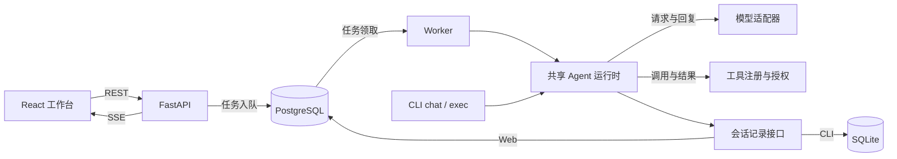

# StellarWeaver

StellarWeaver 是一个以 **React 工作台**为主要入口的本地 Coding Agent。它能分析 Git 项目、执行经批准的修改、运行测试，并交付可审阅和复验的补丁。工作台也支持无项目的普通对话，CLI 则提供终端交互、单次任务和结构化输出。两种入口共用同一个 Python Agent 运行时。

[使用与部署](docs/USAGE.md) · [React 工作台调用链](docs/ARCHITECTURE.md#react-工作台调用链) · [评测记录](docs/EVAL.md)

## 快速开始

### Web 工作台

使用 Docker Compose 和 Linux 容器。首次启动需准备 `.env`、`.stellarweaver/workbench.compose.env`、成员配置和一个带已提交基线的 Git 项目。完成配置后，从 StellarWeaver 仓库根目录执行以下启动命令。 [首次部署配置](docs/USAGE.md#新机器首次配置)

```powershell
$dc = @('--env-file', '.env', '--env-file', '.stellarweaver/workbench.compose.env',
  '-p', 'stellarweaver', '-f', 'deploy/compose.yaml', '-f', 'deploy/compose.workbench.yaml',
  '-f', 'deploy/compose.g5.yaml', '-f', 'deploy/compose.g5-local.yaml')
docker compose @dc up -d --build --wait
```

打开 `http://127.0.0.1:8787/` 并注册或登录。可直接新建普通对话，也可添加 Git 工作区发起只读分析。启用 `SW_WORKBENCH_REPAIR=1` 后，项目任务可经审批修改代码和运行验证。

### CLI 离线演示

从源码运行需要 **Python 3.12+、uv 和 Git**。以下命令同步依赖、检查本地环境并运行 FakeModel 演示。

```powershell
uv sync --locked
uv run --locked --offline stellarweaver doctor --offline
uv run --locked --offline python -m stellarweaver.demo
```

演示在临时 Git 仓库中修改代码、实际执行测试，并根据第一次失败的结果继续修复。成功时 `demo_passed` 为 `true`，`test_exit_codes` 为 `[1, 0]`。

## 工作台功能

| 功能 | 使用方式 |
| --- | --- |
| 工作区与会话 | 从配置的项目目录选择 Git 仓库，设置工作区别名，按项目查看、归档及恢复会话。普通对话单独分组。 |
| 流式运行与审批 | 在原线程继续提问，逐项批准编辑和测试。工作台实时显示回复与工具事件，在结束后折叠工具过程，并保留日志、用量和测试结果。 |
| 隔离验证与补丁交付 | 项目线程在专属 Git worktree 中修改代码。验证命令在一次性 Linux 容器中运行。可按改动块反馈、选块复验，预检当前目标分支后导出补丁到 IDE 应用。 |
| 账号与管理 | 本机使用账号密码登录。团队配置可接入 OIDC，并按项目分配成员权限、额度和审计访问。用量面板支持按日查看，Skills 库支持只读浏览。 |
| 网页搜索 | 选用 DeepSeek Flash 时，模型可按需调用 `ds_search`，来源在对应的执行过程内查看。 |

## Agent 模块设计



### 运行时与模型

CLI 直接调用 `build_agent`，Web 则由 worker 从持久队列领取任务后调用同一入口。Agent 逐轮处理模型回复、工具调用和实际结果，并跟踪模型请求、工具次数、token 与运行时长预算。DeepSeek 默认使用 `deepseek-flash`，启用 Thinking，强度为 `high`。适配器在完整接收工具参数后才交给运行时处理，也支持配置 Chat Completions 兼容端点。FakeModel 可用脚本复现工具回合及失败场景。 [运行时](src/stellarweaver/runtime/loop.py) · [模型适配器](src/stellarweaver/providers/)

### 上下文、工具与权限

模型请求包含当前任务、会话历史、适用的 `AGENTS.md`、工具定义和 Python 仓库索引。默认上下文窗口配置为 100,000 tokens。接近估算上限时，系统压缩过长工具输出和较早的完整工具回合，原始证据保留在会话记录中。文件编辑需通过路径、授权、SHA-256 和唯一文本匹配检查。CLI 的 `/diff` 对照启动基线，`/undo` 可撤销符合条件的内置编辑。 [上下文](docs/ARCHITECTURE.md#上下文与指令) · [工具与权限](docs/ARCHITECTURE.md#工具与权限)

### 会话恢复与扩展

CLI 的 SQLite 和工作台的 PostgreSQL 各自保存消息、工具执行意图、授权、结果和检查点。CLI 支持回放、恢复和导出。Web 刷新后可按 SSE 游标补读，中断后的未确认操作会留给用户核对。CLI 可加载本机 Skills 和配置的 stdio MCP 工具，工作台提供独立的只读 Skills 库。 [会话持久化](docs/ARCHITECTURE.md#会话持久化) · [数据库](docs/DATABASE.md)

## SWE-bench Lite 评测进展

| 范围 | 当前状态 |
| --- | --- |
| 批量适配 | 固定数据集修订和仓库基线，分离公开任务与官方评分资料。支持中断续跑、导出 `predictions.jsonl`，以及使用已有补丁独立评分和重新汇总。 |
| 三题开发集试跑 | Marshmallow 和 Pydicom 的候选补丁通过官方评分，Astroid 的旧尝试因预算用尽而未生成补丁，记为未评分。 |
| 下一步 | 已冻结 23 道 `dev` 的清单，现有 3 道题的执行配方。待补齐其余环境并完成开发集验收，再推进 300 道 `test` 基线和 Harness 消融。 |

[批量评测命令和试跑结果](docs/EVAL.md#swe-bench-lite-批量评测) · [评测实施计划](docs/EVAL_PLAN.md) · [历史 20 题内部评测](docs/archive/00_Sample_Run.md)

## 文档导航

| 文档 | 内容 |
| --- | --- |
| [使用与部署](docs/USAGE.md) | CLI 配置、工作台操作、Docker Compose 和团队账号。 |
| [架构与调用链](docs/ARCHITECTURE.md) · [数据库](docs/DATABASE.md) | 运行流程、执行边界、表结构和迁移。 |
| [实施进度](docs/archive/PROGRESS.md) · [路线图](docs/ROADMAP.md) | CLI M0–M5、Web G0–G5、后续交付与实验验收。 |
| [Harness 差距审计](docs/archive/04_HARNESS_GAP_AUDIT.md) · [归档索引](docs/archive/README.md) | 当前能力对照、原始方案与历史记录。 |

## 常用命令

使用 DeepSeek 前，将 [`.env.example`](.env.example) 复制为仓库根目录的 `.env`，填写 `STELLARWEAVER_API_KEY`。模型、预算与策略可参考[配置模板](stellarweaver.example.toml)。

```powershell
# 与 DeepSeek 进行流式交互
uv run --locked stellarweaver chat --workspace . --provider deepseek --env-file .env --stream

# 只读分析当前项目，输出 JSONL
uv run --locked stellarweaver exec --workspace . --provider deepseek --env-file .env --policy read-only --json --prompt "梳理项目入口和核心调用链，给出文件路径与行号。"

# 查找现有 CLI 会话，查看 SWE-bench Lite 批量入口
uv run --locked stellarweaver sessions list
uv run --locked --offline python -m stellarweaver.evals.swebench --help
```
