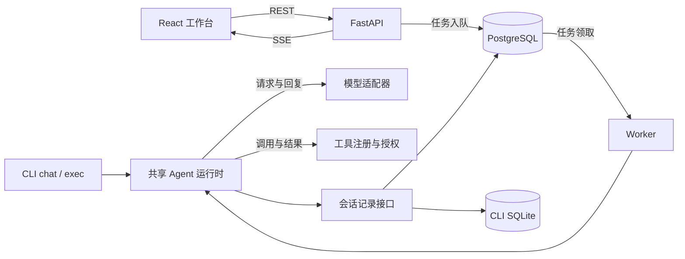

# StellarWeaver

StellarWeaver 是一个本地 Coding Agent，可以阅读 Git 项目、执行经授权的代码修改、运行测试并交付可审阅的补丁。命令行和浏览器工作台共用同一个 Python Agent 运行时。配置密钥后可使用 DeepSeek `deepseek-flash`，离线演示和测试使用可脚本化的 FakeModel。

[使用与部署](docs/USAGE.md) · [架构与调用链](docs/ARCHITECTURE.md) · [验证与实验](docs/VALIDATION.md)

## 快速开始

从源码运行需要 **Python 3.12+、uv 和 Git**。可选安装 `rg`，缺少时使用 Python 搜索。

```powershell
uv sync --locked
uv run --locked stellarweaver doctor --offline
uv run --locked --offline python -m stellarweaver.demo
```

演示在临时 Git 仓库内完成两次编辑，并在每次编辑后运行真实测试。第一次测试失败，Agent 根据结果修正代码并重跑。输出中 `demo_passed` 为 `true`，`test_exit_codes` 先后为 `1` 和 `0`。

## Agent 模块设计

StellarWeaver 把模型调用、工具执行和运行记录连成一个循环。CLI 在终端进程里直接装配 Agent，Web 把任务写入 PostgreSQL，由后台 Worker 调用同一个装配入口。两种入口因此共用模型协议、工具验证和预算控制。



### 入口与 Agent 运行时

CLI 的 `chat` 保留交互状态，可以多轮追问和处理审批。`exec` 执行单个任务，适合脚本调用和 JSONL 输出。入口负责读取工作区配置、选择模型和授权策略，再把这些依赖传给 `build_agent`。运行时准备模型请求，收到回复后记录助手消息和计划执行的工具。工具结果按调用 ID 匹配并写回上下文，下一轮模型可以根据代码、差异或真实测试输出决定后续动作。模型请求数、工具次数、token 和运行时长都有预算。 [CLI](src/stellarweaver/cli.py) · [运行时](src/stellarweaver/runtime/loop.py) · [领域类型](src/stellarweaver/domain/__init__.py)

### 模型适配与上下文

模型适配器把内部消息和工具定义转换成 Chat Completions 请求，聚合流式文本及分片的工具参数，再把完整回复交给运行时。DeepSeek 和 OpenAI 兼容服务通过适配器接入。FakeModel 可以按脚本产生回复和工具调用，便于用同一执行链路复现成功、失败和授权阻断。 [模型适配器](src/stellarweaver/providers/)

每次请求前，上下文模块组合当前任务、会话历史、适用的 `AGENTS.md`、工具定义和 Python 仓库索引。默认窗口配置为 100,000 tokens，触及本地估算阈值时，会缩短过长的工具输出，并按完整工具回合压缩旧历史。原始消息保留在会话记录中，压缩后的证据和覆盖位置写入检查点。 [上下文](src/stellarweaver/context/) · [项目指令](src/stellarweaver/instructions/)

### 工具、权限与改动管理

工具层提供文件枚举、读取、搜索、新建和精确编辑，以及命令执行、Git 状态和差异查询。注册表先校验参数并解析工作区路径，再由策略决定放行、请求审批或阻断。一次精确编辑会重新核对目标文件的 SHA-256，并要求旧文本唯一匹配。这样可以把并发改动和重复匹配报告为明确的冲突。CLI 的获准命令使用当前用户的宿主权限，Web 修复中的验证命令交给专用执行器。 [工具注册表](src/stellarweaver/tools/registry.py) · [权限策略](src/stellarweaver/policy/)

`ChangesManager` 记录 CLI 启动时的 Git 状态，用它区分原有改动和会话中的变更。`/diff` 可以查看会话新增的变化，`/undo` 依据操作记录、文件哈希和备份回退符合条件的内置编辑。 [改动管理](src/stellarweaver/changes/)

### 会话记录、恢复与扩展

CLI 用 SQLite 保存消息、工具授权、执行意图、结果和检查点，Web 通过 PostgreSQL 实现同一个会话记录接口。写入类操作先记录意图，再执行并保存结果。中断后，文件操作可以用改动前后的哈希核对，已启动但结果未知的命令会保留为待核对项。CLI 提供回放、恢复和导出，Web 提供原线程追问和按事件游标补读。 [会话存储](src/stellarweaver/session/) · [Web Journal](src/stellarweaver/web/journal.py)

CLI 可以按需加载 Skills，并把已配置的本地 stdio MCP 工具注册到同一个权限流程。Web 侧栏的 Skills 库提供本机技能目录和正文的只读浏览。 [CLI 扩展](src/stellarweaver/extensions/) · [Web Skills 库](src/stellarweaver/web/skills.py)

### Web 工作台、执行隔离与补丁交付

React 负责账号登录、项目切换、线程管理、流式回复和审批交互。FastAPI 校验租户、成员与工作区权限，把运行持久化到队列，并通过 SSE 把事件传回浏览器。Worker 领取任务后装配 Agent，同一项目线程的追问可继续使用对应工作区。普通对话沿用会话和模型链路，并关闭项目工具。PostgreSQL 还保存模型用量与成员操作审计。 [前端](frontend/src/) · [API](src/stellarweaver/web/app.py) · [Worker](src/stellarweaver/web/worker.py)

一次 Web 修复从 Git 基线建立独立 worktree。用户批准编辑或测试后，Agent 修改该 worktree，验证执行器将工作区快照送入一次性 Linux 容器运行允许的命令。运行结束后，工作台展示文件差异、测试退出码和验证证据。用户可以选择改动块，在新的独立工作区里应用选中补丁并复验，再下载结果。 [任务隔离](src/stellarweaver/web/isolation.py) · [交付报告](src/stellarweaver/web/delivery.py) · [补丁复验](src/stellarweaver/web/execution.py)

### 验证与评测

Agent 的运行终态、常规测试结果和独立评分各自记录。固定 20 题的评测入口根据改动范围、测试行为和文件证据判定结果，也可以对已保存的运行和工作区重评分。SWE-bench Lite 单题试跑还提供按需开启的缺陷复现检查，正式评分使用独立环境。 [评测手册](evals/README.md) · [验证与实验](docs/VALIDATION.md)

## 启动 Web 工作台

本机部署需要 Docker Compose 和 Linux 容器。首次使用时，按[部署指南](docs/USAGE.md#新机器首次配置)准备 `.env`、本机 Compose 配置和初始 Git 工作区。配置完成后，从仓库根目录启动。

```powershell
$dc = @('--env-file', '.env', '--env-file', '.stellarweaver/workbench.compose.env',
  '-p', 'stellarweaver', '-f', 'deploy/compose.yaml', '-f', 'deploy/compose.workbench.yaml',
  '-f', 'deploy/compose.g5.yaml', '-f', 'deploy/compose.g5-local.yaml')
docker compose @dc up -d --build --wait
```

默认入口为 `http://127.0.0.1:8787/`。登录后可开始普通对话，或添加 Git 工作区后发起只读分析和审批式修复。

## 文档导航

[完整文档](docs/README.md) · [数据库](docs/DATABASE.md) · [历史评测结果](evals/RESULTS.md) · [路线图与 Harness 对照](docs/ROADMAP.md) · [开发指南](CONTRIBUTING.md)

## 常用命令

使用 DeepSeek 前，首次配置时将 [`.env.example`](.env.example) 复制为仓库根目录的 `.env`，填写 `STELLARWEAVER_API_KEY`。可从 [配置模板](stellarweaver.example.toml) 开始设置本机模型、预算与策略。

```powershell
# 与真实模型交互
uv run --locked stellarweaver chat --workspace . --provider deepseek --env-file .env --stream

# 只读分析项目并输出 JSONL
uv run --locked stellarweaver exec --workspace . --provider deepseek --env-file .env --policy read-only --json --prompt "梳理项目入口和核心调用链，给出文件路径与行号。"

# 查看已保存的 CLI 会话和运行离线评测
uv run --locked stellarweaver sessions list
uv run --locked --offline python -m stellarweaver.evals run --provider fake
```
