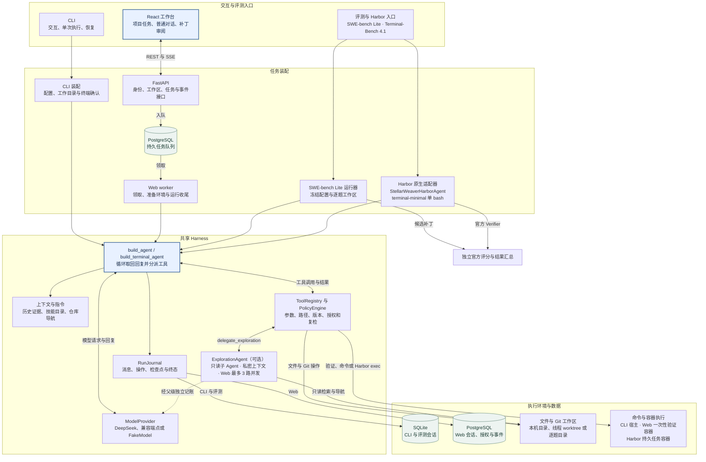
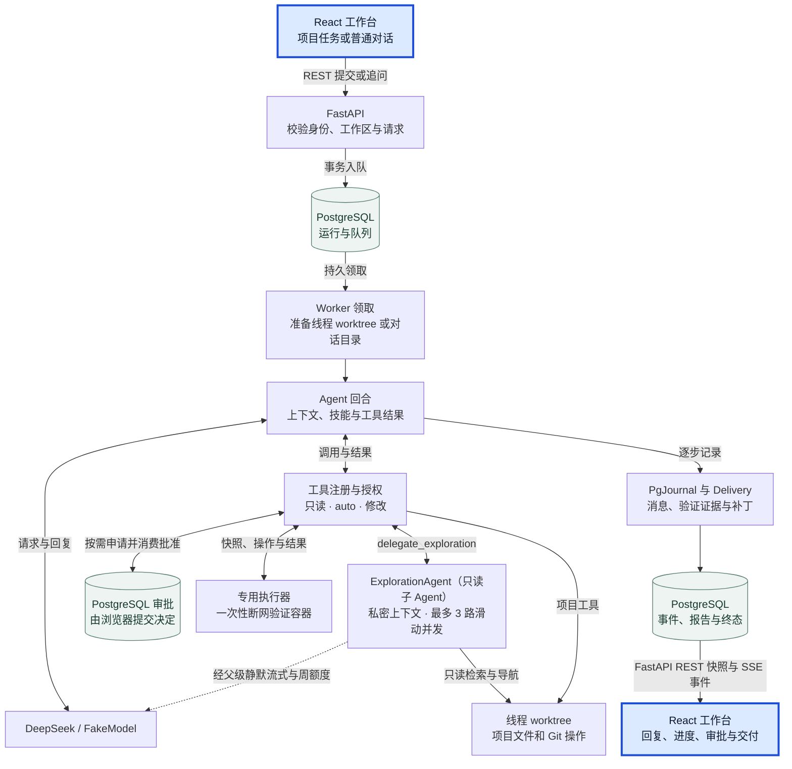
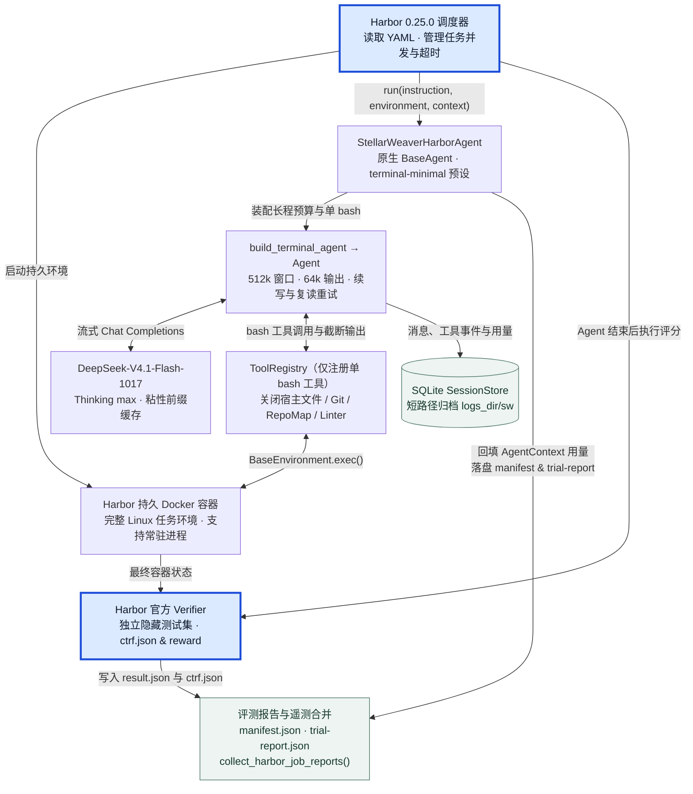
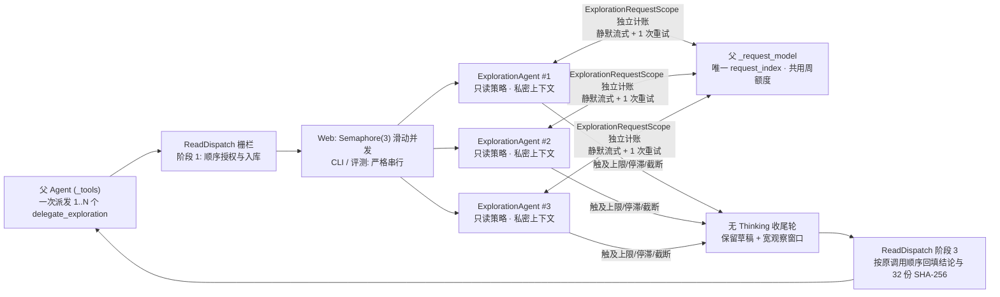
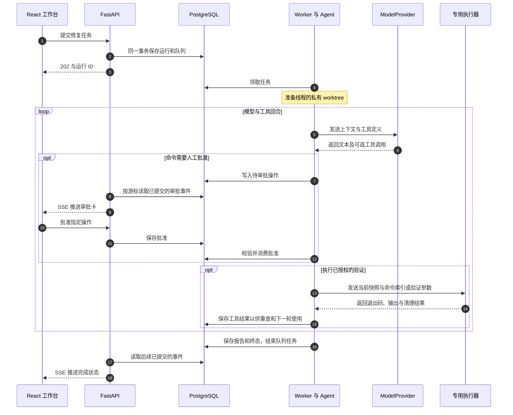

# StellarWeaver 整体架构

StellarWeaver 由交互入口、任务装配、共享 Harness、执行环境和持久化组成。CLI 直接在终端进程运行 Agent。Web 的 FastAPI 受理任务并持久入队，worker 领取后装配同一套运行时。独立评测可用相同的 Agent 和工具产生候选，独立评分器再读取冻结的补丁和评分资料。本文以当前仓库实现为准。 [实施进度与验收](HARNESS_ACCEPTANCE.md#当前实现进度核对)

装配层为每种入口选择模型、权限、上下文配置和 Journal。CLI、Web 与 SWE-bench Lite 经 `build_agent` 装配完整工具面；Terminal-Bench 4.1 经 Harbor 原生适配器调用 `build_terminal_agent` 装配极简 `terminal-minimal` 单 `bash` 运行时，共享同一套 `Agent` 主循环、上下文压缩与流式容错引擎。图中的 Web 任务队列和会话事件由同一个 PostgreSQL 实例保存；评测入口分别通过 SWE-bench 独立评分器或 Harbor 官方 Verifier 产出可核验裁决。

## React 工作台调用链

本机 Compose 中，React 通过 REST 提交任务、回传审批或请求取消，通过 SSE 接收持久化事件。下图从接单走到界面回显。图中的队列、审批和运行记录对应同一 PostgreSQL 实例中的不同数据。实验看板通过独立的只读接口读取已发布报告。

1. **提交。** React 提交提示词、工作区、模式、技能引用和请求 ID。已有线程会带上会话 ID。API 返回的新运行 ID 用于查快照、订阅事件和之后的交付操作。
2. **领取。** worker 从数据库领取任务，根据工作区种类选择私有 Git worktree 或普通对话目录。该轮保存的窗口配置随领取结果传入运行时。
3. **循环。** 模型回复触发工具调用。注册表核对实际工具参数和权限；需要批准时，worker 等待数据库中的决定。启用只读探索时，`delegate_exploration` 可由最多 3 路并发的 `ExplorationAgent` 在线程 worktree 内完成只读检索，经父级独立记账并产生 `exploration.*` 事件。执行结果写入 Journal，并按工具调用 ID 回给模型。
4. **回传。** FastAPI 从数据库读取已提交的事件。React 通过 REST 获取运行快照，按事件序号拼接 SSE 进度，完成后按需读取验证及改动报告。 [任务提交](../frontend/src/main.tsx) · [工作台 API](../src/stellarweaver/web/app.py) · [Worker](../src/stellarweaver/web/worker.py)

## Terminal-Bench 4.1（Harbor）调用链

Terminal-Bench 4.1 评测由 Harbor 0.25.0 统一编排任务容器与官方独立 Verifier，StellarWeaver 以原生 `BaseAgent` 接入并挂载极简 `terminal-minimal` 单 `bash` 运行时。整条链路复用共享 `Agent` 主循环、粘性前缀压缩与长程容错机制，同时严格不向容器暴露宿主机文件或 Git 工具。

1. **调度与持久容器。** Harbor 根据任务清单（如 [harbor-tb41-smoke5.yaml](../deploy/harbor-tb41-smoke5.yaml)）拉起对应任务的持久 Linux Docker 容器，并在整题生命周期内保持容器状态（支持安装依赖、编译构建与后台守护进程保活），随后将 `instruction`、`environment` 与 `context` 交给 `StellarWeaverHarborAgent`。
2. **极简装配与长程主循环。** 适配器加载 `long_horizon_deepseek_flash(harness_profile="terminal-minimal")` 预设（`512k` 上下文窗口、`64k` 单次输出、`2,000,000` 累计输出上限、`300` 次工具调用、`3600s` 墙钟与 `max_retries=5`），经 `build_terminal_agent` 构造 `Agent`。此路径刻意关闭宿主机文件/Git 工具、`RepoMap`、`InstructionLoader`、`ChangesManager` 与 `run_linter`，仅保留单个容器 `bash` 工具以压缩 Preamble 并维持高 Prefix Cache 命中率（5 题实测 `96.38%`）；同时完整保留 `sticky_context_checkpoint`、`calibrated_context_budget`、`length` 安全续写、双级失败软引导与 `reasoning_content` 滑动窗口复读检测。
3. **单 `bash` 委托与短路径归档。** 每次 `bash` 调用由 `TerminalExecutor` 委托给 Harbor 的 `BaseEnvironment.exec()` 在持久容器内执行，自动注入非交互环境变量（`DEBIAN_FRONTEND=noninteractive`、`GIT_TERMINAL_PROMPT=0`、`PIP_NO_INPUT=1`、`CI=true`）并支持单命令最长 `1800s` 超时；会话明细写入短路径 `logs_dir/sw/`（规避 Windows `MAX_PATH` 限制），即使触发外层 `asyncio.CancelledError` 也会先落盘已采集遥测再向上传播。
4. **独立官方 Verifier 与指标合并。** Agent 结束后（无论是 `model finished` 还是触及超时/预算上限），Harbor 在同一容器终态上运行官方独立 Verifier 生成 `verifier/ctrf.json` 与 `result.json`（含 `reward`）；StellarWeaver 仅对 `model.completed` 事件聚合缓存与费用写入 `trial-report.json`（零字节断连不虚扣输出预算），并由 `collect_harbor_job_reports()` 合并官方裁决与 Harness 遥测。 [Harbor 原生适配器](../src/stellarweaver/evals/terminal_bench.py) · [容器终端工具](../src/stellarweaver/tools/terminal.py) · [Terminal-Bench 4.1 冒烟报告](TerminalBench4Eval.md)

## 模块职责

| 模块 | 主要职责 | 源码入口 |
| --- | --- | --- |
| [CLI 和配置](#cli-和配置) | 将终端参数、工作目录和配置装配为一次运行。 | [cli.py](../src/stellarweaver/cli.py)、[config.py](../src/stellarweaver/config.py) |
| [领域与运行时](#领域与运行时) | 推进模型与工具回合，管理硬预算、修复反馈和终态。 | [domain/](../src/stellarweaver/domain)、[runtime/](../src/stellarweaver/runtime) |
| [只读子 Agent 探索](#只读子-agent-探索) | 私密只读上下文、3 路滑动并发、独立计账、停滞收敛与无 Thinking 收尾抢救。 | [exploration.py](../src/stellarweaver/runtime/exploration.py)、[loop.py](../src/stellarweaver/runtime/loop.py) |
| [模型](#模型) | 转换 Chat Completions 请求，聚合流式回复，提供离线响应。 | [providers/](../src/stellarweaver/providers) |
| [上下文与指令](#上下文与指令) | 组装历史、项目指令、Python 仓库导航与本轮证据。 | [instructions/](../src/stellarweaver/instructions)、[context/](../src/stellarweaver/context) |
| [工具与权限](#工具与权限) | 解析参数，核对路径、版本和授权，执行并返回可审计结果。 | [tools/](../src/stellarweaver/tools)、[policy/](../src/stellarweaver/policy) |
| [CLI 改动管理](#cli-改动管理) | 保存启动基线，归类差异，按证据撤销内置修改。 | [changes/](../src/stellarweaver/changes) |
| [扩展](#扩展) | 发现与加载 Skills，管理本地 stdio MCP 工具。 | [extensions/](../src/stellarweaver/extensions) |
| [会话持久化](#会话持久化) | 保存消息、工具状态、检查点和终态，提供中断证据。 | [session/](../src/stellarweaver/session)、[web/journal.py](../src/stellarweaver/web/journal.py) |
| [Web 前端与 API](#web-前端与-api) | 管理身份、工作区、线程和交互，以 REST 与 SSE 连接浏览器和后台。 | [frontend/src/](../frontend/src)、[web/app.py](../src/stellarweaver/web/app.py) |
| [Web 调度与交付](#web-调度与交付) | 持久入队、领取、审批、取消、测试证据和补丁审阅。 | [web/db.py](../src/stellarweaver/web/db.py)、[web/worker.py](../src/stellarweaver/web/worker.py) |
| [Web 执行环境](#web-执行环境) | 创建线程 worktree，传输受控快照，运行和清理验证容器。 | [web/isolation.py](../src/stellarweaver/web/isolation.py)、[web/broker.py](../src/stellarweaver/web/broker.py) |
| [评测与实验看板](#评测与实验看板) | 固定输入、执行与官方评分，核对证据和可比性，读取已发布报告。 | [evals/](../src/stellarweaver/evals)、[实验报告读取](../src/stellarweaver/web/experiment_records.py)、[看板](../frontend/src/experiment.tsx) |

### CLI 和配置

`cli.py` 以 Typer 接收命令。`exec` 为一次任务装配运行时，`chat` 将多次输入接到同一交互会话，`resume` 打开并协调已有 SQLite 会话。`sessions list`、`replay` 和 `export` 走存储的只读查询。`ui/` 负责输入、格式化和终端确认，Agent 通过事件与文本回调返回执行进度。

配置分三步进入运行。`load_config` 读取显式路径或工作区中的 `stellarweaver.toml`，缺省时使用 `AppConfig`。Pydantic 检查未知字段、窗口与输出上限、命令超时等字段关系。`effective_config` 应用用户传入的 provider、策略和流式覆盖项。`SessionStore.set_config` 保存公开配置供核对。执行 `resume` 时，CLI 先从原会话取得工作区，再按当次参数和该工作区配置重新装配。

凭据采用独立读取路径。`get_api_key` 优先取已配置的进程环境变量，其次读取指定 dotenv 文件，缺省时从启动目录、再按规则从工作区选择 `.env`。配置快照记录环境变量名称，Provider 则单独接收密钥值。`execute_task` 建立 Journal、模型和终端回调后调用 `build_agent`，运行结束后把 `RunOutcome` 转换为终端状态与退出码。例如 `blocked` 返回 `3`，`budget_exceeded` 返回 `4`。开启验证失败退出选项后，流程正常结束但检查失败时返回 `5`。 [配置实现](../src/stellarweaver/config.py) · [CLI 入口与退出码](../src/stellarweaver/cli.py) · [终端 UI](../src/stellarweaver/ui)

### 领域与运行时

领域类型是 SDK、界面和数据库之间的共同数据格式。Provider 返回 `AssistantReply`，里面有可见文本、工具调用、停止原因和用量。运行时再把它转换为 `Message`、持久化操作和事件，供下一轮模型请求、回放或前端显示。以下标识承担不同用途。

| 数据或标识 | 用途 |
| --- | --- |
| `workspace_id` | Web 的项目或普通对话工作区标识。项目路径与访问范围由 API 和 worker 各自核对。 |
| `session_id` | 标识一条会话线程。Web 项目线程的私有 worktree 由租户和该 ID 定位。 |
| `run_id` | 标识线程内的一次运行。提交新任务、追问或撤销时创建新运行，刷新页面仍查询原 ID。 |
| `request_id` | 浏览器生成的重试标识。服务端在成员范围内去重，客户端可重试相同任务而复用运行。 |
| `ToolCall.call_id`、`Message.tool_call_id` | 将模型发出的某个工具调用与返回给模型的工具消息配对。 |
| `ToolResult.operation_id` | 定位本机记录中的一次操作，用于查找授权、写入前状态、结果和制品。 |
| `AgentEvent.seq` | 按事件顺序定位会话记录。Web 用它作为 SSE 补读游标。 |
| `RunOutcome` | 保存运行终态、验证状态、证据、计量和回复。CLI 运行时将 `task_assessment` 保持为 `unknown`，独立评测随后按任务规则判定。 |

`build_agent` 是公共装配点。它用 Journal 的工作区创建 `PolicyEngine` 和 `ToolRegistry`，再把模型、边界配置、审批回调、可选的命令执行器和通知回调交给 `Agent`。CLI 将审批连接到终端，Web 用 `ApprovalGate` 处理策略判定需要审批的操作。开发工具、导航、补丁暂存、修复反馈、任务证据和预算提示分别受配置控制。普通对话用 `chat_only` 关闭仓库工具与仓库上下文。 [公共装配点](../src/stellarweaver/runtime/service.py) · [Web 配置映射](../src/stellarweaver/web/execution.py)

主循环 `_drive` 用当前工具清单和上下文发起模型请求。取得完整回复后，先检查工具调用 ID，再通过 Journal 保存助手消息及计划操作。`_tools` 默认按回复顺序串行分派工具；启用 `parallel_read_tools` 时，对连续的内置只读工具（`list_files`、`read_file`、`search_text`、`find_symbol`、`find_references`、`find_related_tests`、`git_status`、`git_diff`、`git_log`、`git_show`）以 `ReadDispatch` 三阶段栅栏最多 4 路并发执行——先按原顺序完成准备、授权与 `tool.started` 入库，再并发执行 I/O，最后严格按原顺序运行 `PostToolUse`、持久化结果并追加 `tool` 消息；遇到写操作、命令、远程 MCP 或需交互审批时立即回退串行。启用 `subagent_exploration` 时，主循环开放只读工具 `delegate_exploration`，由独立的 `ExplorationAgent` 在私密上下文内完成只读检索（Web 模式下配合 `parallel_read_tools` 最多 3 路滑动并发，默认安全熔断 20 次模型调用 / 60 次工具调用 / 300 秒 / 连续 3 轮停滞；CLI 与评测严格受父级剩余预算约束），子请求采用静默流式与单次重试、按 `ExplorationRequestScope` 独立记账并共用父任务及 Web 周额度，触及边界或截断时通过关闭 Thinking 的收尾轮（保留截断草稿与宽观察窗口）回传结构化结论与最多 32 份 `{path, sha256}` 证据。遇到取消、预算耗尽或无法确认的执行状态时，已声明但未执行的调用记录相应的跳过或取消结果。完成所有工具关联后，运行时才组装下一次请求。 [领域类型](../src/stellarweaver/domain/__init__.py) · [主循环](../src/stellarweaver/runtime/loop.py) · [只读探索委派](../src/stellarweaver/runtime/exploration.py)

例如，模型为修复 `calc.py` 请求读取文件，获取源码和当前 SHA-256 后再提交精确替换。编辑完成后，它可以请求登记的测试。若退出码为 1，带退出码的工具结果交给模型，模型可根据失败位置修改后执行同一项检查。最终回答由模型生成，代码和测试证据来自实际执行工具。

运行结束与验证通过是两项状态。`_finish` 按命令和工作目录保留最新检查；一次成功的内置写入会清除前一版本的有效检查。模型发出结束回复可以让运行达到 `completed`，验证字段仍取决于真实工具结果。Web 交付层另按快照细化检查的新鲜度。

启用修复控制器后，工具失败按断言、依赖、语法或运行时错误、补丁冲突、权限、超时和基础环境等类别归纳。控制器结合当前候选指纹、操作和失败签名统计重复失败，把诊断和建议写入 Journal，并提供给下一轮模型请求。`feedback` 仅提供建议；`enforce` 与主循环的重复失败熔断共享可配置的双级阈值（`repeated_failure_soft_threshold` / `repeated_failure_hard_threshold`，基线默认 `3/3`，`full` 与长程预设为 `3/6`）。当达到软阈值且尚未触发硬停机时，运行时直接将诊断提醒拼接在当前 `tool` 结果文本尾部并记录 `repair.soft_guidance`（不插入额外 `user` 消息，避免打断 DeepSeek Thinking 回合连续性）；达到硬阈值后停机。`benchmark_allow_denied_tool_continue` 仅在 `policy.preset == "benchmark"` 下允许模型在工具被策略拒绝后继续调整策略，交互式 `ask`/`auto` 模式下用户显式拒绝仍立即以 `blocked` 停机。主循环还支持可配的 `length`/`max_tokens` 安全续写（`max_length_continuations`，`full` 与长程预设为 `3`）：对截断且参数 JSON 不完整的 `tool_calls` 严禁执行并整组丢弃；对纯思考耗尽输出上限（无可见文本且无工具调用）写入极短非空占位助手消息并记录 `model.truncated_thinking` 后续写，确保严格的 Role 交替与零空助手消息。 [修复控制器](../src/stellarweaver/runtime/repair.py) · [运行时接入](../src/stellarweaver/runtime/loop.py)

### 只读子 Agent 探索

启用 `subagent_exploration` 后，主循环向父 Agent 注册 `delegate_exploration` 工具，用于将大范围代码检索和跨模块架构调研委派给独立的 `ExplorationAgent`，避免海量中间读取撑爆父上下文，同时保证所有写入、审批和撤销仍由唯一父 Agent 统一收口。

1. **三层只读隔离。** 子 Agent 强制绑定 `PolicyEngine("read-only")`、独立的内存 `ExplorationJournal`，并且 `builtins=False` 仅注册 `list_files`、`read_file`、`search_text` 与 Python 导航工具（`find_symbol`、`find_references`、`find_related_tests`），不暴露任何写文件、命令执行、MCP 或嵌套委派工具。子 Agent 内部继承父级的 `parallel_read_tools`、`navigation_prefilter`、`import_aware_repomap` 与上下文校准/压缩配置。
2. **3 路滑动并发与保序回填。** 当 `parallel_read_tools=True` 且 `enforce_run_budget=False`（Web 模式）时，同一轮内连续的 `delegate_exploration` 调用进入专用并发组（不与 `read_file` 等本地快工具混用屏障），通过 `asyncio.Semaphore(3)` 滑动并发执行——任意子任务结束后下一个排队任务立即补位，且排队等待不扣除其 `timeout`；全部完成后按原调用顺序写入 `tool.completed` 并回填父上下文。CLI 与 SWE-bench 评测（`enforce_run_budget=True`）保持串行以保证冻结预算零竞态。
3. **独立计账与预算继承。** 父循环用单调 `_request_sequence` 在 `model.started` 前原子分配 `request_index`，每次子请求通过专属 `ExplorationRequestScope` 精确记录自身的 `model_calls`、`input_tokens`、`output_tokens`，彻底避免并发串账，同时所有消耗实时计入父任务与 Web 成员周额度账本。Web 模式受可配安全熔断约束（默认 `20` 次模型调用、`60` 次工具调用、`300s`、连续 `3` 轮停滞，见 `SW_WEB_EXPLORATION_*`）；CLI 与评测同时受父级冻结剩余预算与子级熔断较小值约束。
4. **静默流式、停滞检测与无 Thinking 收尾抢救。** 子请求复用流式消费但 `emit_deltas=False`（不污染父级流式输出），并允许 1 次可重试错误的退避重试。停滞检测按 `(tool_name, 规范化完整参数)` 判重（同一大文件的不同行范围分页读取视为推进），连续达到阈值或全返回 `error`/`denied` 时转入收尾。无论触及熔断、停滞、输出 `length` 截断，还是已有有效观察后的 `exploration_failed`，子 Agent 都会执行一次 `disable_thinking=True` 的无工具收尾轮，带入已写出的截断草稿与最高 `(48, 4000, 4096)` 宽度的观察记录，快速输出约 1500–2500 字结构化结论与最多 32 份文件 SHA-256。
5. **全链路事件与工作台透明展示。** `exploration.started` 携带 `goal` 与 `paths`，`exploration.tool` 携带具体 `tool_name` 与状态，`exploration.completed` 携带 `completion_status`（`completed`/`partial`/`cancelled`）、`stop_reason` 与用量；三类事件均经 `public_event()` 投影至 SSE，前端在执行过程直接展示启动任务描述、结果路径标签，并将连续 `>= 3` 次模型请求自动折进可实时刷新计数的小折叠栏。 [子 Agent 实现](../src/stellarweaver/runtime/exploration.py) · [并发与计账](../src/stellarweaver/runtime/loop.py) · [工作台展示](../frontend/src/conversation.tsx)

### 模型

`ModelProvider` 公开 `capabilities`、`complete` 和 `stream`，让运行时先检查是否支持工具、流式和上下文窗口。`OpenAICompatibleChatProvider` 将领域消息转换为 Chat Completions 输入，保留原始工具参数和结果 ID。适配器为 DeepSeek 显式发送 `thinking` 和启用时的 `reasoning_effort`，CLI 与 Web 默认使用 `enabled`、`high`。

DeepSeek Thinking 的工具对话需要回传保留轮次的 `reasoning_content`，其中包括有工具调用和无工具调用的助手回复。流式和非流式路径将这部分数据留在进程内。持久化、导出和文本增量只保留公开内容。预算压缩整体保留或移除助手及其工具结果。跨进程续接缺少原始推理时，运行时以历史回复和工具证据生成模型上下文，并移除已归纳的旧助手及工具消息。Journal 仍保存可供核对的回复和工具记录。 [DeepSeek Thinking 协议](https://api-docs.deepseek.com/guides/thinking_mode/)

流式响应经过 `ChatCompletionAccumulator`。文本片段可在到达时以 `text.delta` 通知界面。工具片段按索引合并 ID、函数名和参数，聚合器核对完成标记、工具 ID 与资源上限，随后提交完整的 `AssistantReply`。工具执行位于聚合之后。启用 `stream_repetition_detection` 后，聚合器仅对 `reasoning_content` 尾部执行低开销滑动窗口复读检测（不监控可见 `content` 或 `tool_calls`，防止误杀重复代码/表格），命中保守连续重复阈值时抛出可重试的 `ProviderError(retryable=True, partial_stream=True)`，复用 `model.interrupted` 与退避重试链路，并受每轮 `stream_repetition_max_retries`（默认 `2`）上限约束。部分流中断时，事件可记录已经显示的片段，当前不完整回复不会进入工具执行阶段。Provider 能力或用户配置关闭流式时，Agent 使用一次非流式请求。

重试由 Agent 管理（`RetryConfig.max_retries` 最高 `8`、`max_delay_seconds` 最高 `120s`，`ModelConfig.request_timeout_seconds` 最高 `900s` 且 DeepSeek Thinking 默认 `240s`；配置模块另提供 `long_horizon_deepseek_flash()` 长程预设工厂）。一次 HTTP 尝试计入一次模型请求，可重试的网络故障或限流使用退避和 `Retry-After`，入口已配置累计预算时还检查剩余量。遇到服务端上下文长度错误时，运行时尝试以约 70% 的有效窗口重新投影，投影缩小后可再次请求一次。重试复用原有工具结果。用量优先取服务端返回值，缺失或未完整返回时记录估算和不完整标记。`FakeModel` 使用固定回复、JSON 脚本或回调生成同样形状的回复，用于离线验证工具和状态流转。 [Provider 接口](../src/stellarweaver/providers/base.py) · [协议适配](../src/stellarweaver/providers/openai_compatible.py) · [流式聚合](../src/stellarweaver/providers/streaming.py) · [离线模型](../src/stellarweaver/providers/fake.py)

### 上下文与指令

`Agent._prepare_context` 在每次请求前组合系统提示、用户任务、历史、工具 schema、适用的 `AGENTS.md`、扩展目录和 repo map。历史记录是持久数据，发送给 Provider 的上下文由 `ContextManager` 按当前预算重新生成。

- **指令加载。** `InstructionLoader` 按工作区根和已操作路径的祖先目录加载 `AGENTS.md`，记录来源、范围和文件哈希。准备修改时，`_before_execute` 根据目标路径判定模型是否已看到适用指令。用户批准后，`_after_authorize` 再检查一次指令指纹。等待期间指令变动会以 `INSTRUCTIONS_UPDATED` 返回，让下一轮先看到新增要求，再决定操作。
- **仓库索引。** `RepoMap` 在工作区文件约束下枚举候选路径，以 Python AST 提取函数、类、签名和行号。显式路径、曾访问位置和关键词影响排序；启用 `import_aware_repomap` 后，还会对当前相关文件的直接导入方与被导入方加权，提高邻居模块进入预算窗口的召回。索引按预算截取，提供下一步搜索和读文件的线索。实际文件内容由工具读取，编辑依据最新文件哈希执行。
- **问题驱动导航。** 启用后，`IssueSignals` 从任务提取路径、符号、异常和测试线索，辅助 Repo Map 排序。`find_symbol`、`find_references` 和 `find_related_tests` 通过 Python AST 查找定义、静态引用和相关测试，返回路径、行号、SHA-256、耗时和覆盖状态。启用 `navigation_prefilter` 后，超过 100 个 `.py` 文件的仓库先按目标符号名全仓库字节预筛（并通过 `NavigationSources` 按文件元数据指纹做有界缓存复用），再对命中文件执行 AST 解析。动态绑定和扫描范围之外的关系仍存在不确定性。 [Python 导航](../src/stellarweaver/context/navigation.py)
- **窗口计算与动态校准。** DeepSeek Thinking 默认从 200,000 token 窗口中预留 16,384 token 输出和 2,048 token 安全余量，估算输入额度为 181,568 token。其他 provider 和 Non-thinking 默认预留 4,096 token 输出。工具 schema 同样占用窗口。基础计量采用保守的 UTF-8 JSON 字节估算；启用 `calibrated_context_budget` 后，运行时取最近 6 个有效服务端 `prompt_tokens` 样本的最大换算率乘 1.05（钳位到 `[0.30, 1.0]`）动态校准估算系数，显著降低过早压缩。启用 `pipeline_metrics` 时，`model.completed` 额外记录估算误差比。
- **历史压缩与粘性前缀。** 默认在估算输入达到可用额度的 80% 时尝试压缩，目标为 55%。系统消息和最新用户任务优先保留。常规压缩保护最近六个完整助手回合及最近六个完整工具回合。启用 `smart_tool_truncation` 后，超长工具输出按 35% 头部 + 65% 尾部保留（并为 `stdout`/`stderr` 各自留额），避免丢失末尾的 `FAILED` 与断言堆栈；启用 `protect_fresh_tool_output` 时，最近 `fresh_tool_rounds`（默认 2）轮工具输出全文逐字节保留；启用 `sticky_context_checkpoint` 后，压缩后的历史前缀检查点保持固定，可变证据作为请求后缀更新，减少重复压缩并提升前缀缓存稳定性。用于下一次模型请求的工具调用和对应结果始终成组处理，原始消息仍由 Journal 完整保存。 [压缩配置](../src/stellarweaver/config.py) · [上下文投影](../src/stellarweaver/context/manager.py)
- **任务证据与软收敛提醒。** 运行内可选投影从工具结果提取路径、文件哈希、测试状态和暂存补丁引用（覆盖 `edit_file`、`create_file` 与按 `files` 展开的 `apply_patch` 增删改）。每条保留事件序号和操作 ID，准备请求时重新核对文件状态。启用 `soft_test_failure_reminder` 时，在当前编辑指纹下按 `(tool_name, target, selector, keyword)` 追踪未解决失败测试集合；若模型在 `completion_check` 关闭时试图直接结束且仍有未复测通过的失败测试，主循环最多注入 1 次 `convergence.reminder` 轻量提醒（防止死循环）。Web 的跨轮证据由 PostgreSQL Journal 另行投影，按当前 worktree 标注文件及检查是否仍适用。 [运行内证据](../src/stellarweaver/runtime/task_evidence.py) · [跨轮证据](../src/stellarweaver/web/continuation.py)

窗口约束单次模型请求。CLI 的 `LimitsConfig` 默认约束每次运行的模型调用、工具调用和总时长，分别为 30 次、100 次和 900 秒，累计输入和输出分别为 1,000,000 与 30,000 token。独立评测用冻结的运行配置。启用总预算约束的运行可生成阶段余量提示。Web 用单次模型窗口、操作自身超时和账户 UTC 周额度控制运行，累计调用和用量仍写入 Journal。 [历史投影](../src/stellarweaver/context/manager.py) · [运行预算](../src/stellarweaver/runtime/loop.py) · [Web 装配](../src/stellarweaver/web/execution.py)

### 工具与权限

`ToolRegistry` 把一个工具定义为名称、参数 schema 和准备函数。注册表生成模型可见的工具清单。实际收到 `ToolCall` 后，`dispatch` 再进行 JSON 与参数验证。准备函数返回 `PreparedTool`，其中包含供授权判断的调用描述、实际执行函数和可选复检。将准备和执行分开后，CLI 与 Web 都可以先展示准确的目标路径、命令或补丁，再决定是否执行。

执行顺序为「参数校验 → 必要的工作区写锁 → 强制边界与风险评估 → 指令检查与可信 Hook → 策略及审批 → 目标与能力复检 → 记录 `tool.started` → 最终复检与执行 → 执行后 Hook 及结果入库」。写锁按规范化工作区路径协调采用同一协议的进程。工作区解析检查相对路径、实际位置和受保护路径。正常完成准备的调用会记录 L0–L3、执行器和判定理由。越界等准备阶段拒绝记录为 `security.guard_denied`。参数错误、目标变化、拒绝授权和未确认副作用各有独立结果，Agent 据此决定下一轮行为。 [安全和风险分级](SECURITY.md#l0-l3-风险分级)

| 内置工具 | 实现逻辑 |
| --- | --- |
| `list_files` | 在固定工作区内有界枚举，过滤受保护及被忽略的路径。 |
| `read_file` | 读取指定行范围，返回内容、行号和文件字节的 SHA-256，供后续读写核对。 |
| `search_text` | 按工作区范围执行搜索。优先使用 `rg`，缺少时由 Python 实现搜索。 |
| `create_file` | 预先检查目标路径，再以排他方式创建，防止覆盖已存在的文件。 |
| `edit_file` | 要求 `expected_sha256` 和唯一匹配的旧文本（启用 `multi_edit_tools` 时支持单文件一次最多 64 处非重叠替换），自动兼容 LF/CRLF 及混合行尾的确定性匹配并保留原文件行尾，生成合并差异供预览。授权后复检，将修改前快照和差异保存为制品，再写同目录临时文件并替换。启用 `post_edit_syntax_hook` 时，写入 `.py` 文件后执行内存 `ast.parse` 并将语法诊断附在结果中。 |
| `apply_patch` | 启用 `multi_file_apply` 后注册。接受带 `expected_sha256` 的最多 12 个文件修改/新建/删除清单，与 `stage_patch` 共用行尾归一化逻辑以保留纯 CRLF 原文件行尾，经双临时目录 `git apply --check` 校验后，先保存全部 `.before` 备份再逐文件原子替换；普通 I/O 异常自动补偿回滚，崩溃混合态由恢复逻辑标记为 `RECOVERY_PATCH_MIXED`，支持 CLI 与 Web 成组撤销。 |
| `delegate_exploration` | 启用 `subagent_exploration` 后注册。在私密上下文中启动强制 `read-only` 的子 Agent 检索源码与导航符号，共享父运行预算与 Web 周额度，仅回传精简结论与文件 SHA-256 证据。 |
| `run_command` | 参数采用 argv 和工作目录，默认注入非交互环境变量（`DEBIAN_FRONTEND=noninteractive`、`GIT_TERMINAL_PROMPT=0`、`PIP_NO_INPUT=1`、`CI=true`），支持放宽单命令超时上限至 `1800s`，返回退出码、输出、超时、取消与强进程树清理状态。Web 可注入验证执行器，CLI 默认使用宿主后端。 |
| `bash`（容器专用） | 仅在 `terminal-minimal` Profile 且 `policy.preset == "benchmark"` + `allow_terminal_container=True` 下注册，绝不暴露给交互式 CLI/Web 或 `swe-python`；通过 Harbor 持久任务容器 `exec` 接口执行命令，默认注入非交互环境变量、支持 `timeout_seconds` 最高 `1800s`、截断超长输出至制品并自然保留容器内后台守护进程。 |
| `git_status`、`git_diff`、`git_log`、`git_show` | 调用 workspace 范围内的只读 Git 查询（含历史提交与受保护路径过滤），返回版本控制证据。 |
| `find_symbol`、`find_references`、`find_related_tests` | 按配置启用 Python 静态查询，返回可回读的路径、行号和哈希。 |
| `run_tests`、`run_python_snippet`、`discover_tests`、`check_syntax`、`run_linter` | 将受控的操作、目标、单测过滤（`selector`/`keyword`）或断网复现脚本交给配置的执行器，返回结构化诊断、退出码和清理状态。`run_linter` 支持 `include_linter` 显式开关（SWE-bench 官方镜像默认关闭），且容器内缺少 `ruff` 时以退出码 0 返回结构化跳过结果（零 Traceback）。 |
| `stage_patch` | 接受带预期哈希的多文件文本变更。用临时 Git 目录生成和复核 diff，批准后保存待审制品。目标工作区不会由此调用写入。 |
| `ds_search` | CLI 和 Web 选用支持搜索的 DeepSeek provider 时注册。公开查询通过风险检查后按 L0 自动放行，由独立的 Chat Completions 请求执行服务端搜索。工具返回来源，模型用量沿当前入口记账。 |

`PolicyEngine` 根据预设、能力和显式授权计算结果。工作台将「只读」「修改」与 `auto` 分别映射为 `read-only`、`ask`、`auto`。命令准备阶段记录实际绑定的执行器。只有固定受限命令和已登记的沙箱开发操作进入 `auto` 的自动验证范围。SWE-bench 使用独立的无人值守预设。CLI 还提供 `workspace-edit`，自动放行普通内置创建和编辑。授权文件绑定工作区，命令匹配完整 argv 与 cwd，内置修改匹配显式路径。仓库指令会影响任务选择和复检，权限由程序策略和用户决定提供。 [分流规则](SECURITY.md#运行模式与分流) · [注册表](../src/stellarweaver/tools/registry.py) · [策略](../src/stellarweaver/policy/__init__.py)

### CLI 改动管理

`ChangesManager` 要区分用户启动前就有的改动、Agent 已记录的操作和运行期间观察到的其他变化。它在会话开始时保存 Git 的已暂存、未暂存和未跟踪状态，记录可读文件的哈希、类型、权限和差异。`chat` 在交互初始化时捕获基线，单次 CLI 运行在准备阶段捕获基线。基线进入 `changes.baseline` 事件，复用会话时仍可查到。Git 查询中断或清理状态无法确认时，管理器记录观察状态，避免依据不完整基线继续归类。

`/diff` 取启动基线、当前 Git 状态和已记录内置修改的路径并集，然后重新读取这些路径。这个并集保留已从当前 Git 列表消失的路径。例如一个原有未跟踪文件被外部工具删除，仍可通过启动基线定位。修改归因依据已确认的操作和当前哈希，无法关联到内置操作的变化单独展示。

`/undo` 从最近一次可撤销的内置写入开始。它核对当前内容是否仍匹配 `after` 哈希、文件类型与权限是否一致，以及编辑前备份是否匹配 `before` 哈希。用户重新授权后，`ChangesManager` 复检目标并记录撤销意图，再恢复旧内容或移除该操作创建的文件。每次只处理一项，Git 暂存区保持原样。若进程在恢复文件后退出，SQLite 的恢复逻辑可通过当前文件状态补记已完成结果。若用户同时写入了不同内容，则留下冲突记录。 [基线、差异和撤销](../src/stellarweaver/changes/__init__.py) · [会话协调](../src/stellarweaver/session/store.py) · [工作区锁](../src/stellarweaver/session/locking.py)

旧会话缺少启动基线时，会将首次观察标记为 `after_recorded_operations`，表示观察发生在已记录操作之后。撤销只处理有完整证据的内置写入。命令、测试或 MCP 产生的其他变化由 `/diff` 与 Git 显示并交由维护者核对。工作区写锁约束采用相同锁协议的进程，写入前的目标复检可以发现已发生且可观测的外部修改。 [改动管理实现](../src/stellarweaver/changes/__init__.py)

### 扩展

`ExtensionManager` 将技能和已配置的扩展接入共享工具注册表。CLI 在任务或交互会话内装配，Web 在每次模型运行前装配服务端配置的技能目录。调用仍使用同一套授权、执行和 Journal 事件。

- **Skills。** `SkillCatalog` 从可信工作区和用户显式指定的目录发现技能。模型先看到目录中的元数据，通过 `load_skill` 请求某个技能的正文。目录记录来源和内容身份，加载结果进入模型工具回合。技能正文用于补充任务方法和指令，任何后续访问仍通过原工具授权路径。
- **Web Skills 库。** API 和 worker 从同一组服务端只读挂载发现技能。成员授权后，项目技能从原项目的 `.stellarweaver/skills` 发现，授权状态记录在该成员的项目授权行。API 由来源和相对路径生成技能标识。用户从输入框选定版本时，提交请求带标识和哈希，运行记录保存该引用。worker 按相同目录找到技能，校验哈希后将正文放入当轮上下文，并记录 `skill.selected`。未指定技能时，模型仍可根据当前可见目录按需调用 `load_skill`。 [Web 技能目录](../src/stellarweaver/web/skills.py) · [Web Agent 装配](../src/stellarweaver/web/execution.py)
- **MCP。** 启动本地 stdio server 前，管理器检查工作区信任，并将 `server_id`、argv、cwd 及 `allow_env` 交给策略判断。匹配凭据规则的环境变量会被拒绝。启动后，连接完成协议初始化和 `tools/list`，为远程工具注册本地名称与参数 schema。显式的只读配置决定哪些工具可在只读模式中暴露。实际交接需要匹配服务、工具、参数的授权或交互批准。调用经 `tools/call` 返回统一工具结果，连接在退出时关闭。
- **动态清单。** 当 server 发出工具列表变化通知时，管理器在下一次请求的上下文组装边界刷新注册表，使发送给模型的 schema 与实际可执行项对应。扩展生命周期中的启动失败、连接中断和结果截断也写入 Journal。

工作台的 Skills 库负责浏览、信任和本轮选用，模型加载由共享工具注册表处理。本地 stdio MCP 由 CLI 装配。 [扩展管理](../src/stellarweaver/extensions/__init__.py) · [技能目录](../src/stellarweaver/extensions/skills.py) · [MCP 连接](../src/stellarweaver/extensions/mcp.py)

### 会话持久化

`RunJournal` 是 Agent 使用的存储契约。`record_assistant` 将完整回复及其计划执行的工具关联起来，`record_approved` 持久化授权，`record_intent` 保存执行前状态，`record_result` 提交结果、相应的 `tool` 消息与事件。界面在结果事务完成后收到完成通知。由此可以区分「模型已提出调用」「已批准」「可能已产生副作用」「结果已入库」。

| 适配器 | 写入与读取方式 | 中断后的处理 |
| --- | --- | --- |
| CLI `SessionStore` | 每会话一个 SQLite 数据库和独立制品目录。使用 WAL、会话写者锁和短事务。`inspect` 用私有只读快照读取历史，供 `replay` 和 `export` 使用。 | `reconcile` 按计划、授权、执行意图和结果协调未闭合的调用。文件操作可以比对 before/after 哈希；已启动但缺少结果的命令进入未确认状态。 |
| Web `PgJournal` | Web 的消息、操作与事件在 PostgreSQL 中按租户和会话管理。`execution_scope` 检查任务的领取者与尝试号；事件序号由会话记录分配。运行终态、报告及队列结束状态由持久化逻辑一起落库。 | worker 启动时查找遗留已领取任务，将仍在执行的旧运行标记为 `interrupted` 并附上未完成操作。排队任务仍可领取。用户可检查证据后发起新的续接运行。 |

检查点保存派生上下文和覆盖的事件范围，原始消息保留。Web 的运行记录存于数据库，私有 worktree 由状态卷保存。重启后查看历史依赖数据库，继续原项目线程还需要相应 worktree。 [Journal 接口](../src/stellarweaver/session/journal.py) · [SQLite 适配器](../src/stellarweaver/session/store.py) · [PostgreSQL 适配器](../src/stellarweaver/web/journal.py) · [数据库和数据卷](DATABASE.md)

### Web 前端与 API

React 的 `main.tsx` 管理当前工作区、线程和 `runId`，同时装配任务提交、订阅、审批和取消。各视图从运行快照与事件流读取状态。切换运行时，`AbortController` 终止旧连接，随后按新 ID 加载快照。

| 前端模块 | 职责 |
| --- | --- |
| [`projects.tsx`](../frontend/src/projects.tsx) | 浏览已授权项目目录、登记工作区、修改别名，按项目分组和归档线程。 |
| [`conversation.tsx`](../frontend/src/conversation.tsx) | 按轮组织回复与执行活动。结束后折叠过程，显示审批、暂存补丁和上下文用量，保留底部追问入口。 |
| [`skills.tsx`](../frontend/src/skills.tsx) | 浏览技能库、管理项目技能信任、为输入框选择技能版本。 |
| [`inspector.tsx`](../frontend/src/inspector.tsx) | 展示改动、检查和日志，支持逐块选择与审阅。 |
| [`admin.tsx`](../frontend/src/admin.tsx)、[`experiment.tsx`](../frontend/src/experiment.tsx) | 前者查看审计与用量，后者读取已发布的实验报告、单题证据和对照结果。 |

FastAPI 使用 `Principal` 确定租户、成员、访问范围及能否修改。当前本机账号用 Cookie 恢复身份，项目访问来自 `local_projects`。静态团队配置使用已登记的项目集合，可选 OIDC 登录。服务端的租户与项目查询决定记录是否可见。归档会标记线程并影响续接，新建工作区时服务端将项目路径限制在配置的宿主根目录内。

本机注册由 `local_accounts.enroll` 归一化账号名，生成加盐的 scrypt 哈希，并在事务中建立账号和普通对话工作区。第一个本机账号可接续配置指定的既有工作区。登录成功后，浏览器收到 HttpOnly Cookie，数据库按摘要查找有效会话。请求进入具体路由前先恢复 `Principal`，写操作另外检查同源请求条件。 [本机账号](../src/stellarweaver/web/local_accounts.py) · [浏览器会话存储](../src/stellarweaver/web/oidc.py)

| `/api/v1` 接口 | 与界面的关系 |
| --- | --- |
| `auth/config`、`auth/login`、`auth/register` | 决定登录方式，建立账号及会话。 |
| `workspaces`、`workspaces/folders`、`threads` | 提供工作区、可选择目录和线程列表。`PATCH /workspaces/{workspace_id}` 更新本机项目别名，`PATCH /threads/{session_id}` 更新线程归档状态。 |
| `POST /runs`、`GET /runs/{run_id}` | 提交任务并取得运行标识，读取运行快照、历史窗口和待审批状态。排队部署返回 `202` 表示请求已受理。 |
| `GET /runs/{run_id}/events` | 逐段接收可见文本与状态事件。断线可按最后处理的事件 `seq` 补读。 |
| `POST /runs/{run_id}/approvals/{approval_id}`、`POST /runs/{run_id}/cancel` | 对单项操作提交决定，或请求停止该次运行。 |
| `report`、`patch`、`review` | 读取交付报告、下载补丁或发起所选改动的复验。复验资格由 API 判断。 |
| `GET /runs/{run_id}/export` | 下载本轮的脱敏 JSON 或离线回放 HTML。 |
| `GET /runs/{run_id}/undo`、`POST /runs/{run_id}/undo` | 查看或提交最近一次可撤销的文件操作，提交后在原线程新建一轮。 |
| `GET /skills`、`GET /skills/{skill_id}`、`PUT /workspaces/{workspace_id}/skill-trust` | 查看已授权技能的清单与正文，或更新当前成员的工作区技能信任。版本选择随运行提交。 |
| `GET /experiment`、`GET /experiments` | 旧接口读取单题报告。新接口列出只读目录中可加载的实验及不可用项。 |
| `GET /experiments/{name}`、`GET /experiments/compare` | 按权限查看报告详情、核对两个 SWE-bench 清单的配对条件、统计共同评分样本及排除原因。 |

运行快照包含当前状态、可见消息、用量和待审批记录。SSE 查询已提交的事件页，`public_event` 按允许公开的字段投影，然后按 `seq` 递增发送。浏览器丢弃已处理的重复事件，断线后携最后游标补读。页面刷新可从快照与保留的事件重建过程，worker 的执行进度仍由数据库记录决定。 [前端连接与状态](../frontend/src/main.tsx) · [SSE 解码](../frontend/src/api.ts) · [API 与访问控制](../src/stellarweaver/web/app.py)

### Web 调度与交付

**从提交到领取。** `db.submit` 按租户和成员校验请求标识。同一请求重试返回原有运行。不同内容复用标识会触发冲突。续接时还会核对线程的项目归属、归档状态及活动运行。写入运行的上下文窗口、技能版本、队列行和审计处于同一事务。`db.claim` 使用 `FOR UPDATE SKIP LOCKED` 领取待执行项，并更新领取者和尝试号。`run_team_worker` 按槽位轮转租户，每个成员同一时间只能领取一个运行。执行过程通过 Journal 核对领取者和尝试号。 [入队与领取](../src/stellarweaver/web/db.py) · [Worker](../src/stellarweaver/web/worker.py)

`runs.status` 表示用户看到的运行状态，`run_jobs.state` 表示调度状态。新任务可同时处于 `active` 和 `queued`，领取后队列行变为 `running`。结果、报告与终态入库时，队列行一并变为 `done`。

**窗口与用量。** 默认 200,000 token 窗口约束一次模型请求。Web 关闭 Agent 的单次运行累计预算，仍按成员周额度管理 DeepSeek 用量，默认每周 1 亿 token，按 UTC 周一划界。每次请求开始时按估算输入与输出上限预留，收到用量后按服务端用量或估算结算。请求中断且缺少可靠用量时，账本保留对应预留或估算状态。 [额度默认值](../src/stellarweaver/web/identity.py) · [用量事务](../src/stellarweaver/web/db.py) · [PostgreSQL Journal](../src/stellarweaver/web/journal.py)

**审批、取消与恢复。** 策略要求审批时，`ApprovalGate` 将操作及指纹登记为待审，worker 等待用户决定。批准需匹配当前运行、操作、指纹和有效期，消费后再复检文件、指令或命令边界。取消排队任务可直接保存终态。任务已领取时，API 写入取消标志，worker 的监控据此中止当前执行，并由执行层报告清理结果。Worker 重启会将遗留的已领取运行标记为中断，保留原操作记录和未确认状态供用户核查。 [审批与取消](../src/stellarweaver/web/approval.py) · [中断恢复](../src/stellarweaver/web/worker.py)

**验证证据与补丁。** `Delivery` 在运行开始时观察基线，命令启动时记录文件快照摘要，结果到达后记录退出码、输出和清理状态。运行结束时，它将检查前快照与当前快照比较，失效的证据标为 `stale`。在隔离修复中，`candidate` 将改动生成相对于 Git 基线的文本 diff，按文件和 hunk 拆分，hunk ID 基于基线、路径及文本计算。后端以报告中已保存的 hunk 为输入重新组装补丁。`verify_selection` 校对基线、检查补丁能否应用，再跑完配置的检查。这里的检查由确定性代码执行，无需模型重新决定改法。

**多文件暂存。** `stage_patch` 在临时 Git 目录生成并验证 diff，批准绑定当前 Git 基线、补丁摘要、目标路径和文件版本。批准后生成可下载的待审制品，供维护者交接。逐块复验由普通修复生成的 `Delivery` 候选触发，暂存制品尚未接入该流程。 [多文件暂存工具](../src/stellarweaver/tools/staging.py)

提交任务、复验和交接预检共用项目解析，统一处理本机账号动态登记和静态项目配置。审阅反馈由服务端从候选补丁解析文件及改动块，构造原线程的下一轮输入。提交事务锁定线程并校验反馈来源仍是最新运行，重复请求沿用普通运行的幂等键。交接预检读取目标分支、提交及涉及文件的工作区和索引，并在临时 worktree 执行 `git apply --check --recount`。通过的复验报告、自身完整补丁和当前预检结果共同决定交接状态。 [队列事务](../src/stellarweaver/web/db.py) · [复验和反馈路由](../src/stellarweaver/web/app.py) · [文本补丁与预检](../src/stellarweaver/web/review.py)

### Web 执行环境

项目源目录、任务 worktree 和验证容器承担不同职责。源目录提供已提交的 Git 基线。`task_worktree` 以租户和会话标识定位持久状态目录，在该目录创建独立的裸 Git 仓库，获取源仓库当前 `HEAD`，检查树中的文件数、总大小、路径和对象类型，然后建立 detached worktree 并写入 `ready` 标记。基线的上限为 6,000 个文件和 32 MiB。项目追问使用 `saved_worktree` 复用该目录。源目录在 Compose 中只读，任务修改保存在状态卷里。

Web 验证命令收到的是工作区的一次文件快照。`snapshot_paths` 基于 Git 记录枚举已跟踪文件和符合规则的未跟踪文件，过滤保护路径并检查文件类型与大小。`RemoteRunner` 将快照打包为 tar，通过私有网络发送给执行服务，同时提交允许列表中的命令索引或受控开发操作。启用 `incremental_sandbox_snapshots` 后，Worker 与执行服务之间按内容摘要缓存基线（`SnapshotCache` 有界 LRU），后续命令仅传输变更文件与删除清单，执行服务在内存中合并并校验全量 manifest 哈希及 `0o755`/`0o644` 权限，未命中或不一致时自动回退全量上传。执行服务核对内部凭据、请求容量、归档内容及操作参数。开发工具使用固定的本地验证镜像，框架和目标路径经过白名单或参数检查。 [增量快照](../src/stellarweaver/web/snapshots.py)

`DockerRunner` 为单次命令创建临时容器，任务命令以非 root 身份运行。容器根文件系统只读，关闭网络，并约束进程数、内存、CPU 和执行时间。`sandbox-workspace` 允许修改临时快照，写入随容器结束丢弃。`sandbox-read-only` 在执行前封存项目快照，再以受限身份运行，临时目录仍可写。执行器服务持有 Docker socket，应用 worker 负责模型和数据库，任务容器只接收所需快照和命令。

| 本机 Compose 服务 | 运行责任与持久边界 |
| --- | --- |
| `db`、`migrate` | PostgreSQL 保存身份、项目、队列和 Journal。迁移服务以独立迁移角色更新表结构，完成后退出。 |
| `api` | 提供 React 页面和 REST、SSE，检查身份与权限，并查询 PostgreSQL。读取配置挂载的项目、技能和实验报告。 |
| `worker` | 领取任务，维护状态卷中的线程 worktree 和制品，调用模型并持久化结果。命令通过私有网络交给执行服务。 |
| `executor` | 接收经过验证的快照和操作，使用 Docker socket 创建和回收单次验证容器。 |

本机入口以基础 PostgreSQL、工作台服务、隔离执行和本机目录覆盖四份 Compose 配置组合启动。会话与用量随 PostgreSQL 数据卷保留，项目线程的文件和运行制品随工作台状态卷保留。 [工作台服务](../deploy/compose.workbench.yaml) · [执行服务](../deploy/compose.g5.yaml) · [本机挂载](../deploy/compose.g5-local.yaml)

结果保留镜像标识、快照哈希、命令退出码、输出和清理状态。取消由执行器撤销当前验证，连接中断或无法确认清理时，报告保留未确认结果。执行器启动时按本部署的容器标签回收残留验证容器。项目验证镜像可锁定 pytest、pytest-asyncio 和 Ruff，pytest 启动时显式加载异步插件。 [项目验证镜像](HARNESS_ACCEPTANCE.md#m6-项目验证镜像补验)

CLI 可以通过 `[execution]` 选用 Docker，Docker 执行不可用时返回错误。CLI 默认的 `host` 路径仍由同一命令工具进入。Windows 用 Job Object 管理受控的子进程树，POSIX 用独立进程组与信号执行清理。各执行路径通过统一结果字段向 Agent 和 Journal 报告退出及清理状态。 [工作区和容器](../src/stellarweaver/web/isolation.py) · [执行器客户端](../src/stellarweaver/web/remote_runner.py) · [执行服务](../src/stellarweaver/web/broker.py) · [宿主命令](../src/stellarweaver/tools/commands.py)

## CLI 修复

离线修复演示包含一次错误修改、一次失败测试、随后修正及通过测试。它可以用于理解 `exec` 的同一套工具和运行逻辑。 [离线修复演示](../src/stellarweaver/demo.py)

1. **建立运行。** CLI 的 `execute_task` 解析工作区和有效配置，创建 `SessionStore`，随后调用 `build_agent`。在准备阶段，CLI 捕获工作区基线并按配置加载扩展。任务文本和运行事件进入 SQLite。 [CLI 任务入口](../src/stellarweaver/cli.py) · [Agent 运行准备](../src/stellarweaver/runtime/loop.py)
2. **从读取到写入。** `read_file` 返回代码和 SHA-256。模型将哈希及旧文本交给 `edit_file`。工具准备差异，策略核对权限，注册表记录执行意图，再实写文件。返回模型的工具消息带同一个 `call_id`，本地可用 `operation_id` 对照差异和备份。如果有人在审批期间改了文件，复检失败，Agent 收到冲突而无需覆盖新内容。 [文件工具](../src/stellarweaver/tools/files.py) · [工具注册表](../src/stellarweaver/tools/registry.py)
3. **用测试结果驱动下一轮。** 执行器实际运行测试，将非零退出码和错误输出交回模型。第二次编辑后，Agent 再运行同一条测试命令。运行时按最新有效检查生成验证状态，Journal 同时保留早先的失败记录。交互模式可用 `/diff` 核对增量，用 `/undo` 逐项撤销符合条件的内置编辑。 [运行终态](../src/stellarweaver/runtime/loop.py) · [改动管理](../src/stellarweaver/changes/__init__.py)

## Web 修复与补丁复验

下面的时序对应一次 Web 修复。图中展示需要批准的验证和后续工具反馈。启用 `auto` 时，满足自动放行条件的操作直接进入执行。

1. **运行与浏览器连接解耦。** API 返回 `202` 后，worker 可以独立处理。用户关闭页面后重新打开，前端以原 `run_id` 读取快照并补读事件。刷新本身无需再提交一份任务，审批和取消仍可作用于原运行。 [前端运行状态](../frontend/src/main.tsx) · [Web API](../src/stellarweaver/web/app.py) · [持久队列](../src/stellarweaver/web/db.py)
2. **将验证结果关联到具体改动。** 假设第一次测试时 `calc.py` 内容为 A，Agent 随后写成 B。报告仍保存 A 的真实测试记录，但该检查的快照和最终 B 不匹配，证据状态变为 `stale`。对 B 再次执行同一条测试后，报告才有与最终文件对应的新证据。 [验证报告实现](../src/stellarweaver/web/delivery.py)
3. **从候选补丁建立独立复验运行。** 用户选择改动块后，API 按原报告的标识组装补丁并将复验作为新运行入队。Worker 从原线程取得基线副本，在新 worktree 预检和应用，再执行项目配置的全部验证命令。结果对应新运行和选中补丁。 [补丁组装](../src/stellarweaver/web/review.py) · [复验执行](../src/stellarweaver/web/execution.py)
4. **预检当前目标分支。** 在复验结果中预检完整补丁时，API 根据当前项目 checkout 建立临时 worktree，报告基线变化和冲突，并检查涉及路径的暂存和本地改动。比对文本内容时统一 LF 与 CRLF，明确标为 `-text` 的文件按原始字节比对。通过的完整复验补丁可下载交接，由维护者在 IDE 应用。 [目标预检](../src/stellarweaver/web/review.py)

## 普通对话与恢复

普通对话在本机账号注册时取得独立工作区标识。该工作区的项目相对路径为空。用户从侧栏顶部创建普通对话，API 据此按 `read-only` 接收入队。worker 为会话准备独立状态目录，执行层以 `chat_only` 选项装配 Agent。该路径沿用可见消息、预算和流式输出，关闭仓库索引、`AGENTS.md`、仓库工具和验证执行器。已配置的共享技能可通过 `load_skill` 按需读取。DeepSeek Flash 可使用 `ds_search`，独立搜索请求只包含本次公开查询。新回复、工具证据和用量按相同的 Web Journal 与 SSE 协议返回。 [本机账号与工作区](../src/stellarweaver/web/local_accounts.py) · [任务准备](../src/stellarweaver/web/worker.py) · [Agent 装配](../src/stellarweaver/runtime/service.py)

Web 追问沿用已有 `session_id`，为本轮生成新的 `run_id`。`history` 从最近最多八轮已完成的常规运行中抽取可见问答，并把文件观察、验证退出码和技能版本整理为结构化证据。文件和验证结果分别按当前文件哈希和 worktree 快照标记有效性。`fresh` 以当前提示开始，跳过旧问答和普通证据的投影。两种方式均复用项目线程的 worktree，并可保留用户选中的技能和须核对的中断记录。所需工具调用与授权仍由本轮产生。 [证据续接](../src/stellarweaver/web/continuation.py) · [历史选择](../src/stellarweaver/web/journal.py) · [Web 执行](../src/stellarweaver/web/execution.py)

隔离线程的撤销请求以新运行排队，worker 获取原 worktree 和已确认的创建或编辑操作，通过 CLI 共用的文件恢复逻辑核对字节和权限后执行。撤销前写入意图，完成后记录确认事件并生成新候选。中断后未确认的撤销显示在恢复记录中。日志页的运行导出将可见对话、操作、事件和验证摘要投影成脱敏 JSON 或可离线阅读的 HTML。 [撤销](../src/stellarweaver/web/undo.py) · [导出](../src/stellarweaver/web/run_export.py)

CLI `resume` 打开原 SQLite 会话并协调未闭合操作。Web worker 重启后，恢复逻辑区分仍在排队的任务和已经被领取的任务。已领取的运行尚未落终态时，恢复逻辑记录中断及未确认操作。用户核对当前目录、原运行状态和已完成结果后，可以提交新的续接请求。磁盘 worktree 和数据库历史的对应关系见[数据库文档](DATABASE.md)。

## 模型上下文与扩展

按请求进入模型的顺序，可从[扩展目录](#扩展)看本次允许的工具，接着从[上下文与指令](#上下文与指令)看请求如何取舍历史，然后到[模型适配](#模型)看协议转换。追踪一次工具修改时，从[领域与运行时](#领域与运行时)找到 `call_id`，到[工具与权限](#工具与权限)核对执行前检查，再到[会话持久化](#会话持久化)寻找对应的 `operation_id` 及终态。这两条阅读路线分别回答「模型为什么看到这些内容」和「一次副作用如何被执行、记录和恢复」。

## 评测与实验看板

### SWE-bench Lite 评测调用链

1. **冻结输入。** 批量适配器从固定数据集修订生成清单，分开保存公开任务与评分输入。Agent 在题目指定的 Git 基线运行，可见测试由配方绑定到断网容器。批量 `prepare` 默认冻结 200,000 token 窗口与任务预算（均可通过参数配置；兼容缺少窗口字段的旧清单回退 100,000），`run` 支持 `--harness-profile baseline|full` 预设及单项开关覆盖。 [批量适配器](../src/stellarweaver/evals/swebench.py) · [评测窗口](../src/stellarweaver/evals/swebench_pilot.py)
2. **生成候选和独立评分。** Agent 复用模型与工具循环。候选补丁保存后，独立评分环境加载官方测试字段和候选，分别记录补丁应用与评分状态。评分身份与补丁、评分器及镜像绑定，旧收据可用于核对与复算。 [官方评分包装](../src/stellarweaver/evals/swebench_official.py) · [评分来源](../src/stellarweaver/evals/provenance.py)
3. **离线汇总与配对。** `swebench_contract` 从已有制品生成 Manifest、Attempt、Score 和 Evidence，按计划题数保留所有终态。对照先检查冻结配置、模型、执行环境和评分条件，再配对双方同时有独立判定的题号，记录其余题目的排除原因。 [统一评测契约](../src/stellarweaver/evals/swebench_contract.py) · [验证与复现](EVALUATION.md#swe-bench-lite-批量评测与单题试跑)

本地安全与修复夹具沿用 ToolRegistry、FakeModel 与 SQLite Journal，使用文件哈希、最终内容和模拟接收器进行独立判定，输出单独的夹具报告。SWE-bench Lite 与固定夹具各自拥有运行入口和报告格式。 [安全边界夹具](SECURITY.md#本地工具边界评测) · [M2–M4 夹具验收](HARNESS_ACCEPTANCE.md#m2-m4-固定夹具与授权)

### Harbor / Terminal-Bench 4.1 原生适配链路（`terminal-minimal`）

为兼容非 Python 占比超过 70% 的长程终端任务并严格保持宿主机安全边界，Harness 区分命名 Profile `swe-python`（现有 SWE-bench 增强链路）与容器专用 `terminal-minimal`：

1. **极简容器工具面。** `build_terminal_agent` 在 `policy.preset == "benchmark"` + `allow_terminal_container=True` 下关闭全部宿主机内置文件/Git 工具、`ChangesManager.capture_baseline()`、`RepoMap`、`InstructionLoader` 与 `run_linter`，仅通过 [tools/terminal.py](../src/stellarweaver/tools/terminal.py) 注册单个容器内 `bash` 工具，保留 `sticky_context_checkpoint` 固定前缀、`calibrated_context_budget`、`repair_controller="feedback"`、`length` 安全续写与流式复读检测。
2. **Harbor 原生执行委托。** [evals/terminal_bench.py](../src/stellarweaver/evals/terminal_bench.py) 中的 `StellarWeaverHarborAgent` 直接对接 Harbor `BaseAgent` 与 `BaseEnvironment.exec()` 接口（默认挂载 `long_horizon_deepseek_flash(harness_profile="terminal-minimal")`），不自行编排 `docker run` 容器或实现 verifier；运行结束后在 `logs_dir` 落盘 `manifest.json`（含 Profile、工具清单与 Preamble 估算）与 `trial-report.json`（仅对 `model.completed` 聚合 `cached_input_tokens` 并记录压缩/续写/软引导/复读重试计数），同时回填 Harbor `AgentContext` 用量字段。

### 实验记录发布链路

维护者将报表放入配置的只读目录。FastAPI 通过 `PublishedExperiments` 读取历史单题轨迹、SWE-bench 批量结果及固定安全夹具。读取时核对记录形状、计算文件摘要和批量分母，并对常见凭据字段及推理明细做脱敏。React 通过实验 API 展示题号、候选与独立评分、失败分类、Token 来源、耗时和配对排除原因，也可下载脱敏 JSON。实验 API 提供读取与比较，日常任务及会话事件由 PostgreSQL Journal 记录。 [报告读取](../src/stellarweaver/web/experiment_records.py) · [实验看板](../frontend/src/experiment.tsx) · [当前评测进度](HARNESS_ACCEPTANCE.md#当前实现进度核对)
