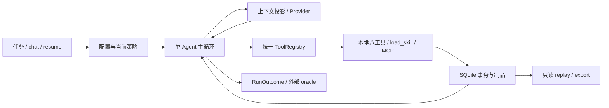

# StellarWeaver 架构（M0–M5）

用户任务进入CLI后固定workspace、配置与策略，provider只返回领域消息；Agent保存完整assistant回合，再经统一dispatch依次校验、授权、记录执行意图、执行工具并保存实际结果。结果成为下一轮模型输入，直到模型正常结束或程序预算/授权/取消要求停止。最终RunOutcome区分运行状态、未知的任务判断及真实验证证据，独立评测器另行判断任务行为。

## 依赖与主循环

`domain`不引用UI、SDK或数据库。`runtime/loop.py`是唯一模型/工具调度循环，不引用Rich、prompt_toolkit或具体SDK响应；`providers`把供应商结构归一为AssistantReply/ModelStreamEvent，`tools`只经过ToolRegistry取得执行权，`policy`由程序拥有，`session`记录事实。CLI装配当前配置、冻结授权并管理provider生命周期；exec/resume把扩展生命周期交给Agent的preflight上下文。UI由事件驱动。

流式聚合按index/ID组装工具名称和原始JSON参数；完整finish及流结束后才持久化assistant。断线、length、ID冲突、半个JSON不会执行工具。临时TextDelta不占durable seq，只有完整assistant文本进入权威历史。

SDK内部重试为0，Agent最多两次额外瞬态尝试，每次计入次数/输入输出/总时长；遵守Retry-After与剩余预算。工具副作用不自动重试。未知usage保守预留并标记estimated/incomplete；服务端上下文超限另有最多一次缩减输入的有记录重试。

任务计时从Agent启动开始，用户任务/run.started先持久化，再进行恢复协调、Git基线、扩展发现/连接、模型与工具执行。可等待阶段共享同一截止时间；同步SQLite/配置计算不能硬抢占，返回后检查已耗时。扩展关闭完成后才保存最终RunOutcome，duration包含清理；超时后给予15秒协作式清理宽限；超出宽限会记录cleanup_failed和未确认资源状态。取消需要等待组件收尾，不能承诺忽略取消的协程或整个CLI在某个硬时点终止。chat会话初始化有单独的同额时限，各提交任务重新计时，用户输入等待不消耗任务预算。CLI初始参数/配置、SessionStore打开以及provider最终aclose不属于Agent任务计时，不能将max_wall_seconds解释成整个操作系统进程的硬时限。

## 上下文与仓库说明

每次请求对系统提示、工具schema、适用AGENTS.md、扩展元数据、用户目标、历史、repo map与输出预留统一预算。保守UTF-8 JSON bytes估算明确标记estimated；默认80%触发、55%目标、保留最近6个完整工具组。assistant tool_calls与全部tool results不可拆分。固定约束/最近回合无法容纳时明确budget_exceeded，不发送超窗请求。

压缩是确定性的模型输入投影，从真实记录抽取路径、hash、operation_id、artifact、命令与退出码，作为标明来源的system摘要，绝不伪装新用户命令。原始消息全留SQLite。checkpoint含派生摘要和覆盖事件seq；位置字段引用包含派生system内容的输入投影，不用来删除数据库原文。`/clear`持久化新投影边界，resume同样遵守。

AGENTS.md仅加载工作区根到已操作路径的祖先目录，记录来源、范围、hash、加载时间并限量；不遍历工作区外祖先。写动作准备时检查指令，策略授权返回后由独立after_authorize钩子再次比较模型已见的路径/hash；根或子目录指令新增、修改、删除均在tool.started前返回INSTRUCTIONS_UPDATED，下一轮先载入再重新决定。before_execute不重复调用，随后仍核对文件hash与权限。文件内容不能扩大授权。repo map是有界Python AST路径/签名/行号索引，按显式路径、关键词、访问关系排序，hash缓存随文件变化失效；不宣称完整语义调用图。

## Journal、锁与恢复

SQLite schema v2通过短事务迁移v1并验证外键；OS锁限制同会话一个写者，工作区写锁协调不同session的内置写入与命令。消息、planned操作、授权、started意图、最终ToolResult/对应tool消息/完成事件在各自短事务内更新。最终结果先提交，再发布成功UI；同一结果幂等补录，拒绝覆盖不同终态。

operation_id是本地操作身份，provider call_id只在对应assistant回合内唯一。序列为planned→approved→started→succeeded/failed/denied/cancelled/unknown；拒绝不能进入started。

resume先在锁内协调未闭合回合：planned/approved补未执行结果；文件当前hash等于after则从状态确认、等于before不伪报成功、其他保留并报告冲突；started命令/MCP无结果标unknown，绝不自动派发旧调用。pending undo也只读比对恢复目标和权限。未知/冲突使无新prompt的恢复blocked，重复resume不绕过；显式新任务仍按当前权限重新读取、重新决策。

replay/export使用私有临时副本读取稳定DB/WAL快照，不在原路径创建SQLite sidecar、不迁移、不协调、不构造provider。完整静态输出含来源标签；export排他创建目标。默认数据目录在工作区外；显式data-dir进入工作区时，文件工具与repo map仍动态保护它。

## 文件改动与授权

八工具与扩展均经过：查找→严格JSON/schema→路径和版本准备→适用指令→策略→授权→复检→started意图→执行→最终结果提交。read-only在schema和dispatch双层限制，无TTY授权不足立即blocked。冻结策略只允许完整argv/cwd、精确文件或远程参数，仓库配置和指令不能自行增加grant。

文件工具保护.git、凭据、SQLite及sidecar/会话目录；枚举搜索尊重忽略规则；内置UTF-8编辑限1MiB，完整hash、唯一精确替换、授权后复检、保留换行/模式，before/diff制品同步落盘。原子替换不是对任意编辑器的全局原子CAS。

ChangesManager保存启动时staged/unstaged/untracked基线，diff核对启动路径、当前Git路径与内置修改路径并集，展示用户原改动、内置操作和其他未归因变化。基线untracked删除、脏文件恢复Git clean、rename两端及类型变化不会因当前状态不列路径而消失，恢复原用户基线不误报。undo只逆序恢复一项before或删除匹配的create，要求当前after hash、权限和备份hash全部可证明匹配；每步有意图/结果，绝不reset/clean/checkout整仓。未知状态与外部更改保留，不能宣称任意shell/MCP可撤销。详见[CHANGES.md](CHANGES.md)。

## Skills与MCP

显式信任的项目技能与用户指定目录提供元数据目录，正文通过load_skill统一dispatch；来源/hash/优先级和同名覆盖可见，正文不能调用subprocess或授予权限。技能按需影响模型的后续工具选择。

ExtensionManager管理官方MCP 1.26.0 stdio客户端：工作区信任加精确mcp_start授权后启动；OS基本环境和显式allow_env传递，stderr另行有界采集。协商协议、分页tools/list、确定性<=64字符命名映射、JSONSchema校验、tools/call与清单变化刷新均通过实测。外部schema远程引用拒绝；服务端readOnlyHint不等于用户确认。

MCP超时/断线/取消不重放副作用；未确认的可写调用标unknown。退出/初始化取消会关闭所有已启动服务器。文本及结构化结果有限长并记录截断/有界制品，其他内容类型显式标记unsupported。Host命令和MCP都没有OS文件系统隔离。MCP服务器由官方SDK管理关闭，不宣称其任意外部broker副作用可回收。

## Host命令进程生命周期

Windows的run_command先以CREATE_SUSPENDED创建主进程，再加入带KILL_ON_JOB_CLOSE、未启用breakaway的匿名Job Object，验证成员后才恢复唯一主线程。不能赋予Job或安全识别线程就返回PROCESS_CONTAINMENT_FAILED，停止尚未执行的进程，不降级为taskkill。正常退出、超时和取消均终止整个Job并查询ActiveProcesses归零、确认主进程退出，再关闭handle和收集管道；无法证实清理就返回unknown/JOB_CLEANUP_UNCONFIRMED。结果中的process_management保留实际证明，Job终止确认窗口为5秒，并单独限制管道排空。搜索rg和内部Git查询也保留unknown/取消/containment失败，不因exit_code=0或1覆盖为成功；只有明确正常的rg无匹配/Git无filter退出1例外。基线/diff观察无法证实进程状态时记录changes.observation_unknown并停止，不伪装成Git不可用后继续模型。

真实Windows测试覆盖父进程先退出、DETACHED_PROCESS/新process group、breakaway请求仍被Job保留或拒绝、kill-on-close、创建期取消、重复取消和启动失败。范围是CreateProcess继承的后代，WMI、服务、计划任务等外部broker代启不在此创建树内；这不是OS安全沙箱。POSIX仍用独立process group和TERM/KILL，setsid逃离组不由该机制保证。本轮只在Windows11/Python3.12.6执行。实现依据[Microsoft Job Objects](https://learn.microsoft.com/en-us/windows/win32/procthread/job-objects)及[AssignProcessToJobObject](https://learn.microsoft.com/en-us/windows/win32/api/jobapi2/nf-jobapi2-assignprocesstojobobject)。

## 验证与评测

默认pytest全离线，以真实临时Git、文件、进程与故障os._exit验证A–G；不会因Key存在自动请求模型。20题参考动作脚本只是框架测试；真实DeepSeek需显式命令。外部行为oracle、变异检测和源码hash事实评分独立于Agent自报，完成marker防普通提前exit0绕过，评分后复核修改范围。完整成功要求独立评分与diff合格且Agent运行completed。受阻、失败、拒绝、取消和估算用量各自保留。

新评测和收据记录原报告hash、实际catalog与评分源码hash、评分版本和来源包；旧报告保持不变。来源包只校验字节，不自动导入归档代码。详见[评测说明](../evals/README.md)。sdist/wheel显式排除IDE、密钥、数据库及本机验证结果，打包回归同时检查sdist构建链和直接wheel。

Oracle在文件工具工作区外，不是恶意宿主代码的安全边界；更强评分隔离、DockerBackend、其他平台实测与重复/消融评测留作后续增强。CI配置已写但尚未推送触发，未宣称远端通过。

## 已核验的参考与融入方式

2026-10-25 阅读实施规范列出的部分官方源码，参考用于理解边界，StellarWeaver独立实现，没有复制这些项目源码，也未运行其完整系统。

| 参考 | 本次读取 | 融入本项目 |
| --- | --- | --- |
| [mini-swe-agent](https://github.com/SWE-agent/mini-swe-agent/blob/04d809ceab9df28f9adaed044884180159172930/src/minisweagent/agents/default.py) | query/execute/observation及次数/时间检查 | provider与执行环境分离，显式调用循环，失败也计量并保留轨迹 |
| [Pi agent loop](https://github.com/earendil-works/pi/blob/38ff99177fba21e9c57a670f4e95adcf407c99c7/packages/agent/src/agent-loop.ts) | 事件流入口与继续执行边界 | SDK消息在provider边界转换，事件驱动UI，继续任务保持完整上下文 |
| [kitagent loop](https://github.com/zed123214/kitagent/blob/eccf32b9fda9863559803a42b52fc03d880bca92/src/agent_runtime/core/loop.py) / [permissions](https://github.com/zed123214/kitagent/blob/eccf32b9fda9863559803a42b52fc03d880bca92/src/agent_runtime/core/permissions/policy.py) | 前轮README/目录/loop/policy | 循环、工具、权限和事件职责分离，会话授权不等于全局配置 |
| [DeepSeek Chat API](https://api-docs.deepseek.com/api/create-chat-completion/) / [tools](https://api-docs.deepseek.com/guides/tool_calls/) | streaming、usage和非思考function tools | DeepSeek协议选项只在adapter，完整聚合后执行，不记录隐藏推理 |

固定参考commit分别为mini-swe-agent 04d809ceab9df28f9adaed044884180159172930、Pi 38ff99177fba21e9c57a670f4e95adcf407c99c7、kitagent eccf32b9fda9863559803a42b52fc03d880bca92。未移植其Web、图框架、Kubernetes、子Agent或额外账户系统。
