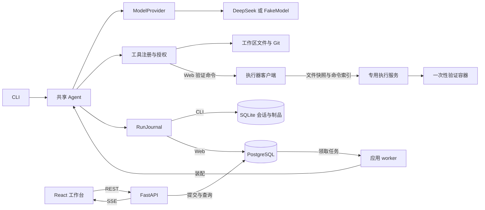
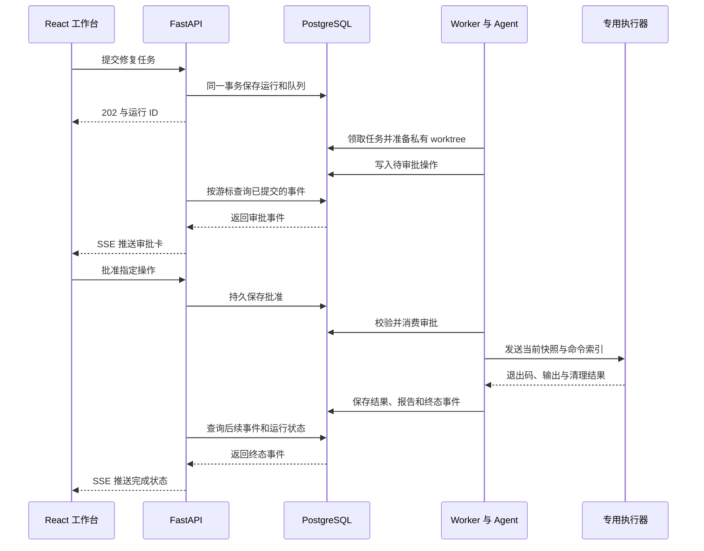

# 架构与调用链

StellarWeaver 将一次编码任务组织为模型决策、受控工具执行和可核对的运行记录。CLI 在本机直接装配 Agent，Web 先持久化请求，再由 worker 装配同一套 Agent。模型适配器、工具注册表和 Journal 提供三个稳定接口，使运行时能复用同一套模型回合、权限判断和预算管理。

## 模块职责

| 模块 | 主要职责 | 源码入口 |
| --- | --- | --- |
| [CLI 和配置](#cli-和配置) | 将终端参数、工作目录和配置装配为一次运行。 | [cli.py](../src/stellarweaver/cli.py)、[config.py](../src/stellarweaver/config.py) |
| [领域与运行时](#领域与运行时) | 定义模块间数据契约，推进模型与工具回合，判定运行终态。 | [domain/](../src/stellarweaver/domain)、[runtime/](../src/stellarweaver/runtime) |
| [模型](#模型) | 转换 Chat Completions 请求，聚合流式回复，提供离线响应。 | [providers/](../src/stellarweaver/providers) |
| [上下文与指令](#上下文与指令) | 组装历史、仓库指令和索引，计算并控制模型输入。 | [instructions/](../src/stellarweaver/instructions)、[context/](../src/stellarweaver/context) |
| [工具与权限](#工具与权限) | 解析参数，核对路径、版本和授权，执行并返回可审计结果。 | [tools/](../src/stellarweaver/tools)、[policy/](../src/stellarweaver/policy) |
| [CLI 改动管理](#cli-改动管理) | 保存启动基线，归类差异，按证据撤销内置修改。 | [changes/](../src/stellarweaver/changes) |
| [扩展](#扩展) | 发现与加载 Skills，管理本地 stdio MCP 工具。 | [extensions/](../src/stellarweaver/extensions) |
| [会话持久化](#会话持久化) | 保存消息、工具状态、检查点和终态，提供中断证据。 | [session/](../src/stellarweaver/session)、[web/journal.py](../src/stellarweaver/web/journal.py) |
| [Web 前端与 API](#web-前端与-api) | 管理身份、工作区、线程和交互，以 REST 与 SSE 连接浏览器和后台。 | [frontend/src/](../frontend/src)、[web/app.py](../src/stellarweaver/web/app.py) |
| [Web 调度与交付](#web-调度与交付) | 持久入队、领取、审批、取消、测试证据和补丁审阅。 | [web/db.py](../src/stellarweaver/web/db.py)、[web/worker.py](../src/stellarweaver/web/worker.py) |
| [Web 执行环境](#web-执行环境) | 创建线程 worktree，传输受控快照，运行和清理验证容器。 | [web/isolation.py](../src/stellarweaver/web/isolation.py)、[web/broker.py](../src/stellarweaver/web/broker.py) |

### CLI 和配置

`cli.py` 以 Typer 接收命令。`exec` 处理一个任务，`chat` 保持交互式会话并处理多次输入，`resume` 打开已有 SQLite 会话。`sessions list`、`replay` 和 `export` 通过存储读取历史。终端展示在 `ui/` 中实现，Agent 以事件和文本回调交付界面数据。

配置分三步进入运行。`load_config` 读取显式路径或工作区中的 `stellarweaver.toml`，缺省时使用 `AppConfig`。Pydantic 拒绝未知字段，并核对诸如输出上限与窗口大小、默认超时与最大超时之间的关系。`effective_config` 再覆盖用户显式传入的 provider、策略和流式设置。最终的可序列化配置快照随 CLI 会话保存，供恢复加载。

凭据采用独立读取路径。`get_api_key` 优先取已配置的进程环境变量，其次读取指定 dotenv 文件，缺省时从启动目录、再按规则从工作区选择 `.env`。配置快照记录环境变量名称，Provider 则单独接收密钥值。`execute_task` 建立 Journal、模型和终端回调后调用 `build_agent`，运行结束后把 `RunOutcome` 转换为终端状态与退出码。例如 `blocked` 返回 `3`，`budget_exceeded` 返回 `4`。开启验证失败退出选项后，流程正常结束但检查失败时返回 `5`。 [配置实现](../src/stellarweaver/config.py) · [CLI 入口与退出码](../src/stellarweaver/cli.py) · [终端 UI](../src/stellarweaver/ui)

### 领域与运行时

领域类型是 SDK、界面和数据库之间的共同数据格式。Provider 返回 `AssistantReply`，里面有可见文本、工具调用、停止原因和用量。运行时再把它转换为 `Message`、持久化操作和事件，供下一轮模型请求、回放或前端显示。以下标识承担不同用途。

| 数据或标识 | 用途 |
| --- | --- |
| `session_id`、`run_id` | 标识一个持续会话和该会话内的一次运行。一次 Web 追问保留前者并创建新的后者。 |
| `ToolCall.call_id`、`Message.tool_call_id` | 将模型发出的某个工具调用与返回给模型的工具消息配对。 |
| `ToolResult.operation_id` | 定位本机记录中的一次操作，用于查找授权、写入前状态、结果和制品。 |
| `AgentEvent.seq` | 按事件顺序定位会话记录。Web 用它作为 SSE 补读游标。 |
| `RunOutcome` | 保存运行终态、验证状态、证据、计量和回复。CLI 运行时将 `task_assessment` 保持为 `unknown`，独立评测随后按任务规则判定。 |

`build_agent` 是公共装配点。它用 Journal 的工作区创建 `PolicyEngine` 和 `ToolRegistry`，再把模型、边界配置、审批回调、可选的命令执行器和通知回调交给 `Agent`。CLI 将审批连接到终端，Web 修复连接到 `ApprovalGate`，普通对话用 `chat_only` 关闭内置工具和仓库上下文。

主循环 `_drive` 收集工具 schema，准备模型请求并获取回复。它先核验工具调用 ID，然后由 Journal 把 assistant 消息和计划操作落库。`_tools` 按回复里的顺序调用工具。每个结果接入消息序列后，下一次模型请求才能从这些结果继续。测试退出码非零会作为工具错误交给模型，便于继续修复；连续三次相同的工具失败、权限阻断、预算耗尽或无法确认的执行状态会提前结束。本轮已经声明但尚未执行的调用会补上对应结果，保持消息配对完整。 [领域类型](../src/stellarweaver/domain/__init__.py) · [公共装配点](../src/stellarweaver/runtime/service.py) · [主循环](../src/stellarweaver/runtime/loop.py)

运行结束与验证通过是两项状态。`_finish` 按命令和工作目录保留最新检查；一次成功的内置写入会清除前一版本的有效检查。模型发出结束回复可以让运行达到 `completed`，验证字段仍取决于真实工具结果。Web 交付层另按快照细化检查的新鲜度。

### 模型

`ModelProvider` 公开 `capabilities`、`complete` 和 `stream`，让运行时先检查是否支持工具、流式和上下文窗口。`OpenAICompatibleChatProvider` 将领域消息转换为 Chat Completions 输入，保留原始工具参数和结果 ID。DeepSeek 专属的 thinking 参数由适配器设置，领域层只接收可见文本、工具调用、停止原因和公开用量。

流式响应经过 `ChatCompletionAccumulator`。文本片段可在到达时以 `text.delta` 通知界面。工具片段按索引合并 ID、函数名和参数，聚合器核对完成标记、工具 ID 与资源上限，随后提交完整的 `AssistantReply`。工具执行位于聚合之后。部分流中断时，事件可记录已经显示的片段，当前不完整回复不会进入工具执行阶段。Provider 能力或用户配置关闭流式时，Agent 使用一次非流式请求。

重试由 Agent 统一管理。一次 HTTP 尝试计入一次模型请求，暂时网络故障、限流等可重试错误根据退避、`Retry-After` 和剩余预算再次请求。遇到服务端上下文长度错误时，运行时另尝试一次更小的投影。历史工具由 Journal 保留，继续请求复用已有结果。用量优先取服务端返回值，缺失或未完整返回时记录估算和不完整标记。`FakeModel` 通过固定回复或脚本复用相同协议，用于离线验证真实工具和状态流转。 [Provider 接口](../src/stellarweaver/providers/base.py) · [协议适配](../src/stellarweaver/providers/openai_compatible.py) · [流式聚合](../src/stellarweaver/providers/streaming.py) · [离线模型](../src/stellarweaver/providers/fake.py)

### 上下文与指令

`Agent._prepare_context` 在每次请求前组合系统提示、用户任务、历史、工具 schema、适用的 `AGENTS.md`、扩展目录和 repo map。历史记录是持久数据，发送给 Provider 的上下文由 `ContextManager` 按当前预算重新生成。

- **指令加载。** `InstructionLoader` 按工作区根和已操作路径的祖先目录加载 `AGENTS.md`，记录来源、范围和文件哈希。准备修改时，`_before_execute` 根据目标路径判定模型是否已看到适用指令。用户批准后，`_after_authorize` 再检查一次指令指纹。等待期间指令变动会以 `INSTRUCTIONS_UPDATED` 返回，让下一轮先看到新增要求，再决定操作。
- **仓库索引。** `RepoMap` 在工作区文件约束下枚举候选路径，以 Python AST 提取函数、类、签名和行号。显式路径、曾访问位置和关键词影响排序。索引按预算截取，提供下一步搜索和读文件的线索。实际文件内容由工具读取，编辑依据最新文件哈希执行。
- **窗口计算。** 默认配置下，`100000 − 4096 − 2048 = 93856` 是模型输出预留与安全余量扣除后的估算输入额度。工具 schema 同样占用窗口。计量采用保守的 UTF-8 JSON 字节估算，实际服务端用量进入独立字段。
- **历史压缩。** 默认在估算输入达到可用额度的 80% 时尝试压缩，目标为 55%。分组保留最新用户任务、系统消息、最近的完整 assistant 回合和最近的完整工具组。过长工具输出以有界摘要进入请求，其中保留路径、哈希、操作 ID、证据位置和关键结果。更早的回合按组移出，生成带来源标记的摘要并记录检查点。原始消息仍在 Journal。必需数据放不进窗口时，运行以预算超限结束。

窗口大小约束一次请求。`LimitsConfig` 还分别约束整次任务的模型调用数、工具调用数、累计输入输出用量和墙钟时长。默认单次任务上限为 30 次模型请求、100 次工具调用和 900 秒，累计输入和输出预算分别为 1,000,000 与 30,000 tokens。一次请求适配窗口后，仍需通过整次运行的剩余额度检查。 [指令加载](../src/stellarweaver/instructions/__init__.py) · [仓库索引](../src/stellarweaver/context/repo_map.py) · [历史投影](../src/stellarweaver/context/manager.py) · [运行预算](../src/stellarweaver/runtime/loop.py)

### 工具与权限

`ToolRegistry` 把一个工具定义为名称、参数 schema 和准备函数。注册表生成模型可见的工具清单。实际收到 `ToolCall` 后，`dispatch` 再进行 JSON 与参数验证。准备函数返回 `PreparedTool`，其中包含供授权判断的调用描述、实际执行函数和可选复检。将准备和执行分开后，CLI 与 Web 都可以先展示准确的目标路径、命令或补丁，再决定是否执行。

执行顺序为「参数校验 → 必要的工作区写锁 → 准备与指令检查 → 策略授权 → 指令与目标复检 → 记录 `tool.started` → 执行 → 返回结果」。写锁按规范化工作区路径协调采用同一协议的进程。工作区解析约束路径、解析后的实际位置以及凭据等受保护路径。参数错、目标变化、拒绝授权和未确认副作用各有独立结果，Agent 据此决定下一轮行为。

| 内置工具 | 实现逻辑 |
| --- | --- |
| `list_files` | 在固定工作区内有界枚举，过滤受保护及被忽略的路径。 |
| `read_file` | 读取指定行范围，返回内容、行号和文件字节的 SHA-256，供后续读写核对。 |
| `search_text` | 按工作区范围执行搜索。优先使用 `rg`，缺少时由 Python 实现搜索。 |
| `create_file` | 预先检查目标路径，再以排他方式创建，防止覆盖已存在的文件。 |
| `edit_file` | 要求 `expected_sha256` 和唯一匹配的旧文本，生成差异供预览。授权后复检，将修改前快照和差异保存为制品，再写同目录临时文件并替换。 |
| `run_command` | 参数采用 argv 和工作目录，返回退出码、输出、超时、取消与清理状态。Web 可注入验证执行器，CLI 默认使用宿主后端。 |
| `git_status`、`git_diff` | 调用 workspace 范围内的 Git 查询，返回版本控制证据。 |

`PolicyEngine` 根据预设与显式授权计算结果。`read-only` 开放内置读工具与经用户配置确认的只读 MCP 调用，已明确授权的 MCP 启动单独判定。`workspace-edit` 放行内置编辑，命令依然按策略判断。`ask` 可交由交互回调。授权文件绑定工作区，命令匹配完整 argv 与 cwd，内置修改匹配显式文件路径。有相应权限才能在非交互场景执行写入或命令。仓库指令影响任务选择和复检，授权来自程序策略与用户决定。 [注册表](../src/stellarweaver/tools/registry.py) · [策略](../src/stellarweaver/policy/__init__.py) · [文件工具](../src/stellarweaver/tools/files.py) · [工作区](../src/stellarweaver/tools/workspace.py)

### CLI 改动管理

`ChangesManager` 要区分用户启动前就有的改动、Agent 已记录的操作和运行期间观察到的其他变化。它在会话开始时保存 Git 的已暂存、未暂存和未跟踪状态，记录可读文件的哈希、类型、权限和差异。`chat` 在交互初始化时捕获基线，单次 CLI 运行在准备阶段捕获基线。基线进入 `changes.baseline` 事件，复用会话时仍可查到。Git 查询中断或清理状态无法确认时，管理器记录观察状态，避免依据不完整基线继续归类。

`/diff` 取启动基线、当前 Git 状态和已记录内置修改的路径并集，然后重新读取这些路径。这个并集保留已从当前 Git 列表消失的路径。例如一个原有未跟踪文件被外部工具删除，仍可通过启动基线定位。修改归因依据已确认的操作和当前哈希，无法关联到内置操作的变化单独展示。

`/undo` 从最近一次可撤销的内置写入开始。它核对当前内容是否仍匹配 `after` 哈希、文件类型与权限是否一致，以及编辑前备份是否匹配 `before` 哈希。用户重新授权后，`ChangesManager` 复检目标并记录撤销意图，再恢复旧内容或移除该操作创建的文件。每次只处理一项，Git 暂存区保持原样。若进程在恢复文件后退出，SQLite 的恢复逻辑可通过当前文件状态补记已完成结果。若用户同时写入了不同内容，则留下冲突记录。 [基线、差异和撤销](../src/stellarweaver/changes/__init__.py) · [会话协调](../src/stellarweaver/session/store.py) · [工作区锁](../src/stellarweaver/session/locking.py)

### 扩展

`ExtensionManager` 由 CLI 在任务或交互会话的生命周期内装配。它将 Skills 和 MCP 接入同一个工具注册表，因此扩展调用也会产生授权、执行和结果事件。

- **Skills。** `SkillCatalog` 从可信工作区和用户显式指定的目录发现技能。模型先看到目录中的元数据，通过 `load_skill` 请求某个技能的正文。目录记录来源和内容身份，加载结果进入模型工具回合。技能正文用于补充任务方法和指令，任何后续访问仍通过原工具授权路径。
- **MCP。** 启动本地 stdio server 前，管理器检查工作区信任，并将 `server_id`、argv 和 cwd 交给策略判断。继承的额外环境变量按 `allow_env` 选择。启动后，连接完成协议初始化和 `tools/list`，为远程工具注册本地名称与参数 schema。显式的只读配置决定哪些工具可在只读模式中暴露。调用经 `tools/call` 返回统一工具结果，连接在退出时关闭。
- **动态清单。** 当 server 发出工具列表变化通知时，管理器在下一次请求的上下文组装边界刷新注册表，使发送给模型的 schema 与实际可执行项对应。扩展生命周期中的启动失败、连接中断和结果截断也写入 Journal。

Web 的装配路径目前直接使用内置工具与验证执行器。`extensions/` 由 CLI 入口接入，对 CLI 做实验验证可使用项目随附的离线扩展演示。 [扩展管理](../src/stellarweaver/extensions/__init__.py) · [技能目录](../src/stellarweaver/extensions/skills.py) · [MCP 连接](../src/stellarweaver/extensions/mcp.py)

### 会话持久化

`RunJournal` 是 Agent 使用的存储契约。`record_assistant` 将完整回复及其计划执行的工具关联起来，`record_approved` 持久化授权，`record_intent` 保存执行前状态，`record_result` 提交结果、相应的 `tool` 消息与事件。界面在结果事务完成后收到完成通知。由此可以区分「模型已提出调用」「已批准」「可能已产生副作用」「结果已入库」。

| 适配器 | 写入与读取方式 | 中断后的处理 |
| --- | --- | --- |
| CLI `SessionStore` | 每会话一个 SQLite 数据库和独立制品目录。使用 WAL、会话写者锁和短事务。`inspect` 用私有只读快照读取历史，供 `replay` 和 `export` 使用。 | `reconcile` 按计划、授权、执行意图和结果协调未闭合的调用。文件操作可以比对 before/after 哈希；已启动但缺少结果的命令进入未确认状态。 |
| Web `PgJournal` | Web 的消息、操作与事件在 PostgreSQL 中按租户和会话管理。`execution_scope` 检查任务的领取者与尝试号；事件序号由会话记录分配。运行终态、报告及队列结束状态由持久化逻辑一起落库。 | worker 启动时查找遗留已领取任务，将仍在执行的旧运行标记为 `interrupted` 并附上未完成操作。排队任务仍可领取。用户可检查证据后发起新的续接运行。 |

检查点保存派生上下文和覆盖的事件范围，原始消息保留。Web 的运行记录存于数据库，私有 worktree 由状态卷保存。重启后查看历史依赖数据库，继续原项目线程还需要相应 worktree。 [Journal 接口](../src/stellarweaver/session/journal.py) · [SQLite 适配器](../src/stellarweaver/session/store.py) · [PostgreSQL 适配器](../src/stellarweaver/web/journal.py) · [数据库和数据卷](DATABASE.md)

### Web 前端与 API

React 将侧栏工作区和线程列表、当前 `runId`、运行快照、事件列表及审阅报告分别管理。`projects.tsx` 提供目录选择、分组与归档交互；`conversation.tsx` 将回复和工具活动按轮组织，并在结束后折叠过程；`inspector.tsx` 展示改动、检查和日志。`main.tsx` 负责页面状态切换、创建运行、提交审批、取消与打开交付报告。切换运行时，旧订阅由 `AbortController` 结束，视图按新运行加载。

FastAPI 使用 `Principal` 确定租户、成员、访问范围及能否修改。当前本机账号用 Cookie 恢复身份，项目访问来自 `local_projects`。静态团队配置使用已登记的项目集合，可选 OIDC 登录。服务端的租户与项目查询决定记录是否可见。归档会标记线程并影响续接，新建工作区时服务端将项目路径限制在配置的宿主根目录内。

本机注册由 `local_accounts.enroll` 归一化账号名，生成加盐的 scrypt 哈希，并在事务中建立账号和普通对话工作区。第一个本机账号可接续配置指定的既有工作区。登录成功后，浏览器收到 HttpOnly Cookie，数据库按摘要查找有效会话。请求进入具体路由前先恢复 `Principal`，写操作另外检查同源请求条件。 [本机账号](../src/stellarweaver/web/local_accounts.py) · [浏览器会话存储](../src/stellarweaver/web/oidc.py)

| `/api/v1` 接口 | 与界面的关系 |
| --- | --- |
| `auth/config`、`auth/login`、`auth/register` | 决定登录方式，建立账号及会话。 |
| `workspaces`、`workspaces/folders`、`threads` | 提供工作区、可选择目录和线程列表。归档由 `PATCH /threads/{session_id}` 写入。 |
| `POST /runs`、`GET /runs/{run_id}` | 提交任务并取得运行标识，随后读取运行快照与待审批状态。排队部署返回 `202` 时，后台运行仍在处理。 |
| `GET /runs/{run_id}/events` | 逐段接收可见文本与状态事件。断线可按最后处理的事件 `seq` 补读。 |
| `report`、`patch`、`review` | 读取交付报告、下载补丁或发起所选改动的复验。复验资格由 API 判断。 |

SSE 在服务端查询已提交的事件页，按 `seq` 递增发送。浏览器丢弃旧游标范围内的重复事件，连接中断后继续从上次已处理的序号获取。刷新时，可以先用 REST 恢复当前运行，再从持久事件重建过程。同一运行的页面重连和创建新运行是两个独立请求。 [前端连接与状态](../frontend/src/main.tsx) · [SSE 解码](../frontend/src/api.ts) · [API 与访问控制](../src/stellarweaver/web/app.py)

### Web 调度与交付

**从提交到领取。** `db.submit` 按租户和成员约束请求标识。同一个标识和相同参数重复提交会返回原有运行，不同内容复用标识会返回冲突。原线程续接需要会话与项目匹配，且线程可继续、未归档、没有活动运行。数据库事务把新运行、队列行和审计一起提交。`db.claim` 使用 `FOR UPDATE SKIP LOCKED` 领取待执行项，并更新拥有者、尝试号和领取时间。`run_team_worker` 轮转已知租户，按槽位并行执行，每个成员同一时间只能领取一个运行。额度在提交阶段限制活跃及近期运行，DeepSeek 用量在模型请求阶段预留与结算。

`runs.status` 表示用户看到的运行状态，`run_jobs.state` 表示调度状态。新任务可以同时为 `active` 和 `queued`，被领取后调度状态变为 `running`，运行结束时配套队列行变为 `done`。模型预算还有独立的计量点：`PgJournal` 处理模型开始事件时按估算输入与输出上限预留额度，收到用量时按实际或估算结果结算。某次请求中断且没有可靠用量时，账本保留相应预留或估算状态。 [队列与用量事务](../src/stellarweaver/web/db.py) · [PostgreSQL Journal](../src/stellarweaver/web/journal.py)

**审批、取消与恢复。** Web 修复装配 `ApprovalGate`。拟执行的文件、补丁或验证 argv 生成待审批记录，worker 等待浏览器决定。批准需匹配当前运行、操作、指纹和有效期，消费后才继续复检。取消由 API 经数据库写入，worker 的运行监控观察到取消请求后中止当前协程，结果由执行层返回。重启恢复将已开始而未落终态的工作交给中断处理，原审批和操作记录作为用户核查依据。

**验证证据与补丁。** `Delivery` 在运行开始时观察基线，命令启动时记录文件快照摘要，结果到达后记录退出码、输出和清理状态。运行结束时，它将检查前快照与当前快照比较，失效的证据标为 `stale`。在隔离修复中，`candidate` 将改动生成相对于 Git 基线的文本 diff，按文件和 hunk 拆分，hunk ID 基于基线、路径及文本计算。后端以报告中已保存的 hunk 为输入重新组装补丁。`verify_selection` 校对基线、检查补丁能否应用，再跑完配置的检查。这里的检查由确定性代码执行，无需模型重新决定改法。

提交任务、复验和交接预检共用项目解析，统一处理本机账号动态登记和静态项目配置。审阅反馈由服务端从候选补丁解析文件及改动块，构造原线程的下一轮输入。提交事务锁定线程并校验反馈来源仍是最新运行，重复请求沿用普通运行的幂等键。交接预检读取目标分支、提交及涉及文件的工作区和索引，并在临时 worktree 执行 `git apply --check --recount`。通过的复验报告、自身完整补丁和当前预检结果共同决定交接状态。 [队列事务](../src/stellarweaver/web/db.py) · [复验和反馈路由](../src/stellarweaver/web/app.py) · [文本补丁与预检](../src/stellarweaver/web/review.py)

### Web 执行环境

项目源目录、任务 worktree 和验证容器承担不同职责。源目录提供已提交的 Git 基线。`task_worktree` 以租户和会话标识定位持久状态目录，在该目录创建独立的裸 Git 仓库，获取源仓库当前 `HEAD`，检查树中的文件数、总大小、路径和对象类型，然后建立 detached worktree 并写入 `ready` 标记。基线的上限为 6,000 个文件和 32 MiB。项目追问使用 `saved_worktree` 复用该目录。源目录在 Compose 中只读，任务修改保存在状态卷里。

Web 验证命令收到的是工作区的一次文件快照。`snapshot_paths` 基于 Git 记录枚举已跟踪文件和符合规则的未跟踪文件，过滤保护路径并检查文件类型与大小。`RemoteRunner` 将快照打包为 tar，通过私有网络发送给执行服务，同时提交允许列表中的命令索引。执行服务核对内部凭据、请求容量、归档内容和命令索引。

`DockerRunner` 为单次命令创建临时容器。容器以非 root 用户运行，根文件系统只读，验证内容解包到临时可写目录，外部网络关闭，并有进程数、内存、CPU 与时间边界。执行器持有 Docker socket，应用 worker 负责模型和数据库。返回值包含命令退出码、输出和清理状态。取消尝试通过执行器撤销当前验证；连接中断或无法确认清理时，报告保留未确认结果。执行器启动时按本部署的容器标签回收残留验证容器。

CLI `host` 执行路径由同一命令工具进入。Windows 用 Job Object 管理受控的子进程树，POSIX 用独立进程组与信号执行清理。两种入口通过统一的结果字段向 Agent 和 Journal 报告退出与清理状态。 [工作区和容器](../src/stellarweaver/web/isolation.py) · [执行器客户端](../src/stellarweaver/web/remote_runner.py) · [执行服务](../src/stellarweaver/web/broker.py) · [宿主命令](../src/stellarweaver/tools/commands.py)

## CLI 修复

离线修复演示包含一次错误修改、一次失败测试、随后修正及通过测试。它可以用于理解 `exec` 的同一套工具和运行逻辑。 [离线修复演示](../src/stellarweaver/demo.py)

1. **建立运行。** CLI 的 `execute_task` 解析工作区和有效配置，创建 `SessionStore`，随后调用 `build_agent`。在准备阶段，CLI 捕获工作区基线并按配置加载扩展。任务文本和运行事件进入 SQLite。 [CLI 任务入口](../src/stellarweaver/cli.py) · [Agent 运行准备](../src/stellarweaver/runtime/loop.py)
2. **从读取到写入。** `read_file` 返回代码和 SHA-256。模型将哈希及旧文本交给 `edit_file`。工具准备差异，策略核对权限，注册表记录执行意图，再实写文件。返回模型的工具消息带同一个 `call_id`，本地可用 `operation_id` 对照差异和备份。如果有人在审批期间改了文件，复检失败，Agent 收到冲突而无需覆盖新内容。 [文件工具](../src/stellarweaver/tools/files.py) · [工具注册表](../src/stellarweaver/tools/registry.py)
3. **用测试结果驱动下一轮。** 执行器实际运行测试，将非零退出码和错误输出交回模型。第二次编辑后，Agent 再运行同一条测试命令。运行时按最新有效检查生成验证状态，Journal 同时保留早先的失败记录。交互模式可用 `/diff` 核对增量，用 `/undo` 逐项撤销符合条件的内置编辑。 [运行终态](../src/stellarweaver/runtime/loop.py) · [改动管理](../src/stellarweaver/changes/__init__.py)

## Web 修复与补丁复验

下面的时序对应一次需要用户批准的 Web 修复。同一轮中可有多次审批和检查，图中以一次测试为例。

1. **运行与浏览器连接解耦。** API 返回 `202` 后，worker 可以独立处理。用户关闭页面后重新打开，前端以原 `run_id` 读取快照并补读事件。刷新本身无需再提交一份任务，审批和取消仍可作用于原运行。 [前端运行状态](../frontend/src/main.tsx) · [Web API](../src/stellarweaver/web/app.py) · [持久队列](../src/stellarweaver/web/db.py)
2. **将验证结果关联到具体改动。** 假设第一次测试时 `calc.py` 内容为 A，Agent 随后写成 B。报告仍保存 A 的真实测试记录，但该检查的快照和最终 B 不匹配，证据状态变为 `stale`。对 B 再次执行同一条测试后，报告才有与最终文件对应的新证据。 [验证报告实现](../src/stellarweaver/web/delivery.py)
3. **从候选补丁建立独立复验运行。** 用户选择改动块后，API 按原报告的标识组装补丁并将复验作为新运行入队。Worker 从原线程取得基线副本，在新 worktree 预检和应用，再执行项目配置的全部验证命令。结果对应新运行和选中补丁。 [补丁组装](../src/stellarweaver/web/review.py) · [复验执行](../src/stellarweaver/web/execution.py)
4. **预检当前目标分支。** 在复验结果中预检完整补丁时，API 根据当前项目 checkout 建立临时 worktree，报告基线变化和冲突，并检查涉及路径的暂存和本地改动。比对文本内容时统一 LF 与 CRLF，明确标为 `-text` 的文件按原始字节比对。通过的完整复验补丁可下载交接，由维护者在 IDE 应用。 [目标预检](../src/stellarweaver/web/review.py)

## 普通对话与恢复

普通对话在本机账号注册时取得独立工作区标识。该工作区的项目相对路径为空。用户从侧栏顶部创建普通对话，API 据此按 `read-only` 接收入队。worker 为会话准备独立状态目录，执行层以 `chat_only` 选项装配 Agent。该路径继续使用可见消息、预算和流式输出，关闭仓库索引、`AGENTS.md`、内置工具和验证执行器。新回复和用量按相同的 Web Journal 与 SSE 协议返回。 [本机账号与工作区](../src/stellarweaver/web/local_accounts.py) · [任务准备](../src/stellarweaver/web/worker.py) · [Agent 装配](../src/stellarweaver/runtime/service.py)

Web 追问沿用已有 `session_id`，服务端为本轮生成新的 `run_id`。在 `history` 续接方式下，`PgJournal.prior_turns` 从至多 8 次已完成且非复验的历史运行中提取用户任务和最终可见回答，并按时间顺序传给模型。`fresh` 从当前提示开始，项目任务仍复用原 worktree。历史工具意图和执行记录保存在数据库中，续接会使用新的工具调用与审批记录。 [历史读取](../src/stellarweaver/web/journal.py) · [Web 执行](../src/stellarweaver/web/execution.py)

CLI `resume` 打开原 SQLite 会话并协调未闭合操作。Web worker 重启后，恢复逻辑区分仍在排队的任务和已经被领取的任务。已领取的运行尚未落终态时，恢复逻辑记录中断及未确认操作。用户核对当前目录、原运行状态和已完成结果后，可以提交新的续接请求。磁盘 worktree 和数据库历史的对应关系见[数据库文档](DATABASE.md)。

## 模型上下文与扩展

按请求进入模型的顺序，可从[扩展目录](#扩展)看本次允许的工具，接着从[上下文与指令](#上下文与指令)看请求如何取舍历史，然后到[模型适配](#模型)看协议转换。追踪一次工具修改时，从[领域与运行时](#领域与运行时)找到 `call_id`，到[工具与权限](#工具与权限)核对执行前检查，再到[会话持久化](#会话持久化)寻找对应的 `operation_id` 及终态。这两条阅读路线分别回答「模型为什么看到这些内容」和「一次副作用如何被执行、记录和恢复」。
