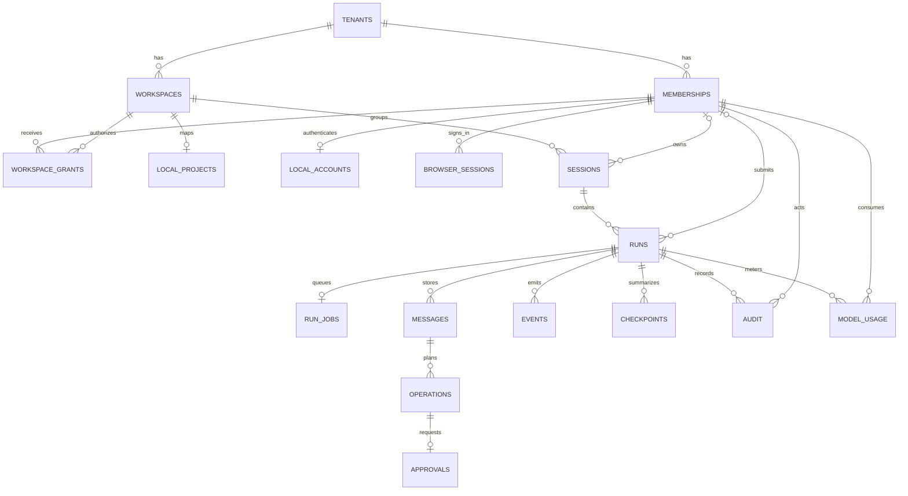

# 数据库与持久化

StellarWeaver 的 Web 与 CLI 各有一套会话持久化路径。Web 工作台使用 PostgreSQL 管理账号、工作区、会话、任务队列和运行证据。CLI 按会话使用 SQLite，并将大输出和编辑前快照保存为同目录下的制品。两种入口共用 Journal 契约，各自维护独立的会话数据。

SWE-bench Lite 批量评测独立保存清单、各次尝试、候选补丁和评分制品，Agent 尝试的会话也保存在实验输出目录。Web「实验记录」从部署配置指定的本地 `report.json` 读取已发布证据。工作台的 PostgreSQL 用于日常项目任务和普通对话，实验元数据的结构化存储仍在 Phase 3 计划中。 [批量评测](EVAL.md#swe-bench-lite-批量评测) · [实验数据契约](EVAL_PLAN.md#phase-3-数据契约)

## 本机 PostgreSQL 连接

当前工作台使用 `postgres:17`，源码的 Alembic 最新迁移为 `g8_workspace_alias`。从 PyCharm 的 **Database → Data Source → PostgreSQL** 创建连接，填写下列参数。选择 **Test Connection** 后，在架构列表中选中 `sw`，需要查看迁移版本时同时选中 `public`。

| 配置 | 当前本机工作台 |
| --- | --- |
| Host | `127.0.0.1` |
| Port | `55434`，映射到容器的 `5432` |
| Database | `stellarweaver` |
| 业务 Schema | `sw` |
| 应用账号 | `stellarweaver_app`，密码取本机 Compose 配置中的 `SW_PG_APP_PASSWORD` |
| 迁移账号 | `stellarweaver_admin`，密码取同一配置中的 `SW_PG_ADMIN_PASSWORD` |
| JDBC URL | `jdbc:postgresql://127.0.0.1:55434/stellarweaver` |

两类数据库密码位于 `.stellarweaver/workbench.compose.env`，与浏览器账号密码、DeepSeek API Key 分开。PyCharm 的普通连接使用应用角色；校验迁移、维护权限或执行数据库转储时使用管理员角色。应用角色受行级安全策略约束，未设置当前租户时，业务查询可能返回空结果。

主机侧的 SQLAlchemy DSN 使用 `postgresql+psycopg://stellarweaver_app:<password>@127.0.0.1:55434/stellarweaver`。迁移用 DSN 将用户名改为 `stellarweaver_admin` 并使用其密码。密码含 URL 保留字符时，应进行百分号编码。容器之间使用 `db:5432`。单独启动数据库开发服务的默认宿主端口为 `55432`，团队覆盖层默认只在 Compose 网络提供数据库连接，本机覆盖层发布回环端口 `55434`。端口可用 `SW_PG_PORT` 调整。

```sql
SELECT current_database(), current_user, current_setting('server_version');
SELECT schemaname, tablename, rowsecurity
FROM pg_tables WHERE schemaname = 'sw' ORDER BY tablename;
```

`public.alembic_version` 记录数据库迁移版本。用迁移管理员执行 `SELECT version_num FROM public.alembic_version;` 可以核对当前数据库是否已应用最新迁移。数据库配置入口见 [Compose 定义](../deploy/compose.yaml)、[本机覆盖层](../deploy/compose.g5-local.yaml)与[角色初始化脚本](../deploy/init-role.sh)。

在以应用角色连接的 SQL 控制台中，使用已获授权的租户 UUID 查询运行记录。下面示例把租户范围限制在同一个事务中。

```sql
BEGIN READ ONLY;
SELECT set_config('sw.tenant_id', '<tenant-uuid>', true);
SELECT id, session_id, status, created_at
FROM sw.runs ORDER BY created_at DESC LIMIT 20;
ROLLBACK;
```

## PostgreSQL 数据模型

`sw` 包含 17 张业务表。`tenant_id` 是主要数据隔离边界，`workspace_id` 表示项目或普通对话分组，`session_id` 标识对话线程，`run_id` 标识线程中的一次运行。下图按实际外键绘制。下文的字段表用 `NULL` 标记允许为空的字段，其余 PostgreSQL 字段均为 `NOT NULL`，包括由主键隐式约束的字段。



### 租户和访问边界

除 `local_accounts` 外，16 张业务表均启用并强制使用行级安全策略（RLS）。API 在认证后确定租户，API 和 Worker 的业务事务用 `set_config('sw.tenant_id', ..., true)` 绑定租户，`tenant_scope` 策略用该值过滤可读行并检查写入行。事务级参数随提交或回滚结束，同一连接可安全归还连接池。复合外键同时携带租户和实体标识，阻止一条记录关联到其他租户的父记录。在同一租户内，应用还根据 `workspace_grants`、成员角色和线程归属筛选资源。`stellarweaver_app` 具有 `NOBYPASSRLS`，因此普通业务查询需要正确的事务租户。应用持有的数据库角色同时是多租户服务使用的角色，事务上下文由服务设置。 [事务和可见性过滤](../src/stellarweaver/web/db.py) · [角色初始化](../deploy/init-role.sh)

### 身份与项目

#### `tenants`

| 字段 | 类型与含义 |
| --- | --- |
| `tenant_id` | `uuid`，主键。 |

租户表只登记数据域标识。工作区、成员以此为父记录，其余业务表通过各自的复合外键继承租户归属。团队配置可以在一个租户中登记多个成员。本机注册模式通常为每个账号分配一个租户，首个账号使用配置指定的历史租户和成员，以承接既有主工作区内尚未归属成员的线程。 [初始迁移](../src/stellarweaver/web/migrations/versions/g1_initial.py) · [本机注册](../src/stellarweaver/web/local_accounts.py)

#### `memberships`

| 字段 | 类型与含义 |
| --- | --- |
| `tenant_id`, `id` | `uuid`，组成主键，`tenant_id` 引用 `tenants`。 |
| `name` | `text`，成员显示名。 |
| `role` | `text`，`CHECK` 限定为 `admin`、`member`、`viewer`。 |
| `active_limit` | `integer`，可同时处于 `active` 的运行数上限，必须大于 0。 |
| `daily_tokens` | `bigint`，成员每天的模型用量配额，必须大于 0。 |

成员行表示租户内的角色和配额。角色决定应用层允许的操作，工作区可见性另外由授权表决定。本机新成员写入 `admin`、3 个活跃运行和每日 500,000 tokens，团队模式由成员清单配置。提交任务和变更模型用量时，服务锁定该成员行，再读取并更新相关计数，避免同一成员的并发请求绕过限额。 [成员定义](../src/stellarweaver/web/identity.py) · [配额事务](../src/stellarweaver/web/db.py)

#### `workspaces`

| 字段 | 类型与含义 |
| --- | --- |
| `tenant_id`, `id` | `uuid`，组成主键，`tenant_id` 引用 `tenants`。 |
| `label` | `text`，导航和历史列表使用的工作区名称。 |

这是授权和会话归组使用的稳定标识，名称可以重复。静态工作区的实际路径来自服务配置，本机动态路径在 `local_projects` 中登记。路径分开存储后，普通对话可以沿用工作区授权和历史查询，项目路径也可以在真正使用前按部署配置重新解析。 [工作区登记](../src/stellarweaver/web/db.py) · [动态工作区](../src/stellarweaver/web/local_accounts.py)

#### `workspace_grants`

| 字段 | 类型与含义 |
| --- | --- |
| `tenant_id`, `member_id`, `workspace_id` | `uuid`，三列组成主键。`(tenant_id, member_id)` 引用 `memberships`，`(tenant_id, workspace_id)` 引用 `workspaces`。 |

一行代表一个成员获得一个工作区的访问授权，形成成员和工作区的多对多关系。复合主键直接防止重复授权和跨租户引用。团队成员同步会在一个事务中重建其授权集。本机注册和添加工作区时，服务将授权与工作区登记一同提交。API 用该表收敛资源范围，查看某个线程时还会按适用规则检查线程所有者。 [授权写入与查询](../src/stellarweaver/web/db.py)

#### `local_projects`

| 字段 | 类型与含义 |
| --- | --- |
| `tenant_id`, `workspace_id` | `uuid`，组成主键，同时引用同一租户的 `workspaces`。 |
| `relative_path` | `text`，可为 `NULL`。有值时是相对于本机受管项目根目录的路径，`NULL` 表示普通对话分组。 |
| `alias` | `varchar(80)`，可为 `NULL`。本机项目的显示别名。为空时使用 `workspaces.label`，普通对话分组不设别名。 |

修改别名需要该项目的成员授权。应用角色只获得别名列的更新权限，项目路径及历史会话归属继续使用原有字段与工作区 ID。 [别名迁移](../src/stellarweaver/web/migrations/versions/g8_workspace_alias.py)

`UNIQUE (tenant_id, relative_path)` 防止同一租户重复登记同一项目目录。常规 PostgreSQL 唯一约束允许出现多个 `NULL`，普通对话分组的唯一性由注册代码使用 `UUIDv5(tenant_id, "personal-chat")` 和主键实现。添加项目时，应用检查目录是否位于允许的范围、是否存在及是否为受支持的 Git 目录，再保存相对路径。真实目录和文件内容位于文件系统。 [目录检查及登记](../src/stellarweaver/web/local_accounts.py) · [本机账号迁移](../src/stellarweaver/web/migrations/versions/g6_local_accounts.py)

#### `local_accounts`

| 字段 | 类型与含义 |
| --- | --- |
| `username_key` | `text`，全库主键。账号名去首尾空白并做 NFKC 归一化后，再用 `casefold()` 生成查询键。 |
| `username` | `text`，保留归一化后的显示形式。 |
| `password_hash` | `text`，十六进制的随机盐和 scrypt 摘要，以冒号分隔。每个账号使用 16 字节随机盐。 |
| `tenant_id`, `member_id` | `uuid`，复合外键指向 `memberships`。两列各有独立 `UNIQUE` 约束。 |

登录需要先由用户名找到租户，因此此表作为全库凭据索引，在设置租户参数之前查询。密码校验通过后，应用才用返回的租户和成员建立登录会话。全库唯一的账号名和两个独立唯一约束形成当前本机模式的一账号、一租户、一成员映射，团队成员仍由独立的身份配置管理。此表的应用角色权限为 `SELECT` 和 `INSERT`，注册在事务中串行处理账号名冲突和首账号历史归属。 [注册与密码校验](../src/stellarweaver/web/local_accounts.py) · [表结构与授权](../src/stellarweaver/web/migrations/versions/g6_local_accounts.py)

#### `browser_sessions`

| 字段 | 类型与含义 |
| --- | --- |
| `tenant_id`, `digest` | `uuid`、`text`，组成主键。`digest` 是随机登录令牌的 SHA-256 摘要。 |
| `member_id` | `uuid`，与 `tenant_id` 一起引用 `memberships`。 |
| `expires_at` | `timestamptz`，登录会话截止时间，目前发行后 8 小时。 |

浏览器持有由租户 UUID 和随机令牌组成的 HttpOnly Cookie。服务解析租户 UUID，在租户事务中查找令牌摘要并校验有效期。创建登录会话时顺带清理本租户过期记录，注销时删除对应记录。该设计允许一个成员拥有多个登录会话，注销与重新登录都独立于项目历史。 [登录会话实现](../src/stellarweaver/web/oidc.py) · [Cookie 签发](../src/stellarweaver/web/app.py)

### 对话线程、运行和异步队列

#### `sessions`

| 字段 | 类型与含义 |
| --- | --- |
| `tenant_id`, `id` | `uuid`，组成主键，`id` 标识对话线程。 |
| `workspace_id` | `uuid`，与 `tenant_id` 一起引用 `workspaces`。 |
| `member_id` | `uuid`，可为 `NULL`，与 `tenant_id` 一起引用 `memberships`，标识线程所有者。早期运行及兼容入口允许没有成员归属。 |
| `next_seq` | `bigint`，默认 `0`。每次写事件时先加一并返回新值，第一条事件的序号为 `1`。 |
| `created_at` | `timestamptz`，默认 `now()`。 |
| `isolated` | `boolean`，默认 `false`。标识线程是否采用隔离任务工作区。 |
| `archived_at` | `timestamptz`，可为 `NULL`，非空表示已归档。 |

线程持有工作区关联、归属和事件计数，让新追问另建运行时仍沿用同一历史及事件序列。续接提交会锁住线程行，校验工作区、归属、隔离模式和归档状态，再判断上一轮能否继续。归档通过写入时间戳实现，取消归档将其清空，已有运行与证据仍保留。隔离线程的实际 worktree 由租户和线程 ID 在状态卷中定位。 [提交、历史和归档](../src/stellarweaver/web/db.py) · [工作区定位](../src/stellarweaver/web/isolation.py)

#### `runs`

| 字段 | 类型与含义 |
| --- | --- |
| `tenant_id`, `id` | `uuid`，组成主键，`id` 标识单轮运行。 |
| `session_id` | `uuid`，与 `tenant_id` 一起引用 `sessions`。 |
| `member_id` | `uuid`，可为 `NULL`，与 `tenant_id` 一起引用 `memberships`，记录本轮发起成员。 |
| `request_key` | `uuid`，与 `tenant_id` 组成唯一键，用于去重。成员请求会先用成员 UUID 派生此键。 |
| `prompt`, `provider` | `text`，本轮用户输入及模型提供方标识。 |
| `status` | `text`，默认 `active`。应用写入 `completed`、`blocked`、`cancelled`、`budget_exceeded`、`failed` 或 `interrupted` 等运行终态。 |
| `created_at` | `timestamptz`，默认 `now()`。 |
| `mode` | `text`，默认 `read-only`，`CHECK` 允许 `read-only` 和 `repair`。 |
| `cancel_requested` | `boolean`，默认 `false`，表示取消请求已登记，供执行器检查。 |
| `continuation` | `text`，可为 `NULL`，保存 `history`、`fresh` 等由入口校验和选定的续接方式。 |
| `outcome` | `jsonb`，可为 `NULL`，保存终态、验证状态、错误代码和恢复所需计数等结果。 |
| `report` | `jsonb`，可为 `NULL`，保存修复报告、变更路径、验证记录及可用的候选补丁。 |
| `review` | `jsonb`，可为 `NULL`。复验请求写入来源运行及线程标识、Git 基线和选中的补丁文本。 |

`request_key` 让客户端重试返回已存在的运行，相同键对应的主要输入不一致时由事务拒绝。`UNIQUE (tenant_id, id, session_id)` 为事件的三列外键提供约束目标，确保运行和事件的线程一致。`runs_recent (tenant_id, created_at DESC)` 面向最近运行，`runs_by_thread (tenant_id, session_id, created_at DESC)` 面向线程历史，`member_runs (tenant_id, member_id, status)` 支持按成员和状态筛选。`outcome` 负责描述执行结果，`report` 保存文件和验证证据，`review` 则是复验运行的输入。`status` 和 `continuation` 的合法转移由应用控制。 [提交和去重](../src/stellarweaver/web/db.py) · [运行收尾](../src/stellarweaver/web/journal.py) · [交付报告](../src/stellarweaver/web/delivery.py)

#### `run_jobs`

| 字段 | 类型与含义 |
| --- | --- |
| `tenant_id`, `run_id` | `uuid`，组成主键并引用 `runs`，一个运行至多一行队列记录。 |
| `state` | `text`，默认 `queued`，`CHECK` 限定为 `queued`、`running`、`done`。 |
| `queued_at` | `timestamptz`，默认 `clock_timestamp()`，用于领取顺序。 |
| `owner` | `uuid`，可为 `NULL`，Worker 领取后写入其实例标识。 |
| `attempt` | `integer`，默认 `0`，领取时递增，用于校验执行归属。 |
| `heartbeat_at` | `timestamptz`，可为 `NULL`，记录领取或执行期间的心跳。 |

表约束要求 `queued` 无领用者且尝试号为 `0`，`running` 有领用者且尝试号大于 `0`。`done` 可以保留先前的领取信息。队列运行与入队在同一事务中写入。`run_jobs_queue (tenant_id, state, queued_at, run_id)` 对应领取条件和排序，Worker 以 `FOR UPDATE OF r SKIP LOCKED` 跳过其他事务已锁定的运行。后续写入核对 `owner` 和 `attempt`。`done` 表示调度结束，任务成功、失败或中断以 `runs` 的结果为准。恢复逻辑保留待领取任务，对需要接管的已领取运行登记 `interrupted` 并保留未确认操作供核对。 [队列迁移](../src/stellarweaver/web/migrations/versions/g3_run_jobs.py) · [领取事务](../src/stellarweaver/web/db.py) · [中断恢复](../src/stellarweaver/web/worker.py)

### 消息、事件与执行证据

#### `messages`

| 字段 | 类型与含义 |
| --- | --- |
| `tenant_id`, `run_id`, `id` | `uuid`，三列组成主键，前两列引用 `runs`。 |
| `position` | `bigint GENERATED ALWAYS AS IDENTITY`，数据库分配的排序值。 |
| `body` | `jsonb`，序列化后的 `Message`，例如角色、正文、工具调用列表、工具结果对应的 `tool_call_id`。 |

一行保存一条完整消息，语义由 `body` 中的角色区分。模型输出及工具结果与当前运行关联，追问时可以从同一线程已结束的历史运行中提取用户请求和最后一条没有工具调用的助手回答。`position` 用于确定消息先后，由表的身份序列生成，因此同一次运行的值允许有间隔。助手消息与它声明的全部工具操作在同一事务中保存。 [消息类型](../src/stellarweaver/domain/__init__.py) · [消息写入与历史上下文](../src/stellarweaver/web/journal.py)

#### `events`

| 字段 | 类型与含义 |
| --- | --- |
| `tenant_id`, `session_id` | `uuid`，与 `seq` 一起组成主键。 |
| `seq` | `bigint`，线程范围内递增的事件游标。 |
| `run_id` | `uuid`，`(tenant_id, run_id, session_id)` 共同引用 `runs (tenant_id, id, session_id)`。 |
| `event` | `jsonb`，完整事件对象，包含线程、运行、游标、事件类型、时间和负载。 |

运行进度、审批请求、工具执行及终态都可以形成事件。分配 `seq` 时，Journal 在同一事务中更新 `sessions.next_seq` 并插入事件，保证游标与已提交的记录一致。`events_run_cursor (tenant_id, run_id, seq)` 适配 API 按运行查询 `seq > after` 并升序分页。游标在线程范围继续递增，单个运行的首个游标取决于该线程此前的事件。 [事件持久化](../src/stellarweaver/web/journal.py) · [事件分页](../src/stellarweaver/web/db.py)

#### `operations`

| 字段 | 类型与含义 |
| --- | --- |
| `tenant_id`, `run_id`, `id` | `uuid`，三列组成主键。`id` 即应用中的 `operation_id`。 |
| `assistant_id` | `uuid`，与前两列一起引用 `messages (tenant_id, run_id, id)`。 |
| `call_id`, `tool_name` | `text`，分别保存模型产生的工具调用标识和工具名。 |
| `args` | `text`，保存模型提交的原始参数字符串，包括后续无法解析的输入。 |
| `state` | `text`，默认 `planned`。应用推进至 `approved`、`started` 或工具结果状态。 |
| `decision`, `intent` | `jsonb`，可为 `NULL`，分别记录授权判断和实施前的执行意图。 |
| `result`, `result_event` | `jsonb`，可为 `NULL`，分别保存最终 `ToolResult` 和对应完成事件。 |

`UNIQUE (tenant_id, run_id, assistant_id, call_id)` 将模型的调用标识限制在所属助手消息内，持久化的 `operation_id` 供审批、结果和恢复关联。工具真正执行前先写 `intent`，完成时把结果、工具消息和完成事件一并提交。对于已存在的结果，重复提交相同结果会返回原事件，提交不同结果会报错。恢复时可通过 `started`、写入意图和最终结果区分已确认与待核对的操作。 [初始表结构](../src/stellarweaver/web/migrations/versions/g1_initial.py) · [操作转移与结果落盘](../src/stellarweaver/web/journal.py)

#### `approvals`

| 字段 | 类型与含义 |
| --- | --- |
| `tenant_id`, `run_id`, `id` | `uuid`，同时构成主键和指向 `operations` 的外键，`id` 沿用操作 ID。 |
| `state` | `text`，`CHECK` 允许 `pending`、`approved`、`denied`、`consumed`、`expired`、`cancelled`。 |
| `expires_at` | `timestamptz`，由数据库时钟和审批有效期计算。 |
| `preview` | `jsonb`，浏览器展示的精确预览，例如补丁及文件哈希，或命令参数和超时。 |
| `fingerprint` | `text`，对按键排序序列化的调用描述计算的 SHA-256 指纹。 |

每个操作最多对应一条审批，审批状态独立于工具操作状态。浏览器提交决定后，执行器仅在有效期内、状态为 `approved` 且指纹仍匹配时原子更新为 `consumed`。一次批准因此绑定一次待执行的具体调用。超时和运行取消分别进入相应终态，运行收尾会清理仍等待或尚未消费的审批。 [审批表迁移](../src/stellarweaver/web/migrations/versions/g2_repair.py) · [审批与消费](../src/stellarweaver/web/approval.py)

#### `checkpoints`

| 字段 | 类型与含义 |
| --- | --- |
| `tenant_id`, `run_id`, `id` | `uuid`，三列组成主键，前两列引用 `runs`。 |
| `through_seq` | `bigint`，摘要覆盖到的线程事件游标。 |
| `summary` | `jsonb`，上下文压缩生成的摘要。 |

长运行可将摘要保存为独立记录，原始消息和事件仍保留。写入检查点时，同一事务追加 `context.checkpoint` 事件，标明检查点 ID 和摘要覆盖范围。`through_seq` 是覆盖标记，数据库未为它建立事件外键。Web 追问的可见历史来自已完成运行的消息查询，中断提示来自运行结果及操作表。 [检查点与历史读取](../src/stellarweaver/web/journal.py)

### 审计与用量

#### `audit`

| 字段 | 类型与含义 |
| --- | --- |
| `tenant_id`, `id` | `uuid`、`bigint GENERATED ALWAYS AS IDENTITY`，组成主键。 |
| `member_id`, `run_id` | `uuid`，各自与 `tenant_id` 组合，分别引用成员和运行。 |
| `operation_id` | `uuid`，可为 `NULL`。审批等操作写入关联的工具操作 ID，数据库未为这一列声明外键。 |
| `action` | `text`，动作标识，例如 `run.submit`、`review.submit`、`run.cancel`、`report.read`。 |
| `created_at` | `timestamptz`，默认 `now()`。 |

审计围绕成员对运行采取的动作建模，便于将责任人、对象和时间一起查询。运行提交和审批决定等动作会在其业务事务中写入审计行。应用角色有读取和插入权限，审计列表还会根据来源运行的工作区和线程归属过滤。运行时进度与工具细节由 `events` 和 `operations` 承担。 [审计写入与读取](../src/stellarweaver/web/db.py) · [审批审计](../src/stellarweaver/web/approval.py) · [团队身份迁移](../src/stellarweaver/web/migrations/versions/g5_identity.py)

#### `model_usage`

| 字段 | 类型与含义 |
| --- | --- |
| `tenant_id`, `run_id`, `request_index` | `uuid`、`uuid`、`integer`，组成主键，前两列引用 `runs`。每次模型请求一行。 |
| `member_id` | `uuid`，与 `tenant_id` 一起引用 `memberships`。 |
| `usage_day` | `date`，默认取插入时的 UTC 日期。 |
| `started_at` | `timestamptz`，默认取插入事务的 `now()`。无法从历史事件恢复时间的旧记录可为 `NULL`。 |
| `tokens` | `bigint`，`CHECK` 要求大于等于 0。先记预留量，结算后为实际或估算用量。 |
| `settled`, `estimated` | `boolean`，默认分别为 `false` 和 `true`，标记是否结算及数据是否来自估算。 |

当前仅对有关联成员的 DeepSeek 请求记账。发起请求时预留输入估算量加输出上限，返回后用输入和输出用量结算。失败时有可信用量也可结算，缺少用量的失败请求保留原预留。两类写入都锁定成员行，并与对应模型事件一同提交。`usage_by_day (tenant_id, member_id, usage_day)` 支持按 UTC 日期检查额度和汇总。`usage_by_started_at (tenant_id, started_at)` 支持按北京时间当天的时间区间统计可见项目，结算仍归属请求开始日期。迁移从 `model.started` 事件回填开始时间，缺失该事件的旧数据仍计入 UTC 历史和额度。 [预留、结算和聚合](../src/stellarweaver/web/db.py) · [事件计量入口](../src/stellarweaver/web/journal.py) · [历史回填](../src/stellarweaver/web/migrations/versions/g7_model_usage_time.py)

### 典型事务中的表协作

| 场景 | 写入与读取顺序 |
| --- | --- |
| 注册、登录和选择项目 | 注册时登记 `tenants`、`memberships`、`local_accounts`，并创建普通对话的 `workspaces`、`local_projects` 和 `workspace_grants`。登录使用账号索引定位身份，再签发 `browser_sessions` 记录。项目列表联合读取工作区、路径映射和授权。 |
| 新建线程、追问与流式订阅 | 新线程先写 `sessions`，追问复用该行。队列模式将 `runs` 和 `run_jobs` 一起提交。运行期间更新 `sessions.next_seq` 并写入 `events`，SSE 按游标补读。 |
| 修改、验证和补丁交付 | 助手 `messages` 和计划中的 `operations` 一同入库。需要授权时写 `approvals`。工具完成时提交结果及事件，运行收尾写 `runs.outcome` 和可用的 `runs.report`，并关闭尚未结束的审批及队列状态。补丁复验自身是新运行，其输入保存在 `runs.review`。 |
| 重启后检查中断 | Worker 检查 `runs` 和 `run_jobs`。已领取且需要恢复的运行记录为中断，通过 `operations` 中的意图和结果识别待核对副作用。项目基线、隔离 worktree 和工作区文件仍由状态卷保存。 |

## 迁移、备份与恢复

### `public.alembic_version`

`version_num` 为 `varchar(32)` 主键，由 Alembic 随迁移更新。当前源码的迁移历史为单线，最新版本是 `g8_workspace_alias`。版本表位于 `public`，与 `sw` 的业务事务及租户隔离独立。排查表或字段缺失时，可先查询该版本，再查看对应迁移增加了哪些结构。 [迁移环境](../src/stellarweaver/web/migrations/env.py)

| Revision | 内容 |
| --- | --- |
| `g1_initial` | 租户、工作区、会话、运行、消息、事件、工具操作和检查点。 |
| `g2_repair` | 浏览器审批、取消标记、运行模式和交付报告。 |
| `g3_run_jobs` | 持久队列、领取状态、拥有者、尝试号和心跳。 |
| `g4_threads` | 独立工作区标记、线程续接方式和补丁审阅请求。 |
| `g5_identity` | 成员、项目授权、审计、用量、浏览器会话和运行归属。 |
| `g6_local_accounts` | 本机账号、可选项目目录与线程归档。 |
| `g7_model_usage_time` | 请求开始时间、历史回填和本地日期聚合索引。 |
| `g8_workspace_alias` | 本机项目别名列、约束和列级更新授权。 |

通过 Compose 启动时，`migrate` 服务先用管理员权限升级，再启动日常服务。开发环境可以用 `STELLARWEAVER_MIGRATION_DSN` 指定管理员 DSN 后运行 `uv run --locked --extra web python -m stellarweaver.web migrate`，并通过 `STELLARWEAVER_DATABASE_DSN` 为 API 或 worker 提供应用账号 DSN。数据库镜像初始化脚本在首次创建空数据卷时建立数据库角色。运行中的密码轮换需同步更新数据库角色与 Compose 配置。

当前 Compose 项目沿用既有 `stellarweaver-compose_postgres_data` 和 `stellarweaver-compose_workbench_state` 两个卷。数据库卷在容器内挂载到 `/var/lib/postgresql/data`，worker 的状态卷挂载到 `/state`。其他部署的卷名以 `SW_WORKBENCH_POSTGRES_VOLUME` 和 `SW_WORKBENCH_STATE_VOLUME` 为准。

备份前排空写入任务并停止 API 与 worker，保留数据库服务。用 `pg_dump -Fc` 导出数据库，同一批备份保存工作区状态卷和部署配置。恢复演练使用独立目标数据库和独立状态卷，先检查 `pg_restore --exit-on-error`、迁移版本和历史计数，再核对登录、租户边界和历史线程续接。已完成的 PostgreSQL 单库恢复见[验收记录](EVAL.md#工作台与部署验证)。

下面的 PowerShell 示例使用[本机启动说明](USAGE.md#已部署实例)中的 `$dc`，将数据库转储文件复制到本地数据目录。每次备份使用单独文件名。

```powershell
$dump = 'stellarweaver-' + (Get-Date -Format 'yyyyMMdd-HHmmss') + '.dump'
docker compose @dc exec -T db pg_dump -U stellarweaver_admin -Fc -d stellarweaver -f "/tmp/$dump"
docker compose @dc exec -T db pg_restore --list "/tmp/$dump"
docker compose @dc cp "db:/tmp/$dump" ".stellarweaver/$dump"
```

## CLI SQLite

默认路径为平台用户数据目录下的 `sessions/<session_id>/session.sqlite3`。当前 Windows 常见路径为 `%LOCALAPPDATA%\stellarweaver\stellarweaver\sessions\<session_id>\session.sqlite3`，可使用 CLI 的 `--data-dir` 指定其他目录。每个会话目录还包含 `artifacts/`，保存工具输出、编辑前快照、补丁等文件。

SQLite 以目录作为会话边界。同一文件内可以有多行运行数据，消息、事件和操作则按会话连续保存。`SessionStore` 启用外键及 WAL，使用会话锁维持单写者，并将状态和证据放在短事务中提交。结构版本由 `PRAGMA user_version` 判定，最新版本为 `2`。打开旧版本供写入时会运行迁移，补齐会话元数据、工具证据、检查点和制品索引。需要回放或导出时，CLI 拷贝稳定的数据库和 WAL 副本，并在副本上只读查询。 [SQLite schema 与快照实现](../src/stellarweaver/session/store.py)

### 会话和运行

#### `sessions`

| 字段 | 类型与含义 |
| --- | --- |
| `session_id` | `TEXT PRIMARY KEY`，会话标识，与会话目录对应。 |
| `workspace_root` | `TEXT`，绑定的绝对工作区路径。 |
| `created_at`, `updated_at` | `TEXT`，创建时间与最近更新时间。 |
| `status` | `TEXT`，当前会话状态。新一轮开始时设为 `active`，收尾后保存当轮结果状态。 |
| `config_json` | `TEXT`，经过配置模型校验的公开配置快照，模型 URL 会去掉凭据、查询参数和片段。 |
| `schema_version` | `INTEGER`，会话元数据记录的结构版本。 |

CLI 用这行元数据展示会话列表、校验继续会话时的工作区，并保留最近状态。会话文件独立保存，每个文件通常只有一条会话元数据。 [会话元数据](../src/stellarweaver/session/store.py)

#### `runs`

| 字段 | 类型与含义 |
| --- | --- |
| `run_id` | `TEXT PRIMARY KEY`，单次运行 ID。 |
| `session_id`, `workspace` | `TEXT`，保存所属会话标识和工作区路径。`session_id` 是逻辑关联，表定义未声明外键。 |
| `outcome_json` | `TEXT`，可为 `NULL`，运行结束前为空，完成后写入结构化结果。 |

每次继续同一会话时开启一条新运行。`runs` 保存各轮的独立结果，`sessions.status` 保存最近一轮的状态。完成运行时，`finish_run` 同时更新运行结果、会话状态并追加终态事件。 [运行写入和收尾](../src/stellarweaver/session/store.py)

### 消息、事件和工具执行

#### `messages`

| 字段 | 类型与含义 |
| --- | --- |
| `message_id` | `TEXT PRIMARY KEY`，消息标识。 |
| `position` | `INTEGER UNIQUE`，消息在整个会话中的位置，写入时取当前最大位置加一，首条为 `0`。 |
| `body_json` | `TEXT`，序列化消息，包括角色、正文和工具调用等。 |

模型上下文按 `position` 读取。消息排序贯穿整个会话，方便 CLI 重建连续对话。助手消息及其计划中的工具调用一同入库，工具执行行可以引用发起调用的具体消息。 [消息写入与加载](../src/stellarweaver/session/store.py)

#### `events`

| 字段 | 类型与含义 |
| --- | --- |
| `seq` | `INTEGER PRIMARY KEY AUTOINCREMENT`，会话内事件序号。写入方法按当前最大值加一，首条为 `1`。 |
| `event_json` | `TEXT`，序列化事件，含 `session_id`、`run_id`、`seq`、时间、类型和事件负载。 |

事件用来回放进度、授权、工作区变更证据和运行结果。记录中的 `run_id` 标明事件来自哪一轮。工具完成时，可用 `result_event_seq` 从操作记录定位原始事件。 [事件写入和快照读取](../src/stellarweaver/session/store.py)

#### `tool_executions`

| 字段 | 类型与含义 |
| --- | --- |
| `operation_id` | `TEXT PRIMARY KEY`，持久化工具操作标识。 |
| `assistant_message_id` | `TEXT`，引用 `messages.message_id`。 |
| `call_id`, `tool_name` | `TEXT`，模型生成的调用标识及工具名。 |
| `state` | `TEXT`，操作状态，例如 `planned`、`approved`、`started`、`succeeded`、`failed`、`denied`、`cancelled`、`unknown`。 |
| `args_json`, `decision_json` | `TEXT`，默认 `'{}'`，分别记录原始参数字符串和授权判断。 |
| `intent_json`, `result_json` | `TEXT`，可为 `NULL`，分别记录执行前意图和执行结果。 |
| `started_at`, `finished_at` | `TEXT`，可为 `NULL`，执行开始及记录结果的时间。 |
| `result_event_seq` | `INTEGER`，可为 `NULL`，引用 `events.seq`。 |

`UNIQUE (assistant_message_id, call_id)` 保证一次助手消息内的调用与操作一一对应，`execution_state (state)` 为按状态筛选提供索引。操作结果、工具消息和结果事件同事务提交。恢复阶段结合文件哈希等现有证据核对未确认操作。只有 `started` 意图且没有结果时，记录本身只能证明运行曾进入执行阶段。 [工具日志与恢复](../src/stellarweaver/session/store.py)

### 上下文摘要与本机制品

#### `checkpoints`

| 字段 | 类型与含义 |
| --- | --- |
| `checkpoint_id` | `TEXT PRIMARY KEY`，检查点标识。 |
| `session_id` | `TEXT`，引用 `sessions.session_id`。 |
| `through_event_seq` | `INTEGER`，摘要覆盖的事件游标，保存前由应用验证范围。 |
| `summary_json` | `TEXT`，序列化的上下文摘要。 |
| `created_at` | `TEXT`，生成时间。 |

摘要和 `context.checkpoint` 事件一起写入，回放或导出时可查看已生成的检查点。当前 CLI 继续会话时从完整的持久化消息序列加载历史，再交由上下文管理器构造输入。原始消息、事件和摘要可以分别查阅。 [检查点保存和读取](../src/stellarweaver/session/store.py) · [会话续接](../src/stellarweaver/runtime/loop.py)

#### `artifacts`

| 字段 | 类型与含义 |
| --- | --- |
| `artifact_id` | `TEXT PRIMARY KEY`，结果登记时使用相对于会话目录的制品路径。 |
| `session_id` | `TEXT`，引用 `sessions.session_id`。 |
| `kind`, `relative_storage_path` | `TEXT`，类型标签与相对存储路径。工具结果登记时通常用文件扩展名作为类型。 |
| `sha256` | `TEXT`，登记时读取实际文件所得的 SHA-256。 |
| `byte_length` | `INTEGER`，登记时的实际文件字节数。 |
| `metadata_json` | `TEXT`，制品相关元数据，工具结果登记时包含 `operation_id`。 |

表保存索引和校验信息，制品正文位于 `artifacts/`。工具结果登记时，应用检查候选路径位于制品目录内且文件可读，再保存摘要、长度与操作关联。备份应在 CLI 退出后复制整个会话目录，以同时保留数据库和制品。 [制品登记](../src/stellarweaver/session/store.py) · [CLI 回放和导出](USAGE.md)
