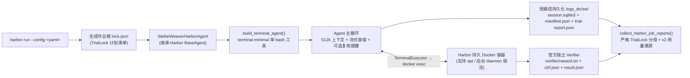

# 评测体系与运行器技术指南

本文档是 StellarWeaver 双评测体系的工程技术参考，系统说明核心回归复现入口、**Terminal-Bench 4.1（Harbor 原生评测器）** 的执行链路与全部冻结参数，以及 **SWE-bench Lite（批量评测器与契约校验）** 的流水线设计。

> **相关文档**：
> - Terminal-Bench 4.1 实测冒烟与 A/B 报告：[TerminalBench4Eval.md](TerminalBench4Eval.md) · 23 题基准档案与同模型标杆：[TB4.1Subset23.md](TB4.1Subset23.md)
> - SWE-bench Lite `dev` 23 题报告与历史归档：[SWEBenchLiteEval.md](SWEBenchLiteEval.md) · 历史 20 题内部评测：[00_Sample_Run.md](archive/00_Sample_Run.md)
> - Harness 各阶段功能与回归验收：[HARNESS_ACCEPTANCE.md](HARNESS_ACCEPTANCE.md)

## 目录

- [复现入口](#复现入口)
- [Terminal-Bench 4.1 与 Harbor 评测体系](#terminal-bench-41-与-harbor-评测体系)
- [SWE-bench Lite 批量评测体系（已归档参考）](#swe-bench-lite-批量评测体系已归档参考)
  - [统一评测协议](#统一评测协议)
  - [SWE-bench Lite 批量评测与单题试跑](#swe-bench-lite-批量评测与单题试跑)

---

## 复现入口

在仓库根目录执行以下命令，可在无外网环境下完整复现静态检查、核心 Demo 与离线回归套件：

```powershell
uv sync --locked --extra web
uv run --locked --offline stellarweaver doctor --offline
uv run --locked --offline python -m stellarweaver.demo
uv run --locked --extra web pytest -q -ra
uv run --locked --extra web ruff check .
uv run --locked --extra web mypy src/stellarweaver
```

前端 TypeScript 类型检查：

```powershell
Push-Location frontend; npm exec -- tsc --noEmit; Pop-Location
```

> 本地工具安全边界与固定安全夹具复现命令见 [SECURITY.md](SECURITY.md#本地工具边界评测)。注意在受限容器/沙箱内跑 `pytest` 时，需确保工作区外临时目录与 Git 路径可读；本机 Windows 环境默认 `D:\Git\cmd` 不在受限沙箱 PATH 时，可前置加入 PATH 后运行。

---

## Terminal-Bench 4.1 与 Harbor 评测体系

Terminal-Bench 4.1 是 StellarWeaver 当前的核心迭代与能力标尺基准。工程上完全复用官方 `harbor==0.25.0` 的任务容器生命周期与官方 Verifier，**不自造题面解析器、容器编排或独立评分器**，从而确保分数与官方排行榜（Claude Code / Ante 等）100% 同口径。

### 1. 架构与执行全流程



关键模块职责：
- **Harbor 原生适配器（[terminal_bench.py](../src/stellarweaver/evals/terminal_bench.py)）**：`StellarWeaverHarborAgent` 原生继承 `harbor.agents.base.BaseAgent`，声明 `AgentCapabilities(reasoning_effort=True)`，负责解析凭证（`extra_env` → `.env` → `DEEPSEEK_API_KEY`）、冻结清单指纹（`config_sha256`、`tools_sha256`、`code_sha`，无 `git` 时回退读取 `.git/HEAD`）、装配运行时并在结束时回填 Harbor `AgentContext`。
- **容器专用单 `bash` 运行时（[terminal.py](../src/stellarweaver/tools/terminal.py) + `build_terminal_agent()`）**：仅注册 1 个 `bash` 工具，将命令委托给 Harbor `BaseEnvironment.exec()`。使用 `PolicyEngine("benchmark", allow_terminal_container=True)`，关闭宿主机专用 `ChangesManager` / `RepoMap` / `InstructionLoader` / `run_linter` / `delegate_exploration`，保持极简 Preamble 与 **97%+** Prefix Cache 命中率。
- **短路径归档与超时取消传播**：会话与 SQLite 统一落在 `<trial>/agent/sw/`（缩短路径避免 Windows `MAX_PATH`）；即使触发 Harbor 外层超时 `asyncio.CancelledError`，仍先完整落盘 `trial-report.json` 与 `AgentContext` 再重新 `raise`，确保 Harbor 正确记录 `AgentTimeoutError` 且不错失真实已消耗用量。

### 2. Harbor YAML 配置与运行时环境变量详解

以标准 19 题配置 [harbor-tb41-fast19.yaml](../deploy/harbor-tb41-fast19.yaml) 与 5 题冒烟配置 [harbor-tb41-smoke5.yaml](../deploy/harbor-tb41-smoke5.yaml) 为例，各字段含义如下：

| 配置字段 / 环境变量 | 典型值 | 工程作用与注意事项 |
| :--- | :--- | :--- |
| `jobs_dir` | `.validation/tb41-fast19` | Harbor 作业输出根目录（已 `.gitignore`），内含作业根 `lock.json`、作业级 `result.json` 与逐题 `<trial>/` 子目录。 |
| `n_attempts` | `1`（`pass@1`） | 每道题运行次数；正式榜单通常 `5`，低成本快速迭代与 A/B 推荐使用 `1`。 |
| `n_concurrent_trials` | `1` 或 `2` | 并发 trial 数。本机 Docker 内存约 **7.5 GiB**，多容器/重编译题建议 `1`，纯 CPU 轻量跑可酌情调至 `2`。 |
| `environment.type` | `docker` | 使用 Harbor 本地 Docker 环境驱动任务镜像。 |
| `environment.delete` | `true`（多题） / `false`（复跑） | 每题结束后是否自动清理容器与镜像。跑 19 题/63 题务必设为 `true` 防止 7.5 GiB Docker 磁盘与内存打满；仅小批 2–5 题频繁复跑调试时设 `false`。 |
| `datasets[].name` / `version` | `terminal-bench/terminal-bench` · `"4.1.0"` | 指定拉取 Harbor Hub 上冻结的 Terminal-Bench 4.1.0 官方任务定义与官方 Verifier。 |
| `datasets[].task_names` | `terminal-bench/<slug>` 列表 | 显式枚举待测题号，严禁中途随意增删以保证同分母对齐。 |
| `agents[].name` | `stellarweaver.evals.terminal_bench:StellarWeaverHarborAgent` | Harbor 动态加载的 Agent 类入口。 |
| `agents[].model_name` | `deepseek/deepseek-flash` | 传入 Harbor 模型标识；`_strip_provider_prefix()` 会剥离前缀映射为 `model="deepseek-flash"`（DeepSeek-V4.1-Flash-1017）。 |
| `agents[].kwargs.reasoning_effort` | `max`（可选 `low \| high \| max`） | 对齐 Harbor Hub 上同模型高分基线的思考强度。 |
| `agents[].kwargs.completion_evidence_reminder` | `true` / `false`（默认 `false`） | **交卷前通用复核提醒开关**。开启后，当模型首次准备无工具交卷且剩余预算充足时，最多追加 1 条仅引用公开题面的通用复核提示，让模型用原任务剩余预算补测并修掉漏网 Bug；压缩时由 `protect_initial_user` 保护初始题面不丢失，并按事件 `seq` 统计 `CancelledError`-safe 的 `post_reminder_*` 增量耗时与调用数。 |
| `agents[].kwargs.stream` | `true`（默认 `true`） | 控制是否启用流式传输与流式断连精细计账。 |
| `agents[].kwargs.env_file` | 可选 `.env` 路径 | 指定凭证文件；不传时依次回退 `extra_env`、`cwd/.env` 与 `DEEPSEEK_API_KEY`。 |
| `PYTHONUTF8=1` | 必备环境变量 | 避免 Windows 中文编码导致 Harbor / Verifier 读写日志或补丁时抛 `UnicodeDecodeError`。 |
| `LITELLM_LOCAL_MODEL_COST_MAP=True` | 必备环境变量 | 禁止 Harbor 内嵌的 LiteLLM 启动时访问外网拉取远端价目表导致启动卡顿或离线失败。 |

### 3. `long_horizon_deepseek_flash(harness_profile="terminal-minimal")` 冻结参数

代码位于 [config.py](../src/stellarweaver/config.py#L204-L284)，专用于 40–120 分钟长程终端任务：

| 维度 | 参数 | 冻结值 | 设计依据 |
| :--- | :--- | :--- | :--- |
| **模型与思考** | `provider` / `model` / `thinking` / `reasoning_effort` | `deepseek` / `deepseek-flash` / `enabled` / `max` | 对应线上 `DeepSeek-V4.1-Flash-1017` 最大推理深度。 |
| **窗口与生成** | `context_window_tokens` / `max_output_tokens` | `512,000` / `65,536` | 经实测 API 探针确认的 512k 窗口与 64k 单次输出上限，避免长思考/大脚本生成被过早截断。 |
| **网络超时与重试** | `request_timeout_seconds` / `RetryConfig` | `240s` / `max_retries=5`（退避 `1s–60s`） | 覆盖 1017 ~40s 首字延迟与跨国长程流式瞬态断连。 |
| **总运行预算** | `max_model_calls` / `max_tool_calls` / `max_wall_seconds` | `None` / `300` / `3600s` | 适配 Harbor 长程任务，主要受 Harbor trial 超时与 300 次工具调用硬顶约束。 |
| **Token 总上限** | `max_input_tokens_total` / `max_output_tokens_total` | `80,000,000` / `2,000,000` | 输入 80M、输出由最初 `600K → 1M → 2M`，防止重思考超长题误撞输出上限。 |
| **命令执行** | `default_timeout_seconds` / `max_timeout_seconds` / 流截断 | `120s` / `1800s` / `1 MiB/stream` | 支持大型 C++/Rust 编译、模型训练与压测，Prompt 显式提示长命令传大超时。 |
| **上下文压缩** | `trigger_ratio` / `target_ratio` / `recent_complete_rounds` / `fresh_tool_rounds` | `0.80` / `0.55` / `6` / `2` | 开启 `calibrated_context_budget=True`、`sticky_context_checkpoint=True`、`protect_fresh_tool_output=True`，压缩后仍保持 97%+ 前缀缓存。 |
| **长程容错** | 截断续写 / 失败引导 / 复读检测 | `max_length_continuations=3` · 软/硬失败阈值 `3/6` · `stream_repetition_detection=True`（上限 `2`） | `length` 安全丢弃半截工具调用并续写；软引导贴附于 `tool` 尾部不打断 `reasoning_content`；监控推理复读并重连。 |
| **极简裁剪（关闭）** | `development_tools`、`issue_navigation`、`include_linter`、`subagent_exploration`、`patch_staging`、`task_evidence`、`budget_guidance`、`import_aware_repomap`、`soft_test_failure_reminder` | 全部 `False` | `terminal-minimal` 仅留 `bash`、并发/预算校准/粘性压缩/容错主干与 `pipeline_metrics=True`。 |

### 4. 裁决分类、严格 `TrialLock` 分母与 v2 用量溯源契约

离线汇总由 `collect_harbor_job_reports(job_dir)`、`aggregate_trial_reports(reports)` 与 `render_markdown_summary(reports)` 完成（均位于 [terminal_bench.py](../src/stellarweaver/evals/terminal_bench.py)）：

1. **Verdict 优先级分类（`_classify_harbor_verdict`）**：
   - `reward_valid` 依据 Harbor `error_policy.policy_for()`（离线回退 `_REWARD_VALID_EXCEPTIONS`，允许 `AgentTimeoutError` 等记录有效得分）。
   - 优先级：**① `reward_valid and reward >= 1.0` → `passed`**（即便带超时异常但官方已给满分仍计通过，并保留异常名）；**② `AgentTimeoutError` / `VerifierTimeoutError` → `timeout`**；**③ `reward_valid and reward < 1.0` → `failed`**；**④ 其余 → `unscored`**。
2. **严格 `TrialLock` 分母契约**：
   - 作业根 `lock.json`（Harbor `TrialLock`）唯一定义计划分母：Pass 1 对计划条目与 `<trial>/lock.json` 执行完整等价匹配，校验 `task_digest`、`agent_name`、`model_name`、`kwargs`、`environment` 与 `verifier`；仅当子 `lock.json` 缺失时走 Pass 2 无歧义字段兼容回退。
   - 若 `lock.json` 损坏，则强制 `planned_denominator_verifiable = False`、`resolved_rate = None`（绝不虚报通过率）。
   - 磁盘上多出的额外试验标为 `planned = False`、`receipt_status = "unplanned"`，**保留审计但排除出主通过率与主用量统计**；Harbor 全局 `n_pending_trials` 仅作作业级 `job_pending_trials` 展示。
3. **`verifier/ctrf.json` 子测试诊断**：若存在，解析 `results.summary` 提取 `total` / `passed` / `failed` / `skipped`，用于区分「差一点（如 `59/60`、`95/97`）」与「方向性失败」。
4. **v2 逐字段用量溯源与 WAL 只读回读**：
   - `_summarize_usage_events()` 通过 `input_estimated` 与 `output_estimated` 独立把输入/输出归类为 `reported` / `estimated` / `unknown`，分别输出 `input_usage_complete`、`output_usage_complete` 与 `cache_usage_complete`。**`cache_hit_ratio` 仅基于经确认的 `reported_cached_input_tokens / reported_input_tokens` 计算**。
   - **零字节断连不虚扣**：流式请求 `chunk_count == 0` 且无部分流时，输出预算记 `0`；仅中途断连按已收字符保守估算并记入 `failed_estimated_*`（彻底与 `reported_*` 剥离）。
   - 缺少 v2 字段的旧收据通过限域 WAL 只读快照安全回读 `sw/session.sqlite3` 补齐实报用量；不可证实部分显式记为 `unknown` 或 `legacy_mixed_unverified`。
5. **`verification_status` 语义**：命令去重键 `[tool_name, argv ?? command, cwd]` 修复 `bash` 键碰撞问题；`terminal-minimal` 模式下普通 `bash` 不再把任意 `exit_code=0` 判为已验证（无显式 `CompletionProof` 时如实记为 `not_run`）。
6. **计价口径（`_estimate_deepseek_cost_usd`）**：按 DeepSeek API 公开标准价折算美元（命中 `$0.006/1M`、未命中 `$0.30/1M`、输出 `$1.20/1M`）；工作日 `18:00–次日 09:00`、`12:00–14:00` 与周末/法定节假日谷期实际账单享受 **50% 折扣**。

### 5. Harbor 启动与离线复算命令

```powershell
# 1. 启动 Terminal-Bench 4.1（以 19 题标准子集配置为例，推荐在谷期窗口运行）
$env:PYTHONUTF8 = "1"
$env:LITELLM_LOCAL_MODEL_COST_MAP = "True"
.\.venv\Scripts\harbor.exe run --config deploy/harbor-tb41-fast19.yaml --env-file .env

# 2. 离线汇总作业目录（严格 TrialLock 分母 + v2 实报用量 + ctrf.json 摘要）
uv run --locked --offline python -c "
from pathlib import Path
from stellarweaver.evals.terminal_bench import collect_harbor_job_reports, render_markdown_summary
reports = collect_harbor_job_reports(Path('.validation/tb41-fast19/<job_timestamp>'))
print(render_markdown_summary(reports))
"
```

---

## SWE-bench Lite 批量评测体系（已归档参考）

> **状态说明**：SWE-bench Lite 已完成全量 `dev` 23 题验证并正式收官归档（见 [SWEBenchLiteEval.md](SWEBenchLiteEval.md)），后续不再推进 `test` 300 题或消融实验。以下保留其批量评测器与契约校验架构说明，作为工程资产与离线复算参考。

### 统一评测协议

统一契约（[swebench_contract.py](../src/stellarweaver/evals/swebench_contract.py)）约束所有 SWE-bench Lite 离线汇总、配对对照与工作台实验看板发布。

#### 离线报告、看板发布与配对命令

```powershell
# 1. 将实验目录汇总为标准契约报告，并发布到工作台「实验记录」目录（无需重启容器）
uv run --locked --offline python -m stellarweaver.evals.swebench_contract report `
  .validation/<实验目录> `
  --output .validation/workbench-experiment/reports/<报告名>.json

# 2. 两份报告按题号做严格配对对照（须显式声明允许差异的控制项）
uv run --locked --offline python -m stellarweaver.evals.swebench_contract compare `
  .validation/workbench-experiment/reports/<基线报告>.json `
  .validation/workbench-experiment/reports/<实验报告>.json `
  --vary config_sha256 --vary prompt_sha256 --vary tools_sha256
```

#### 数据契约与身份绑定

- 任何已发布报告由四层对象构成：**Manifest**（数据集修订/SHA-256、题目顺序、模型、预算、窗口、代码指纹）、**Attempt**（候选补丁、状态、用量与耗时）、**Score**（独立官方评分器在断网容器中的裁决）与 **Evidence**（摘要哈希、日志与验证制品）。
- 评分记录强绑定 `instance_id`、`attempt_id`、`patch_sha256`、`scorer_sha256`、`image`、`grader_version` 与 `raw_report_sha256`，任一哈希不匹配即拒绝复用或汇总。
- 公开输入（`task.json`）与隐藏评分字段（`scorer.json`）在 `prepare` 阶段物理隔离；Agent 仅读取公开题面与基线仓库。

#### 分母、计量与配对规则

- **计划题数即分母**：`resolved_rate = resolved / planned`；未运行、超时、超预算、空补丁、环境错误与评分失败全部保留在分母中，禁止剔除后重算。
- **配对对照**：仅比较双方在相同数据集修订、模型、窗口、预算与评分条件下**同时具有独立判定**的题号，其余题号记录排除原因；允许变化的自变量必须通过 `--vary` 显式声明。
- **成本与缓存计量**：总输入 token 包含缓存命中与未命中；报告单独记录 `cached_input_tokens` 以便核算真实 Prefix Cache 命中率与谷期成本。

### SWE-bench Lite 批量评测与单题试跑

#### 批量评测入口（`stellarweaver.evals.swebench`）

批量入口固定 SWE-bench Lite 上游修订 `b0dde1093fe417d83b7184254edf8199c1f0dff5`，校验 `dev`（23 题）和 `test`（300 题）的 Parquet SHA-256 与题号。

- **五阶段流水线**：`prepare`（冻结题面与预算）→ `run`（运行 Agent 产出候选）→ `export`（生成标准 `predictions.jsonl`）→ `evaluate`（调用官方 `swebench` 评分器在断网容器中裁决）→ `report`（汇总单批结果）。
- **冻结窗口与预算**：`prepare` 默认冻结 `200,000` token 窗口（兼容旧清单回退 `100,000`），默认不限模型调用次数，每题默认 `max_tool_calls=50`、`max_wall_seconds=360`、`max_input_tokens_total=320,000`、`max_output_tokens_total=16,000`，均可在 `prepare` 阶段通过 CLI 覆盖冻结（DeepSeek Thinking 推荐 `--max-tool-calls 80 --max-wall-seconds 600 --max-input-tokens-total 3000000 --max-output-tokens-total 64000`，并支持 `--reasoning-effort low|high|max`）。
- **执行配方（`--recipes`）**：按题号或 `owner/repo` 指定 `image`（本地镜像 `sha256:...`）、`pytest_args`、可选 `dependencies`（`--assets` 下的只读依赖目录，容器内通过 `site.addsitedir("/deps")` 加载含 `.pth` 在内的依赖）和 `grader_image`（官方评分镜像 `repo@sha256:...`）。
- **一键预设与单因素消融**：`run` 支持 `--harness-profile baseline|full`（默认 `baseline` 全关；`full` 开启全部已交付 Harness 能力与 14 项流水线开关，含 `run_tests` 细粒度过滤、`run_python_snippet`、`git_log`/`git_show`、`apply_patch`、只读并发、上下文三项优化与子 Agent 探索），并支持在预设上用 `--no-<开关>` 或显式开关覆盖。展开后的完整配置与 `config_sha256` 冻结写入 `run-settings.json` 防漂移。
- **Windows 兼容与官方镜像复用**：基线检出统一传 `-c core.longpaths=true -c core.autocrlf=false` 避免深层路径与 CRLF 污染；补丁校验临时目录使用短路径系统 temp 并开启容错清理避免 `MAX_PATH` 异常；评分器以 `python -I -X utf8` 启动修复中文 Windows 下非 ASCII 测试补丁编码问题，并支持 `evaluate --instance-id` 定向重评。
- **按仓库分批评测助手（[swebench_eval_helper.py](../scripts/swebench_eval_helper.py)）**：支持直接复用 Docker Hub 官方预构建 SWE-bench 镜像，评测数据与产物统一存放在已 `.gitignore` 忽略的 `SWEBenchLite_Eval/` 目录中：
  - `prepare-recipes --repo <owner/repo>`：按仓库拉取官方镜像（带 180s 超时 4 次重试）并生成 `recipes.json`；
  - `prefetch-assets`：带 5 次重试与 `HEAD` 完整性校验预拉取基线提交；
  - `prune-images --report <合同报告>`：带防误删守卫（仅在 `not_evaluated=0` 且 `evaluation_error=0` 时清理本批镜像，避免本地磁盘膨胀）。

#### 完整批处理参考命令

```powershell
$swRun = 'SWEBenchLite_Eval/runs/dev-full-marshmallow'
$swData = 'SWEBenchLite_Eval/datasets/dev.parquet'
$swSha = (Get-FileHash -LiteralPath $swData).Hash.ToLowerInvariant()
$swGrader = '.validation/swebench-lite-pilot/grader-venv/Scripts/python.exe'
$swAssets = 'SWEBenchLite_Eval/assets'
$swRecipes = 'SWEBenchLite_Eval/recipes/dev-marshmallow.json'

# 1. 按仓库拉取官方镜像并生成配方
uv run --locked python scripts/swebench_eval_helper.py prepare-recipes `
  --dataset $swData --grader-python $swGrader --repo marshmallow-code/marshmallow --output $swRecipes

# 2. 冻结清单与预算，并预拉取基线提交
uv run --locked python -m stellarweaver.evals.swebench prepare `
  --dataset $swData --dataset-sha256 $swSha --split dev `
  --grader-python $swGrader --recipes $swRecipes --output $swRun `
  --context-window-tokens 200000 --max-tool-calls 80 --max-wall-seconds 600 `
  --max-input-tokens-total 3000000 --max-output-tokens-total 64000
uv run --locked python scripts/swebench_eval_helper.py prefetch-assets `
  --experiment-dir $swRun --assets $swAssets

# 3. 运行（baseline / full / 单因素覆盖，支持 --fake-scripts 与 --retry-interrupted）
uv run --locked python -m stellarweaver.evals.swebench run `
  --output $swRun --assets $swAssets --env-file .env --harness-profile full --live

# 4. 导出、官方独立评分（支持 --instance-id 定向重评）、汇总、发布看板并清理本批镜像
uv run --locked python -m stellarweaver.evals.swebench export --output $swRun
uv run --locked python -m stellarweaver.evals.swebench evaluate --output $swRun --grader-python $swGrader
uv run --locked python -m stellarweaver.evals.swebench report --output $swRun
uv run --locked python -m stellarweaver.evals.swebench_contract report $swRun `
  --output .validation/workbench-experiment/reports/dev-full-marshmallow.json
uv run --locked python scripts/swebench_eval_helper.py prune-images `
  --recipes $swRecipes --report .validation/workbench-experiment/reports/dev-full-marshmallow.json
```

> 单题复现闸门脚本 `stellarweaver.evals.swebench_pilot` 保留用于历史 `marshmallow-1359` 复现对照；23 题 `dev` 实测汇总、3 题冒烟及 Phase 2 历史基线均已完整归档至 [SWEBenchLiteEval.md](SWEBenchLiteEval.md#附录历史试跑与阶段基线归档迁移自-evaluationmd)。
