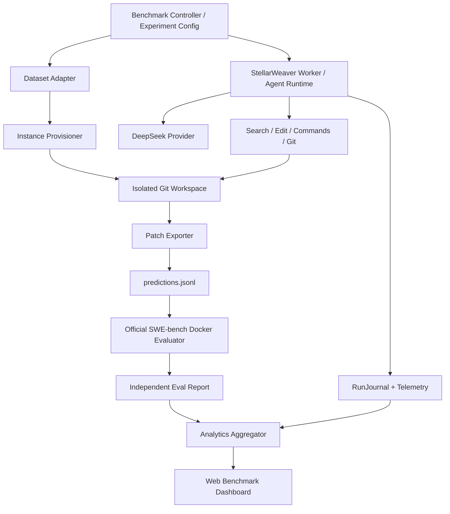

# StellarWeaver × SWE-bench Lite：Harness 优化与可复现实验实施方案

> **用途**：交给 Codex 的工程实施规范和阶段验收清单。  
> **项目**：[lyx0902/StellarWeaver](https://github.com/lyx0902/StellarWeaver)  
> **基准**：[SWE-bench Lite](https://www.swebench.com/lite.html)  
> **目标模型**：DeepSeek API `deepseek-flash`；**每次实验必须保存请求模型 ID、响应/文档可确认的实际模型版本及 Thinking 配置**。  
> **编写日期**：2026-11-20  
> **重要原则**：保留现有产品功能；先获得可信、可复现的基线，再进行 Harness 改造；所有指标以实测为准，不预设提升。

---

## 0. 给 Codex 的总任务说明（可直接复制）

你正在维护现有仓库 `lyx0902/StellarWeaver`。请**先读取仓库实际源码和最新文档**，不要依赖本文中的路径描述盲目修改。我们要将 StellarWeaver 从「具备 CLI 和 Web 工作台的 Coding Agent」扩展为「可以在 SWE-bench Lite 上进行可复现、可审计的 Harness 实验的平台」。

执行时遵守：

1. **不重写现有架构**。沿用现有 Python Agent Runtime、ModelProvider、Tools、Policy、ContextManager、RunJournal、Web Worker、PostgreSQL、Git Worktree、验证执行器和 React 前端。通过清晰接口新增 Benchmark Adapter / Evaluator / Analytics。
2. **先完成第 1、2 阶段，交付可运行的端到端最小闭环，再继续优化**。每个阶段都附单元测试、集成测试、可复现命令、变更文件、结果说明与未解决问题；不要一口气修改全部模块。
3. **不要伪造成绩、运行日志、Token 费用或性能提升**；没有真正运行则标记 `not_run`。不把项目内的 20 题成绩当作 SWE-bench 成绩。
4. **SWE-bench 的 `patch`、`test_patch`、`FAIL_TO_PASS`、`PASS_TO_PASS` 及最终评测报告只供独立评测端使用，不进入 Agent 的任何提示、工具输出、仓库可访问文件或模型请求**。`hints_text` 是否使用必须作为显式实验配置，默认禁用并记录。
5. **所有执行不可信项目代码的操作都必须进入受限隔离环境**，不能只隔离最终验证。不得因为 Benchmark 模式就绕开安全边界。在无人工交互时，使用明确的容器内受限授权策略；不要悄悄扩大宿主权限。
6. 固定模型与预算比较 Harness；如果修改 Thinking 等模型配置，要把它单列为模型配置实验，不能把由此产生的增益宣称为 Harness 增益。
7. 每次实验保存 Git 提交 SHA、数据集版本/修订、环境镜像、模型配置、Prompt/工具 Schema 哈希、随机种子（若适用）、预算、启动时间、评测器版本和全量运行记录。敏感信息必须脱敏。
8. 每个阶段结束时输出「已实现、测试情况、使用命令、验收结果、尚待完成」，未通过验收不要声称完成。

**交付目的**：能够命令行批量运行 Lite 的 23 道 dev 题和 300 道 test 题，导出标准 `predictions.jsonl`，调用官方评测器获得 resolved 结果，并用现有 Web 工作台展示每题执行轨迹、成本、成功/失败、Harness 消融与两组轨迹对比。

---

## 1. 背景：为什么做 SWE-bench Lite

SWE-bench Lite 有 **300 道 test 题和 23 道 dev 题**。每题基于真实 GitHub 仓库的历史提交与 Issue：Agent 需要定位缺陷、修改仓库、生成 Git patch；官方 Docker 评测器独立应用补丁并验证测试。其用途不仅是比较模型，更是研究同一模型在不同 Coding Agent / Harness 下的工程表现。

**目标主张（待实验验证）**：

> 在相同 DeepSeek Flash 模型、相同样本和相同资源预算下，通过改进代码定位、验证反馈、上下文管理及自适应执行策略，提高修复成功率，或在成功率不下降的情况下降低单位成功修复成本。

需要同时衡量：

- **Effectiveness**：Resolved Rate（任务修复成功率）。
- **Efficiency**：总 API 成本、Cost per Resolved、模型请求数、工具调用数、Tokens、墙钟时长。
- **Reliability**：无效补丁、权限阻断、执行异常、超时、回滚/恢复的成功率。
- **Explainability**：为什么成功/失败、哪些 Harness 改动引起可观察的差异。

### 1.1 公开参考成绩（仅作为外部参考，非本项目目标值）

2026-10-20，Yuki 项目方发布的 DeepSeek Flash 1017 + Yuki Agent 在 SWE-bench Lite **216/300 = 72.00%** 的第三方实测，采用 Thinking High；**并非官方统一的 DeepSeek 模型独立成绩，也不是与 StellarWeaver 的公平同预算对照**。请在项目报告里标明其第三方性质、模型/预算/推理配置差异，不能直接以差值认定 Harness 优劣。

参考：[Yuki 公开实验记录](https://github.com/YuanYeYouTao/Yuki/blob/main/docs/benchmarks/2026-10-20-yuki-flash-1017/README.md)。如果链接或记录变化，以可核对的原始报告为准。

### 1.2 现有 StellarWeaver 基线（根据仓库当前文档，实施前必须复核）

- CLI/Web 共用 Python Agent Loop；ModelProvider 可接 DeepSeek/OpenAI 兼容 API；工具与授权、流式、重试和预算已实现。
- 内置工具涵盖搜索、文件读写、命令执行和 Git 差异；Skills、MCP 当前主要由 CLI 接入。
- Python AST Repo Map、AGENTS.md 与上下文压缩；SQLite/PostgreSQL Journal 可回放和恢复；工作台已有 FastAPI/React、Worker、队列、SSE、审批、Git Worktree 和专用验证容器。
- 历史自建 20 题集：DeepSeek `deepseek-flash`、Non-thinking，初评 **19/20**，修正规则后零模型重评分 **20/20**。这是**固定小型自建任务**，不是 SWE-bench，也不能外推大型仓库。
- 现有参考配置：100k 应用上下文、30 模型请求、100 工具调用、900 秒、累计输入 1M Tokens / 输出 30k Tokens。须在实际源码中确认是否仍有效。
- 核心源码路径参考：`src/stellarweaver/providers/openai_compatible.py`、`src/stellarweaver/providers/streaming.py`、`src/stellarweaver/domain/`、`src/stellarweaver/runtime/`、`src/stellarweaver/context/`、`src/stellarweaver/web/`、`frontend/`、`src/stellarweaver/evals/`。

**已发现的明确技术缺口**：目前 `OpenAICompatibleChatProvider.complete()` 与 `stream()` 对 DeepSeek 显式使用 `thinking: disabled`，同时流式聚合没有保存 DeepSeek 的 `reasoning_content`。需要先补齐 Thinking + Tool Calling 协议，才适合比较与 Thinking High 外部运行的结果。

---

## 2. 总体架构与职责边界



### 2.1 明确分离三个进程/信任域

1. **Agent 执行域**：只收到 `instance_id`、`repo`、`base_commit`、`problem_statement` 及必要的环境信息；工具限制在指定隔离工作区内。
2. **评分域**：能够访问官方数据集里的隐藏测试和参考信息，负责运行官方评测器；不得把这些数据传回 Agent 域。
3. **分析/展示域**：记录 Agent 自身运行过程以及正式评分结果；可以读结果，但不把官方评分细节重新当作当前任务的模型上下文。

安全要求：仓库代码和测试可能包含危险命令。Benchmark 所有命令执行、安装和测试需要无宿主凭据、最小权限、资源限制、网络策略（只在必要的依赖安装阶段允许可信源），并阻止读取宿主文件或全局 `.env`。如果现有 Web 容器当前只隔离验证命令，则**须新增 Agent 工具执行隔离适配**；不能直接使用 CLI 的 Host backend 跑外部任务。

---

## 3. 实施阶段与验收标准

### Phase 0 — 冻结现状与环境核查（先做）

**任务**

- 检查 README、ARCHITECTURE、ROADMAP、VALIDATION、[历史评测结果](archive/legacy/INTERNAL_EVAL_RESULTS.md)以及关键模块，绘制真实数据流。
- 跑现有单元测试、集成测试、构建；记录当前实际通过/跳过/失败数及环境依赖。
- 核实 DeepSeek API 支持的 `thinking`、`reasoning.effort`、`reasoning_content`、流式 Tool Call 结构和缓存用量字段，不凭假设添加请求参数。
- 记录基线 Git SHA，避免同时混入无关的 Web 或界面改动。
- 确定 Benchmark 数据版本、官方评测器版本和 Docker/WSL2 支持情况。

**验收**：提供现有测试报告、架构差距清单、风险清单与逐阶段变更计划。无功能回归。

### Phase 1 — DeepSeek Thinking Provider 协议补齐（P0）

**实现**

- 新增可配置 Thinking 模式：`disabled` / `enabled`。推理强度使用 API 当前支持的名称和值，例如 `reasoning.effort`，以官方协议为准。默认值应保证旧用例兼容。
- `complete()` 与 `stream()` 行为一致；支持在多轮 Tool Calling 中正确保存和回传**当前 API 要求的** `reasoning_content`。
- 在领域消息/Provider serialization 和流式 accumulator 中建立必要字段；不要在 Web 用户界面公开原始推理内容，也不要把它塞进公开日志。若需要保存在 Journal 中确保可续接，应设置访问控制、加密/脱敏与保留策略，最小化存储。
- 处理 tool call 分片拼装、finish reason、重复 ID、流被中断、重试、历史压缩后的协议一致性。
- 验证窗口、输出上限、请求耗时与 Tokens 计量是否覆盖 Thinking 模式；不能默认为历史 Non-thinking 行为。
- 不修改现有安全策略和工具权限。

**测试**

- Mock 非流式、流式、Thinking/Non-thinking、工具调用、多个工具、部分流中断、缺失字段、400 参数异常。
- 有效的 Tool Calling 往返：assistant(reasoning + tool_calls) → tool message → assistant follow-up。
- Compaction/Resume 后消息序列符合 API 协议，不会丢失必要的配对字段。
- 一个最小真实 API 冒烟测试（仅在用户配置真实 Key 后进行）。

**验收**：Non-thinking 不回归；Thinking+Tools 端到端完成；报告实际 token、API 请求次数和配置；不以能返回普通文本作为通过标准。

### Phase 2 — SWE-bench Lite Adapter + 可信最小闭环（P0）

**新增建议模块（具体路径按现有架构调整）**

```text
src/stellarweaver/benchmarks/
  dataset.py          # dataset/split/instance adapter & filtering
  environment.py      # immutable base checkout, task sandbox, cleanup
  runner.py           # orchestrate one instance / batch
  predictions.py      # diff validation and JSONL export
  evaluator.py        # isolated official swebench invocation
  schemas.py          # typed task/run/attempt/result contracts
  provenance.py       # dataset, commit, env, model fingerprints
  reporting.py        # aggregator and reports

# 可扩展现有 web/ routes 与 worker，不必新建第二个调度框架
# 可扩展现有 src/stellarweaver/evals/，分别记录 internal-20 与 swebench-lite
```

**任务适配**

- 下载/缓存版本固定的 `SWE-bench/SWE-bench_Lite` 或官方文档支持的固定镜像名称；按 `dev`(23) 与 `test`(300) 分别运行。
- 最小传入 Agent 字段：`instance_id`、`repo`、`base_commit`、`problem_statement`。`hints_text` 单独可配置，默认关闭；记录其使用情况。
- 创建真实仓库工作树，精确 checkout 到 `base_commit`，确保任务之间不共享未清理修改、缓存记忆和工具状态。
- **防泄漏**：绝不把 `patch`、`test_patch` 或官方测试 Oracle 输入模型；默认不让 Agent 搜索对应 Issue 的历史 PR/参考修复，限制可访问 Git 后续历史与外网；保存规则执行证据。
- 无头运行（headless）：指定只对容器内白名单操作进行自动批准；Host 操作仍须阻断。记录所有授权决策。
- Agent 退出时，从基线计算**仅包含 Agent 变更**的 `git diff`；处理未追踪新文件、非法路径、空 patch、二进制文件、旧工作区脏状态与异常中止；不得混入项目初始化/依赖安装改动。
- 对 patch 进行可应用性检查，但**不能将官方隐藏评分回流指导同一次 Agent 修复**。

**标准 prediction（JSONL 每行一条）**

```json
{"instance_id":"sympy__sympy-20590","model_name_or_path":"StellarWeaver-DeepSeek-Flash-B0","model_patch":"diff --git a/... b/...\n..."}
```

**调用官方评测器（推荐先用独立 Linux/WSL2 环境）**

```bash
python -m swebench.harness.run_evaluation \
  --dataset_name SWE-bench/SWE-bench_Lite \
  --split dev \
  --predictions_path predictions-dev.jsonl \
  --max_workers 2 \
  --run_id stellarweaver_dev_b0_001
```

实际执行前，运行 `python -m swebench.harness.run_evaluation --help`，确认该安装版本的 flags、dataset 名称与 `dev` split 支持；如果官方版本改变，以安装版本的接口为准。评测 test 时显式 `--split test`。**不同预测或不同配置必须使用不同 `run_id`**，避免官方缓存复用旧评分。

**测试**

- FakeModel/固定小夹具先跑 Adapter、快照、补丁导出、预测格式、任务隔离、评测结果归档。
- 23 道 `dev` 的首次真实运行只用于检查闭环；分离环境/下载/代码错误和模型任务失败。
- 建立 Agent 禁止读取 gold patch、hidden tests 与本地敏感文件的安全断言。

**验收**：至少能成功端到端运行一个官方 dev 实例并得到可归因的真实官方评分结果；随后 23 道 dev 可批量运行、可中断继续且不重复执行已确定有副作用的操作；所有失败都有结构化状态，不能把未评测样本计为 resolved。

### Phase 3 — 观测、后端存储与实验管理（P0）

沿用现有 Journal/Worker/PostgreSQL，新增 Benchmark 数据模型（建议字段）：

| 实体 | 关键字段 |
| --- | --- |
| `BenchmarkExperiment` | experiment_id, label, code_sha, dataset_revision, evaluator_version, model_id, thinking_mode, reasoning_effort, config_hash, prompt_hash, tools_hash, budget, created_at |
| `BenchmarkTaskRun` | experiment_id, instance_id, split, attempt_id, run_id, workspace_id, start/end_time, status, termination_reason, patch_sha, predictions_path |
| `BenchmarkUsage` | request_count, tool_calls, input_tokens, output_tokens, cached_input_tokens, estimated_usage, billed_cost, pricing_version |
| `BenchmarkEvaluation` | instance_id, official_run_id, patch_applied, resolved, eval_status, raw_report_path, grader_version |
| `BenchmarkArtifact` | trace_path, redacted_events, patch_path, logs_path, env_fingerprint, hashes |

**状态至少分清** `queued/running/completed/blocked/timeout/failed/interrupted` 和 `not_evaluated/unresolved/resolved/evaluation_error`。`run_status=completed` **不代表** `resolved=true`。

- 支持按实验 ID 与 `instance_id` 查询全部数据；重启后继续读取持久队列和之前的可验证状态。
- 报表记录缓存命中、完整输入/输出 Tokens、缓存缺失时的估算标识；成本使用**运行当时定价快照**计算，区分缓存/非缓存输入及输出。
- 日志禁止记录 API Keys、宿主 `.env` 和未经授权的敏感内容；高敏感推理字段保持最小留存。

**验收**：同一 `instance_id` 两次独立运行可以比较，不会相互覆盖；导出 CSV/JSON（或 Parquet）含原始证据路径；重新汇总无需再次调用模型。

### Phase 4 — 逐项 Harness 优化与消融（P1）

#### H1：Issue-Aware Repository Localization

在已有 Python AST Repo Map 基础上，增加针对 Issue 的符号/路径/异常栈/相关测试检索、候选文件排序以及按需读取。**不要直接一次性向模型注入整个仓库**。

候选排序可以从简化线性公式开始：

\[
S(f)=\alpha K(f)+\beta A(f)+\gamma T(f)+\delta G(f)
\]

其中 `K` 是关键词，`A` 是 AST 符号，`T` 是异常栈/测试，`G` 是调用关系；先做可解释的固定权重，后续再验证权重选择。对照组保持相同上下文、模型与预算。

**指标**：Top-1/Top-5 定位准确率、首次有效编辑前 Token、定位耗时、最终 Resolved Rate。注意 gold 修改文件仅能用于**离线分析/评分**，不能用于 Agent 的检索。

#### H2：Failure-Aware Verification & Recovery

建立结构化失败分类器：断言失败、导入/依赖失败、语法/运行时失败、patch 冲突、超时、权限阻断、重复无进展等。

新增「验证失败 → 分类 → 有针对性地补充证据 → 重新编辑/回滚/停止」策略。利用已有编辑前后哈希和 Journal 保证回退安全；避免盲目重复同一命令或累积无效补丁。

**指标**：失败后修复成功率、重复失败次数、无效工具调用比例、每成功任务请求数、Resolved Rate。

#### H3：Task-Aware Context & Prefix Cache

与当前 History Compaction 对照：保留 Issue、已验证假设、关键代码路径、最近 patch、测试失败信息和必要工具 ID；长日志保留可重新读取的制品链接。稳定系统前缀与工具 Schema，观察 DeepSeek Prefix Cache 命中与成本变化；不能因省 Token 破坏 Thinking 多轮协议。

**指标**：Resolved Rate、上下文相关输入占比（需定义）、cache hit、累计输入 Tokens、Cost per Resolved。

#### H4：Adaptive Budget

根据定位进展、测试反馈、重复错误和剩余成本动态分配工具/请求/验证预算；在相同**总预算上限**下比较固定预算策略。可尝试分阶段预算（定位/编辑/验证）和无进展终止，不得简单通过给增强组更高上限实现提升。

**指标**：Resolved Rate、平均/中位成本、Cost per Resolved、超时/预算耗尽率、P50/P95 时长。

#### H5：Multi-Candidate / Multi-Agent（后续可选）

仅在 H1-H4 有可靠结果后评估。单次轨迹、多个候选 `Best-of-N`、子 Agent 协作分别报告；披露额外资源和选择机制，绝不与单次尝试成绩混淆。

**每个优化模块都必须提供实验开关**、单元测试、可观测事件和单独消融；最终实现可关闭某一模块回归到原始行为。

### Phase 5 — Web Dashboard（P1）

基于现有 React 工作台/FastAPI API/PG/SSE 增加三个页面或视图：

1. **Benchmark Overview**：总测试数、Resolved/Unresolved/Not evaluated、Resolved Rate、Tokens、缓存命中、API 成本、Cost per Resolved、P50/P95 耗时；按仓库、实验、失败类型和配置筛选。
2. **Task / Trajectory Comparison**：同一 `instance_id` 两组轨迹的搜索/读取/编辑/测试/回退时间线、最终 diff、关键测试输出、各轮 Token 和成本。清晰标记哪一步多做或少做了工作。
3. **Failure Analysis**：空补丁、补丁不可应用、错误文件定位、测试不通过、超时、权限阻断、环境准备失败、API 报错。提供样本钻取和下载脱敏运行证据。

不要新建与现有 Worker 重叠的任务调度系统。页面必须清晰标出「模拟/尚未运行」与「真实官方评分」，绝不预填虚构成功率。

**验收**：从 Dashboard 任意失败任务可跳转到其运行记录、补丁与官方评分证据；能复现两组实验的核心汇总，刷新/重启后不丢失。

---

## 4. 实验设计：避免把模型能力误归因于 Harness

建议两层分组：

| 组别 | 配置 | 主要目的 |
| --- | --- | --- |
| A0 | 当前 StellarWeaver + `deepseek-flash` Non-thinking | 历史行为参考，确认迁移不回归 |
| A1 | 当前 StellarWeaver + Thinking High（其余固定） | 单独量化模型配置收益，**非 Harness 增益** |
| B0 | Thinking High + 固定同一预算 + 当前 Harness | 正式 Harness 基线 |
| B1 | B0 + H1 Localization | 代码定位模块收益 |
| B2 | B1 + H2 Verification/Recovery | 失败反馈收益 |
| B3 | B2 + H3 Context | 上下文模块收益 |
| B4 | B3 + H4 Adaptive Budget | 预算模块收益 |

以上是**逐步累加**的工程收益曲线。为了分析单组件作用，还应在最终完整配置上分别**关闭一个模块**，做 leave-one-out 消融，不能把累计组间差异误认为各模块的独立主效应。

### 4.1 固定变量

- 数据集修订、instance 清单与顺序、仓库 base commit、官方评分器版本。
- 目标模型实际版本、Thinking/effort、温度和其他可用采样参数、API endpoint。
- 相同系统提示与工具 Schema 的比较范围（若 H1 要改变工具信息，则将其作为实验变量记录）。
- 相同单次任务总预算：模型请求、工具调用、Token、总时长、容器资源。
- 任务之间隔离上下文和状态；不能从某题的 gold/评分结果反向指导同轮解题。
- 每题一次正式尝试的指标与多次重复采样指标分开报告。

### 4.2 实验流程

1. 用**23 道 dev** 调通所有模块与评分链路、回归测试及开发参数。避免在 300 道 test 上反复调权重、挑失败案例定向打补丁。
2. 冻结代码和配置版本，执行一次完整 **300 道 test** 的 B0 正式基线。
3. 逐个模块开发和在 dev/自建额外任务评估；冻结版本后执行对应 test 评测。对已经反复查看的 test 结果，报告需要明确“迭代接触过 test”，不可再称完全独立的泛化评估。
4. 选择有代表性的设置对每题多次独立运行（例如 3 次），报告方差、失败类型与可复现性；如果成本受限，先对 dev 重复，test 报告样本次数限制。
5. 同一样本的成功/失败差异用**配对统计**（如 McNemar 或配对 bootstrap）分析并给置信区间，不仅罗列百分点。
6. 尽可能再用更新、与训练语料重叠风险更小的独立任务集做泛化验证，说明 SWE-bench Lite 的历史 Issue 污染限制。

### 4.3 指标定义与分母

- `Resolved Rate = 官方 resolved 任务数 / 评测计划任务总数`；同时单独报告 *actually evaluated* 数、未启动数与评测基础设施错误数。若采用固定 300 题完整报告，不能删除失败任务美化分母。
- `Cost per Resolved = 所有任务产生的 API 总费用 / 官方 resolved 数`；分母为 0 时标记 `N/A`。
- `Patch Apply Rate = 成功应用的 patch 数 / 有有效候选 patch 的任务数`，另报 Empty Patch Rate，避免只看可应用样本造成选择偏差。
- `Tool Error Rate = 工具执行错误次数 / 已执行工具次数`，授权拒绝与取消另报。
- `Recovery Rate = 预定义可恢复故障中最终成功恢复的次数 / 此类故障总次数`；故障类别和统计时间窗口需固定。
- `Latency P50/P95` 按单次任务总墙钟时长统计；区分 Agent 用时和官方容器评分用时。
- `Input/Cached/Output Tokens` 优先用 API 返回的准确量；缺失时显式标记 estimate；不能把缓存命中 Token 重复累计到总输入之外。

### 4.4 推荐的汇总产物

```text
benchmark-runs/<experiment_id>/
  manifest.json               # code_sha, dataset_revision, model, budget, env, prompts
  predictions.jsonl           # 官方格式的所有任务预测
  task_results.jsonl          # 任务终态 + usage + artifacts paths
  official_evaluation/        # 官方评测结果与日志
  aggregate.json              # 指标汇总 + 口径 + 分母
  per_instance_comparison.csv # 与另一实验按 instance_id 配对
  report.md                   # 实验说明、失败分布、结论、局限
```

实际产物存储在现有忽略提交的数据目录或对象存储；Git 中只提交脱敏的复现脚本、配置模板和可公开汇总，不提交密钥、私有日志或大批临时环境文件。

---

## 5. 建议的 CLI / 配置接口（**目标接口，不代表当前已经存在**）

Codex 可根据现有 Typer CLI 改成更契合项目的命名，但应保持可脚本化、可恢复和配置可追溯：

```bash
# 1. 核验数据/依赖/评测器/容器环境
uv run stellarweaver benchmark doctor --suite swebench-lite

# 2. 跑 dev 小样本（先跑 1–3 题，再跑 23 题）
uv run stellarweaver benchmark run \
  --suite swebench-lite --split dev --config benchmark.b0.toml \
  --limit 3 --output .validation/swebench/dev-smoke

# 3. 全量 B0（须有用户明确同意与 API 预算）
uv run stellarweaver benchmark run \
  --suite swebench-lite --split test --config benchmark.b0.toml \
  --output .validation/swebench/b0

# 4. 从已有记录导出官方预测
uv run stellarweaver benchmark export \
  --run-dir .validation/swebench/b0 --format swebench-jsonl

# 5. 调用独立官方评分器并保存 run_id
uv run stellarweaver benchmark evaluate \
  --run-dir .validation/swebench/b0 --official-run-id b0_20261120_001

# 6. 不重跑模型，仅从原始记录重算指标
uv run stellarweaver benchmark report --run-dir .validation/swebench/b0
```

### 配置样例（字段名称以实际实现为准）

```toml
[suite]
name = "swebench-lite"
dataset = "SWE-bench/SWE-bench_Lite"
split = "dev"
revision = "PIN_ME_TO_EXACT_REVISION"
allow_hints = false

[model]
provider = "deepseek"
model = "deepseek-flash"
thinking = "enabled"
reasoning_effort = "high"

[limits]
max_model_calls = 50
max_tool_calls = 150
max_wall_seconds = 1800
max_input_tokens_total = 2000000
max_output_tokens_total = 50000

[security]
workspace_backend = "isolated_container"
network_policy = "restricted"
allow_host_commands = false
allow_reference_patch_access = false

[harness]
issue_aware_localization = false
failure_aware_recovery = false
task_aware_compaction = false
adaptive_budget = false

[reporting]
persist_trace = true
redact_secrets = true
write_predictions = true
```

**说明**：上面的数值是**建议实验配置示例，不是 API 或官方评测默认要求，也不是已验证的最优预算**。正式 B0–B4 采用同一份固定资源上限。`revision` 需实际 pin；`reasoning_effort` 的 API 映射以 DeepSeek 当期文档为准。

---

## 6. 风险清单与处理策略

| 风险 | 处理 |
| --- | --- |
| Thinking + Tools 400 或丢失多轮状态 | Provider 按官方协议往返测试；流式/非流式与 Compaction 回归 |
| API 别名指向新模型 | 保存响应模型信息；无法可靠确认则标记 `model_revision_unverified`，不要宣称跨日期同一模型 |
| 测试/参考补丁泄漏 | 数据域隔离；仅白名单字段传 Agent；限制 Git 后续历史与相关网页检索 |
| Host 命令执行不安全 | Benchmark Agent 所有命令容器化，最小权限和有限网络，不仅验证容器化 |
| Windows/Linux 环境差异 | 在 WSL2/Linux Docker 运行官方评测，日志明确系统与镜像版本 |
| SWE-bench 依赖构建失败 | 独立标识 infra error，不算作 Agent 自身 patch 失败原因；总任务分母仍透明 |
| 评分缓存旧结果 | 不同候选/实验使用不同 `run_id`，记录 patch 哈希 |
| 数据集训练污染与 test 调参 | 使用 dev 调试；接触 test 的次数单独披露；增加独立样本验证 |
| 成功率与 Token 成本冲突 | 同时报告成功率、总成本、Cost per Resolved 与时延，不只挑单指标 |
| 大规模费用不可控 | 先 1–3 dev → 23 dev → 经预算批准再 300 test，支持紧急取消与停机恢复 |
| 生成不符合官方预测格式 | JSONL Schema 校验、补丁可应用性测试、样本 ID 完整性校验 |
| Web 改造影响现有工作台 | 新增隔离的 Benchmark 路由和迁移；保持 CLI/Web 共用 Runtime |

---

## 7. 完成定义（Definition of Done）

必须满足全部条件后，才可宣称「SWE-bench Lite 评测能力已完成」：

- [ ] Thinking + Tool Calling 协议正确，原 Non-thinking 工作流无回归。
- [ ] 任务/官方隐藏评分信息严格隔离；Benchmark 所有可执行不可信代码的操作在容器内完成。
- [ ] `dev` 23 题可端到端运行，含失败、取消、超时、异常恢复路径；官方评分能区分 Agent 失败与基础设施错误。
- [ ] 可对 `test` 300 题批量运行，输出完整 `predictions.jsonl`，任务数/缺失任务数可核验。
- [ ] 可以调用官方评测器并保存可追溯的结果、版本、logs、patch SHA 和 `run_id`。
- [ ] 可恢复、可重汇总，重复评测不会无意复用过期官方缓存或重复执行不确定副作用。
- [ ] 每项 H1–H4 均有独立配置开关、测试和消融结果；没跑的组别明确标记 `not_run`。
- [ ] Dashboard 展示真实统计和逐任务证据，能比较同模型两组 Harness。
- [ ] README/使用文档覆盖安装、配置、试跑、评测、成本保护与安全限制。
- [ ] 最终报告不编造相对 Yuki 或其他 Agent 的胜出结论。

---

## 8. 直接给 Codex 的分阶段工作指令

> **建议第一条消息**：
>
> 请阅读 `StellarWeaver_SWEBench_Lite_Harness_Implementation_Plan.md`，结合当前仓库实际源码完成 **Phase 0 + Phase 1**。先输出真实的架构检查结果与具体修改计划，然后开始编码。只改必要模块，补齐 DeepSeek Flash Thinking + Tool Calling 协议和对应测试。要求流式与非流式一致、支持多轮工具消息回传、压缩/恢复后协议不坏、Non-thinking 不回归。运行可用的离线自动测试，真实 Key 测试如不可用则说明未运行。结束时给我变更摘要、测试结果、风险和 Phase 2 的具体下一步；**暂时不要运行收费的全量 Benchmark**。

> **第二条消息（Phase 1 验收后）**：
>
> 继续按规范完成 **Phase 2：SWE-bench Lite Adapter**。先实现安全隔离、数据集加载、单实例 workspace、无头策略、Git patch 导出、官方评测格式与离线测试。先用 FakeModel/固定夹具验证，再执行不超过 3 道官方 dev 题端到端冒烟测试；所有网络与 API 费用应显式可控。提供可复现命令、准确的输出路径和官方评分证据。不要开始 H1–H4 或整个 Web Dashboard。

> **第三条消息（Phase 2 验收后）**：
>
> 完成 **Phase 3：Experiment Metadata + Telemetry**，使每个 instance、模型调用、工具调用、Patch、评分和费用都有持久化与可查询身份。先给出数据契约及迁移方案，不要另造一套与当前 Journal/Worker 重复的框架。测试相同 Issue 的两次独立运行不会串写状态，并提供零模型调用的重评分/汇总命令。

> **后续迭代**：每次只实现 H1、H2、H3、H4 中**一个**，在 dev 集测量并提交独立报告；然后开发 Dashboard。需要进行全量 test 和花费较大的真实模型实验时，先给出实验配置、预计调用预算与资源需求，由我决定何时执行。

---

## 9. 参考资料

- SWE-bench Lite 官方介绍（300 test / 23 dev）：https://www.swebench.com/lite.html
- SWE-bench 官方仓库：https://github.com/SWE-bench/SWE-bench
- 官方评测说明：https://www.swebench.com/SWE-bench/guides/evaluation/
- 官方评测接口源码：https://github.com/SWE-bench/SWE-bench/blob/main/swebench/harness/run_evaluation.py
- 数据集：https://huggingface.co/datasets/SWE-bench/SWE-bench_Lite
- DeepSeek Thinking + Tool Calling：https://api-docs.deepseek.com/guides/thinking_mode/
- DeepSeek Chat Completion API：https://api-docs.deepseek.com/api/create-chat-completion/
- StellarWeaver 架构：https://github.com/lyx0902/StellarWeaver/blob/master/docs/ARCHITECTURE.md
- [StellarWeaver 既有评测](archive/legacy/INTERNAL_EVAL_RESULTS.md)
- StellarWeaver 验证与后续计划：https://github.com/lyx0902/StellarWeaver/blob/master/docs/VALIDATION.md
- 第三方 Yuki Flash 1017 SWE-bench Lite 记录（仅供参考）：https://github.com/YuanYeYouTao/Yuki/blob/main/docs/benchmarks/2026-10-20-yuki-flash-1017/README.md

**最终目标不是“让模型多回答对几题”本身，而是在严格控制模型、预算和测试条件的前提下，提供证据证明 StellarWeaver Harness 的哪项机制提高了真实仓库修复能力、可靠性或成本效率。**
