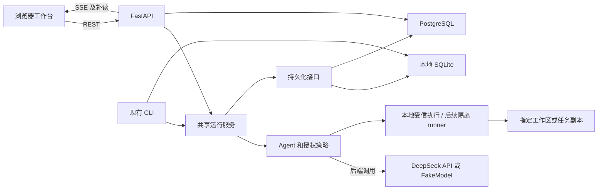

# StellarWeaver GUI、PostgreSQL 与容器化实施方案

> 历史记录。现行说明见[项目文档](../README.md)。

日期：2026-11-16。本文是总体规划，补充原 V1 规范。当前操作入口见 [G0 探针和 G1 只读工作台](legacy/WEB_G1_QUICKSTART.md)、[G2 本地审批与修复](legacy/WEB_G2_QUICKSTART.md)及 [G3 持久化任务队列](legacy/WEB_G3_QUEUE_QUICKSTART.md)。

## 1. 产品目标与交付形态

把 StellarWeaver 做成本地 AI 编程工作台。用户在浏览器里选项目和会话、发任务、查看文件及工具时间线、审批危险操作、停止运行，最终拿到可核对的 diff、测试结果与交付报告。CLI 继续可用，两个入口共享同一个 Agent、工具、授权和恢复原则。

首发是一人可用的正式前后端应用。数据库从第一版 Web 持久化开始就具备租户归属；登录、多个用户同时使用、任务执行隔离在后续验收后才开放。一个租户下可以有多个工作区，一个工作区可有多条会话；会话历史相互独立，共享同一工作区的会话默认会看到相同文件，写操作必须互斥。

| 领域 | 方案 |
| --- | --- |
| 前端 | React + TypeScript + Vite。左栏项目与会话，中间对话和事件，右栏文件、变更和验证。首次发布由 Python 服务同源提供构建产物。 |
| 后端 | FastAPI + Uvicorn，REST 处理明确操作，SSE 推送进度；API 路由只负责鉴权、DTO 与调度，业务层不依赖浏览器或终端。 |
| 数据 | Web 使用 PostgreSQL，拟用 SQLAlchemy 2 异步接口 + Psycopg 3 + Alembic；保留 CLI 的 SQLite。两条持久化路径复用领域契约，不双写。 |
| 模型 | GUI 的真实模型默认沿用当前 DeepSeek API 和 `deepseek-flash`，保持已有 Chat Completions、流式工具回合与当前能力配置。FakeModel 用于离线演示、集成和故障测试。 |
| 部署 | Docker Compose 先部署应用和 PostgreSQL；后续增加受控 runner。前端不直连数据库、DeepSeek 或 Docker。 |

原代码的直接复用点是 `Agent`、`ToolRegistry`、`PolicyEngine`、上下文投影、DeepSeek provider、变更/恢复规则和独立评测。当前 `cli.py` 直接创建这些对象并绑定终端 UI；`SessionStore` 是同步 SQLite，Agent、扩展和改动管理都用到它。需要抽取共享运行服务和持久化边界，有计划地改造依赖方；只给现有 CLI 套一层启动子进程或直接替换连接串，都不能提供可靠的 Web 审批和恢复。

## 2. 前后端连接与运行状态

- `/api/v1` 预留工作区与会话查询、运行提交与查看、取消、审批、事件流、文件预览和交付报告。运行提交返回 `202 + run_id`，用会话范围的幂等键去重；相同键但请求内容不同应冲突。浏览器请求不能直接指定宿主 cwd、命令、模型地址或内部制品路径。
- SSE 对持久事件使用 **会话级单调 seq**。初次打开先取得快照和游标，再订阅该运行；服务端按游标从数据库补读归属该运行的事件，前端按身份和游标去重。实时通知只负责唤醒，不能作为唯一事件来源；订阅期间继续补读，覆盖快照和订阅之间的间隙。临时文本片段没有持久游标；重连可以舍弃草稿，最终文本由已提交的消息替换。
- 运行状态区分排队、运行、等待审批、取消请求、完成、失败、受阻、超预算、已取消和需人工核对。**点取消只表示请求已收到**，直到进程退出、工具状态写入后才报告终态；无法确认副作用时保留 unknown。浏览器刷新、断线和多标签页不会创建新运行或自动授权。
- Web 审批适配现有异步回调。申请先持久化，绑定租户、会话、运行、操作 ID 和参数摘要；批准/拒绝要校验身份、权限、有效期和待决状态，并原子消费。过期、取消或服务重启后，未完成的一次授权失效。通过后仍按现有规则重查文件版本、适用指令和路径，持久化执行意图后才启动工具。等待时间计入任务预算，等待时不占数据库事务。
- DeepSeek Key 继续由启动端读取现有配置（当前变量名 `STELLARWEAVER_API_KEY`）。Web 只看见模型名和是否配置，运行快照只保存非敏感配置。缺 Key 要明确提示，不能在 GUI 静默换成 Fake；模型连通检查由操作者显式触发。允许实际发送项目上下文前，界面说明哪些工作区内容可能发给 DeepSeek。不把隐藏推理、密钥或真实宿主路径作为 UI 事件输出。

## 3. PostgreSQL：权威数据与隔离

### 数据模型

| 表组 | 关键约束 |
| --- | --- |
| `users`、`tenants`、`memberships` | 租户是数据隔离单元，用户经成员关系获得角色；早期用一个本地用户和个人租户。 |
| `workspaces`、`sessions` | 工作区保留执行端的受控定位信息，浏览器只用不透明 ID；会话固定租户和工作区。 |
| `runs`、`messages`、`events` | 记录任务和非敏感配置快照、消息和持久事件；对会话内 seq 做唯一约束，使用索引支持分页、游标和会话历史。 |
| `tool_operations`、`approvals` | 保存 planned、authorized、started 和终态，按运行与操作身份关联；批准状态只能消费一次。 |
| `artifacts`、`run_reports` | 保存归属、大小、SHA-256、访问和留存信息。大日志、补丁和文件快照放私有制品卷，数据库不存任意可访问文件路径；同一运行的报告引用相应的证据。 |
| `run_jobs`（G3 增加） | 存接单状态、执行拥有者、尝试号和心跳；和工作状态落在同一数据库里。 |

每张业务表带 `tenant_id`，复合外键校验父子资源属于同一租户，例如工具操作不能引用另一个租户的运行。索引以租户和查询范围起始；状态、时间、身份用列，版本化事件负载可用 JSONB。SQLite 和 PostgreSQL 必须通过同一组契约测试，包括完整工具回合、事件顺序、结果幂等和故障恢复。PostgreSQL 的请求和 worker 写入用短事务、异步连接池；SQLite 适配保留连接的线程归属。**一个运行只写它选定的数据源。**

### 数据隔离与一致性

1. API 从可信身份和成员关系确定租户及角色，不从请求正文信任 `tenant_id`。每个端点都核对对象归属，包括 SSE 连接、制品下载、运行取消和审批。多用户前必须覆盖同租户角色差异和非成员拒绝。
2. PostgreSQL 在租户表上启用行级安全（RLS），读写都要校验。应用角色不是表所有者、无超级用户或 BYPASSRLS；迁移/备份使用独立角色，按需 FORCE RLS。用同一事务内的 `set_config(..., true)` 设置受信租户上下文，缺失默认拒绝，避免连接池复用串租户。RLS 是对业务查询漏过滤的第二层约束，不能替代 API 鉴权；Agent 工具和任务代码都不能直接使用应用数据库连接。
3. 保留已有事务边界：消息、工具计划与对应事件一起记账；结果与 tool 消息、完成事件一起提交。终态读模型以已提交的状态为准。制品卷与数据库无法同事务提交，采用先写临时文件、验证 hash、原子落盘再登记；只有已登记且校验通过的制品可读，崩溃遗留孤立文件由后台清理。
4. 同一会话首版最多一个活动运行；同一物理工作区的写入互斥，不能靠不同 ID 或路径别名绕开。Web 本地宿主模式与 CLI 写入同一目录时，要共用已有 OS 写锁；后续独立任务工作区用唯一租约和存储边界。租约或心跳不等于可以随意接管仍可能运行的旧命令。
5. CLI 历史保持可直接使用；后续提供显式导入，需选择租户与对应工作区，导入前预览、对账消息/事件数量及制品 hash，按来源身份去重。导入默认只形成历史记录，不恢复任何运行中的任务、一次授权或未知副作用。原 SQLite 保留。日常备份要覆盖 PostgreSQL 和制品卷，并在新环境做恢复演练。

参考：[PostgreSQL 行级安全](https://www.postgresql.org/docs/current/ddl-rowsecurity.html) · [事务范围设置](https://www.postgresql.org/docs/current/functions-admin.html)。

## 4. Docker：部署和任务隔离分开

### 4.1 应用部署（单机先行）

- 开发：先用 Compose 运行 PostgreSQL，Windows 宿主启动 Python API，Vite 将请求代理到 API。这条路径便于直接使用已经登记的 Windows 仓库并调试。
- 打包：规划 `Dockerfile`、`compose.yaml`、`.dockerignore`、启动说明。多阶段构建先产出前端静态文件，再进入 Python 运行镜像；依赖按锁文件构建。 `db`、一次性 `migrate`、`api`（同源提供 UI）分别定义，数据库有健康检查，迁移成功后启动 API；后续加入 `worker`。数据库不对外映射端口，API 首版只映射到本机回环，健康接口不公开敏感细节。
- PostgreSQL 和制品有各自的数据卷，更新容器不丢历史。Windows 路径映射由操作者登记，只挂明确选定的目录或用导入后的副本；不把整个磁盘、用户主目录或仓库所在上级目录映射出去。Windows Docker Desktop 的 Linux 容器与 Windows 原生运行是不同环境，测试报告应标明执行环境，不能把容器中的通过写成 Windows 原生通过。
- 现有 `.env` 留在宿主开发环境；容器运行时由操作者把同一 Key 注入需要访问模型的服务，优先采用 Compose secret 文件（计划新增文件读取入口）。真实 `.env`、数据库口令、数据库卷、测试制品不进入镜像构建上下文；部署文件只提供模板。API 或 worker 的 DB 凭据用独立配置，不把任一种服务密钥传给任务。
- 运维交付包含查看健康状态、升级、备份与恢复、关闭服务但保留 volume 的文档。迁移前备份，失败时停止启动；不以删除卷作为迁移失败的恢复办法。

### 4.2 任务运行隔离（多用户前置门槛）

**应用装进 Docker、PostgreSQL 开 RLS，都不限制工具命令能读哪些文件。** 第一版宿主模式只用于本机可信仓库；允许互不信任的用户提交任务前，提供独立的受限执行端。它是可信调度组件创建的任务环境，不允许浏览器或模型指定镜像、挂载和网络。

- 每次运行使用独立任务目录或经策略明确共享的受控副本；读、写、Git、测试都指向同一份文件树。通过补丁和制品交付结果，再由用户复核应用。Git worktree 可用于开发时的变更分支管理，但共享 Git 元数据，不作为跨用户安全边界。
- 任务环境非 root、最小权限、限制 CPU/内存/PID/磁盘/时长，默认网络禁用、只暴露工作目录和受限临时区。不挂 Docker socket、GPU/宿主设备、凭据目录、应用配置、数据库和其他租户工作区；只用批准的镜像。后端 API 与普通 worker 本身也不直接暴露 Docker socket，确需创建容器时由独立执行服务管理能力。
- DeepSeek 的网络调用由可信服务负责，任务容器只执行工具；即使任务拥有自己工作区，不应接触 DeepSeek Key 或数据库连接。取消/超时要能定位并结束具体任务环境，且确认已结束；无法确认就禁止自动接管。Docker 能限制常见资源访问，不把普通 Compose 配置当作已验收的强多租户沙箱；需要面向不可信用户时，再根据威胁范围决定是否采用更强沙箱或独立 VM。

参考：[Compose 健康依赖](https://docs.docker.com/reference/compose-file/services/) · [Compose Secrets](https://docs.docker.com/compose/how-tos/use-secrets/) · [Docker 安全](https://docs.docker.com/engine/security/) · [Bind mounts](https://docs.docker.com/engine/storage/bind-mounts/)。

## 5. 分阶段实施与验收

| 阶段 | 交付 | 必过验收 |
| --- | --- | --- |
| **G0：确定共享契约** | 梳理 `cli.py`、Agent、会话/制品接口；提取运行服务和审批注入；定义 OpenAPI、SSE 消息及会话游标。CLI 继续写 SQLite。 | 现有 CLI 真实临时 Git 读改测回归不退化；同一 FakeModel 脚本可用测试适配器接收持久事件，临时文本不污染恢复记录。 |
| **G1：PostgreSQL + 可运行的只读 GUI** | 数据库 Compose、Alembic 初版、个人租户、后端项目/会话/运行 API、最小 React 页面与 SSE。首版 Web 直接使用 PostgreSQL；单进程接单，崩溃时中断，历史可读。 | 从空卷迁移；浏览器用 FakeModel 真实读取临时 Git 仓库；断开、刷新及重启 API 后补读历史，不重发任务；两个租户测试身份不能访问对方数据。 |
| **G2：可审阅的修复闭环** | 三栏工作台、受控文件预览、写入审批、取消、diff、命令证据和报告下载；现有 DeepSeek 接入 GUI。检查结果与对应补丁/工作区快照绑定，变更后标为过期。 | 浏览器跑通批准编辑→测试失败→修复→测试通过→下载报告；拒绝、过期、重复审批和 hash 冲突都无写入；刷新继续显示同一运行。离线全流程过后，显式跑一条短 DeepSeek 工具任务，记录实际结果。 |
| **G3：Compose 发布与独立 worker** | 前端生产构建、Python 运行镜像、数据库迁移及持久卷；运行请求与 job 同事务入库，worker 从 PostgreSQL 接单；先不用 Redis。 | 从干净环境部署、不需在宿主手动启动 Node；数据库重启、API 重启、worker 在副作用前后死亡均有明确结论；演练备份恢复、停止与更新，表与制品均可核对。 |
| **G4：任务级隔离** | 实现受控执行服务、任务工作区、受限运行环境、限额与真实清理；明确 Windows 宿主模式和容器模式的能力差异。 | 两个任务看不到彼此的工作区及宿主/服务凭据；非授权文件操作被拒；取消、超时及执行端断联不误报清理成功；只能导出授权的补丁与制品。此阶段前不开放不可信用户写/命令执行。 |
| **G5：多用户、多会话上线准备** | 正式身份入口（优先 OIDC）、成员角色、工作区权限、限流/并发/DeepSeek 用量配额、审计与留存；脱敏报告和备份恢复流程。 | 两用户两租户交叉验证会话、SSE、审批、取消、文件与制品；连接池交替复用不串数据；同会话重入被拒；相同工作区的写入互斥；一用户超额不阻塞其他用户。G4 未完成时不上线共享执行。 |

G3 接单设计：先在短事务中从队列表认领排队项，可用 `FOR UPDATE SKIP LOCKED`；提交后才执行。API 不依赖进程内队列保留已接受任务。worker 写入时核对运行拥有者和尝试号，旧 worker 不能覆盖新状态。未开始的排队项可安全再派；已开始的运行在 worker 故障时进入核对流程，**不自动重放已取得授权或可能已执行的工具**。特别是命令已写开始意图但没有结果时，要先核查旧任务环境和制品，必要时等待人工确认。数据库拥有权能保护账本，不能阻止已经发出的一条外部命令继续运行。见 [PostgreSQL 队列行锁](https://www.postgresql.org/docs/current/sql-select.html)。

## 6. 开工切口和推进约束

第一批只做 **G0 加 G1 的最小贯通链路**：在不替换原 Agent 的前提下，用 PostgreSQL 保存一次只读运行，并在浏览器刷新后恢复。不开远程访问，不引入多 Agent、A2A、远程 MCP、通用 Web 编辑器或新的模型供应商。做通后再进入审批和变更展示，优先交付可操作的真实修复演示。

初次实施预计新增共享运行服务、Web API、PostgreSQL 适配器与迁移目录、`frontend/` 和部署模板；实际目录名随 G0 依赖审计定稿。项目保持手动本地检查方式，不因本计划恢复 GitHub Actions。验收记录分开记：CLI 回归、真实 PostgreSQL、浏览器、Docker 环境、真实 DeepSeek；只报告已运行的项目。

当前基线：[总体架构](legacy/ARCHITECTURE.md) · [Provider 兼容性](legacy/PROVIDER_COMPATIBILITY.md) · [V1 验收](V1_ACCEPTANCE.md)。接口参考：[FastAPI SSE](https://fastapi.tiangolo.com/tutorial/server-sent-events/) · [DeepSeek Chat Completions](https://api-docs.deepseek.com/api/create-chat-completion/)。
